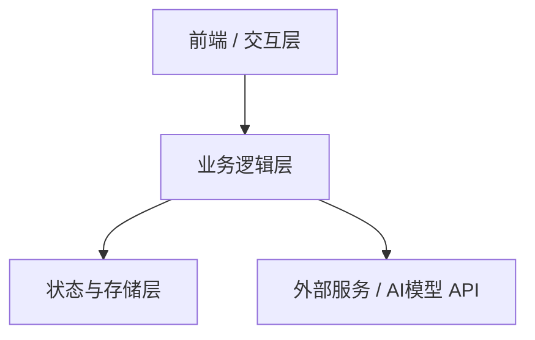

# [项目名称] 技术架构与工程设计 (Architecture)

> **版本**：v0.1.0  
> **更新时间**：YYYY-MM-DD  

---

## 1. 技术栈选型 (Technology Stack)

| 层次 | 选型 | 版本/依赖 | 选型理由 |
| :--- | :--- | :--- | :--- |
| **前端/UI** | 如 React / Vue / CLI TUI | React 19, TailwindCSS | 快速原型与现代化生态 |
| **状态管理/数据流** | Zustand / Context / TanStack Query | 最新稳定版 | 轻量且易于维护 |
| **后端/运行时** | Node.js / Bun / Python / Go | LTS 版本 | 跨平台及高性能 |
| **持久化存储** | SQLite / LocalStorage / Postgres | - | 本地轻量化优先 |
| **测试框架** | Vitest / Jest / Pytest | - | 快速验证与自动化 |

---

## 2. 系统整体架构与模块关系 (System Overview)



---

## 3. 推荐工程目录结构 (Directory Layout)

```text
my-project/
├── src/
│   ├── components/     # UI 视图组件
│   ├── services/       # 业务服务与 API 封装
│   ├── store/          # 状态持久化与管理
│   ├── types/          # TypeScript 类型声明或数据结构
│   └── utils/          # 通用工具函数
├── tests/              # 单元测试与集成测试
├── package.json        # 依赖与脚本
└── README.md
```

---

## 4. 关键设计考量 (Design Considerations)

- **状态流转与单向数据流**：清晰定义组件间的数据传递规则。
- **错误捕获与容错机制**：网络超时、API 限流、非法输入回退。
- **安全性与鉴权**：密钥安全保存、权限检查。
