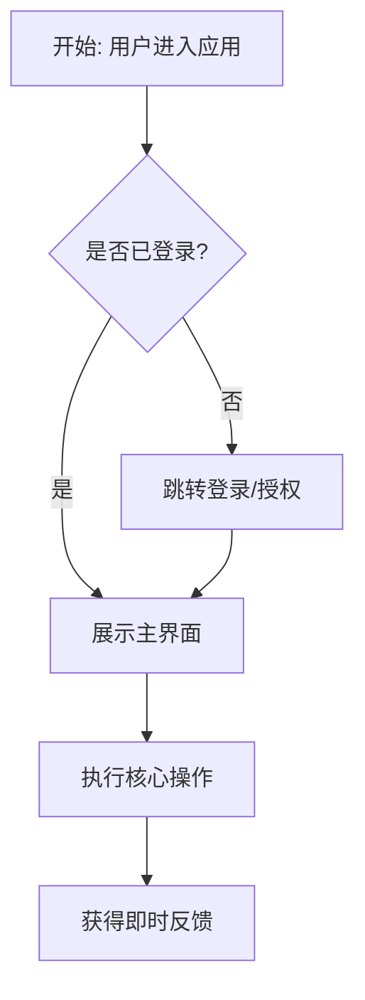

# [项目名称] 产品需求文档 (PRD)

> **版本**：v0.1.0  
> **更新时间**：YYYY-MM-DD  
> **状态**：Draft / In Review / Approved  

---

## 1. 项目背景与目标 (Context & Goals)

### 1.1 背景
- 一句话描述当前存在的痛点或需求出发点。

### 1.2 核心目标 (Goals)
- 目标 1：...
- 目标 2：...

### 1.3 非目标 / 边界约束 (Non-Goals)
> [!IMPORTANT]
> 明确本版本**坚决不做**或延后的内容，避免开发范围膨胀。
- Non-Goal 1：...
- Non-Goal 2：...

---

## 2. 目标用户与使用场景 (User Personas & Scenarios)

| 用户角色 | 核心诉求 | 典型使用场景 |
| :--- | :--- | :--- |
| 普通用户 | ... | ... |
| 管理员 | ... | ... |

---

## 3. 功能需求与验收标准 (Functional Requirements)

### 3.1 模块 A：[模块名称]
#### 3.1.1 功能点：[功能名称]
- **需求描述**：详细阐明该功能的用户操作及系统行为。
- **用户故事 (User Story)**：
  - *As a* [用户角色], *I want to* [操作], *so that* [达成价值].
- **验收标准 (Acceptance Criteria)**：
  - [ ] **Given** 前置条件，**When** 用户触发行为，**Then** 预期结果。
  - [ ] 边界情况：当输入为空/超限时，提示明确错误。

---

## 4. 关键用户交互与流程 (User Flow)

---

## 5. 待确认与未来规划 (Open Questions & Roadmap)
- [ ] 待定问题 1
- [ ] 待定问题 2
