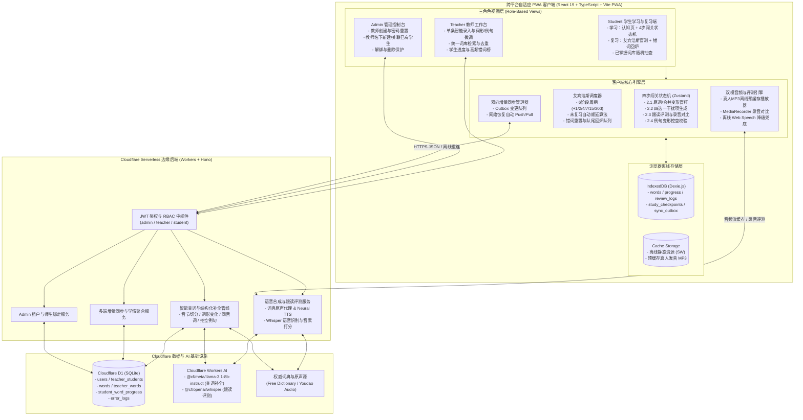
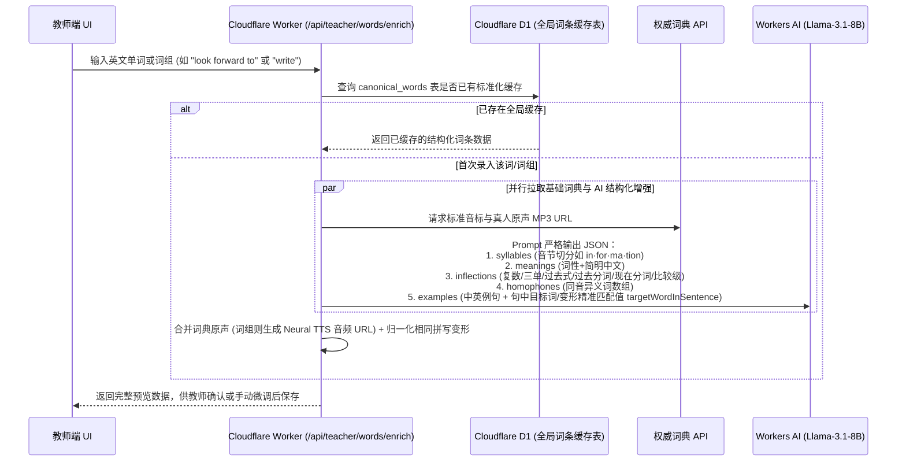

# 技术架构设计 (ARCHITECTURE) - english-word

## 1. 整体系统架构 (System Architecture)

`english-word` 采用 **Local-First PWA (React 19 + TypeScript + Dexie.js IndexedDB)** 结合 **Cloudflare 全家桶 Serverless (Pages + Workers + Hono + D1 SQLite + Workers AI)** 的现代边缘全栈架构：
- **前端与离线引擎层 (PWA Client)**：负责跨平台响应式 UI、四步递进式学习/复习状态机、下划线字母格盲打交互、本地 IndexedDB 数据读写、真人发音 MP3 离线预缓存，以及断网环境下的本地 TTS / 语音识别降级兜底。
- **边缘计算与 AI 服务层 (Cloudflare Workers)**：基于轻量级路由框架 `Hono` 提供 REST API、JWT 角色鉴权、多租户师生关系管理、增量同步端点，并调用 **Workers AI** 实现「单词/词组结构化智能补全」、「词组高拟真语音合成」与「Whisper 真人跟读语音评测」。
- **云端持久化层 (Cloudflare D1)**：基于边缘分布式 SQLite (`D1`) 存储多租户用户、师生多对多绑定关系、教师词库、归一化共享词条元数据以及学生的学习/艾宾浩斯复习记录。

### 架构全景图



---

## 2. 技术选型与决策依据 (Tech Stack)

| 层次 / 领域 | 选用技术 | 版本/库 | 选型理由 |
| :--- | :--- | :--- | :--- |
| **前端框架** | **React + TypeScript** | `React 19, TS 5.x` | 组件化生态成熟，严格类型检查保障复杂四步状态机与艾宾浩斯算法零运行时类型错误。 |
| **构建与 PWA 引擎** | **Vite + vite-plugin-pwa** | `Vite 6.x, Workbox` | 开箱即用生成 Service Worker 与 `manifest.webmanifest`，支持静态资源离线缓存与桌面/移动端安装。 |
| **UI 与响应式样式** | **Tailwind CSS + Lucide Icons** | `v3.4+` | 轻松实现 PC 端宽屏、iPad 平板与手机端自适应布局，定制下划线字母格、抖动动画与星级进度条。 |
| **客户端状态管理** | **Zustand** | `v5.x` | 极简响应式状态管理，驱动 `2.1 ~ 2.4` 闯关步骤切换与实时按键反馈。 |
| **客户端离线数据库** | **Dexie.js (IndexedDB)** | `v4.x` | 工业级 IndexedDB 封装，支持复合索引、响应式查询 (`useLiveQuery`)，完美支撑离线单词学习、子步骤断点持久化与增量同步队列。 |
| **边缘后端运行时** | **Cloudflare Workers + Hono** | `Hono v4.x` | 零冷启动、全球边缘低延迟，前后端同仓（Monorepo / Pages Functions）共享 TypeScript 接口类型。 |
| **云端关系型数据库** | **Cloudflare D1 (SQLite)** | `D1 Serverless` | 原生 SQL 支持多对多师生关联查询、跨教师同词归一化聚合与学情统计，免费额度极高（每日 500 万次读 / 10 万次写）。 |
| **智能补全与语音评测** | **Cloudflare Workers AI** | `@cf/meta/llama-3.1-8b-instruct`<br/>`@cf/openai/whisper` | 无需额外部署 GPU 服务器或绑定海外信用卡，直接在 Worker 内免费调用 LLM 生成音节切分/变形/挖空例句，并调用 Whisper 评测学生跟读音频。 |
| **密码哈希与鉴权** | **Web Crypto API (PBKDF2 + JWT)** | `jose` | 100% 兼容 Cloudflare Workers V8 Isolate 环境，无原生 C++ 依赖，轻量安全。 |

---

## 3. 核心业务管线设计 (Core Technical Pipelines)

### 3.1 教师端「词典 + Workers AI」混合智能补全管线



### 3.2 学生端「跟读评测 + 录音回放对比」双模管线

1. **录音采集与本地暂存**：
   - 学生在 `2.3 跟读评测` 点击录音按钮时，前端通过 `navigator.mediaDevices.getUserMedia` + `MediaRecorder` 录制学生朗读音频 `Blob`，并在内存中生成 `studentAudioUrl = URL.createObjectURL(blob)`，供学生随时点击**「我的录音 vs 标准音对比」**一键回放。
2. **双模识别与音素相似度打分**：
   - **在线模式（默认首选）**：将录制好的轻量音频二进制流（16kHz 单声道压缩）上传至 Worker 端点 `/api/speech/evaluate`，调用 `@cf/openai/whisper` 转写为英文文本，并结合 **Double Metaphone / 音素编辑距离算法（Phonetic Levenshtein）** 计算与目标单词/词组的发音相似度得分（`0 ~ 100`）。
   - **离线模式（断网自动切换）**：当检测到 `navigator.onLine === false` 时，自动调用浏览器本地 `SpeechRecognition` 引擎结合声学包络时长/音节匹配度进行离线评分。
   - **达标判定**：得分 $\ge 80$ 判定为「读音准确」，点亮 1 颗星（累计满 3 颗星解锁 2.4）；若 $< 80$，保留已点亮星数，高亮读错部分并自动引导播放标准发音对比。

### 3.3 艾宾浩斯动态顺延与当日错词回炉算法

- **为什么不会发生未复习挤压？**
  - 传统静态日历算法在学完第 0 天时一次性死板生成未来 6 个固定日期（如 11月6日、11月8日、11月12日...），一旦学生 11月6日~8日没上线，11月9日上线就会出现同一个词的多条逾期任务撞车。
  - 本系统采用 **动态相对状态机**：每个单词在 `student_word_progress` 中仅记录当前所处的 `stage (1..6)` 与当前阶段的预期复习日 `nextReviewDate (YYYY-MM-DD)`。
  - **每日待复习筛选**：查询条件为 `status = 'reviewing' AND nextReviewDate <= todayLocalDate`。若昨日未复习，由于 `nextReviewDate` 仍小于等于今日，该词自然出现在今日待复习池中（即自动顺延 1 天）。
  - **完成复习后动态推算下一阶段**：当学生在 `todayLocalDate` 完成复习后：
    - **一次无错通关**：若 `stage < 6`，则 `stage = stage + 1`，且 `nextReviewDate = todayLocalDate + INTERVALS[stage]`（其中 `INTERVALS = [1, 2, 4, 7, 15, 30]`）；若原 `stage == 6`，则 `status = 'mastered'`。
    - **中途出错或查看提示**：
      1. 当场将当前词的听写与跟读配额从 `1 次` 提升为 `3 次`；
      2. 将 `stage` 重置为 `1`，`nextReviewDate = todayLocalDate + 1 day`（次日必考），且 `errorCount += 1`, `resetCount += 1`；
      3. 将该词推入当前会话的 `intraDayRequeuePool`（今日队尾回炉池），在今天剩余单词考完后（或混入最后几个词中），必须再完成一次**无错、无提示的 1 遍通关**，今日复习进度条才算走完 100%。

---

## 4. 推荐工程目录结构 (Directory Structure)

在业务工程仓库 `/Users/aubreyhan/Tools/git_repo/PersonalDev/EnglishWord` 中进行开发时，采用前后端同仓（Cloudflare Pages + Functions / Workers）标准结构：

```text
EnglishWord/
├── package.json                         # 前后端依赖、开发与构建脚本
├── vite.config.ts                       # Vite + vite-plugin-pwa + Cloudflare Pages/Workers 代理配置
├── wrangler.toml                        # Cloudflare Pages/Workers、D1 数据库与 Workers AI 绑定配置
├── tsconfig.json                        # TypeScript 严格模式配置
├── migrations/                          # Cloudflare D1 SQLite 数据库迁移脚本
│   ├── 0001_initial_schema.sql          # 用户、师生关联、词库、学生进度、错题日志表结构
│   └── 0002_seed_admin.sql              # 默认 admin (P@ss=w0rd) 与内置中文释义混淆池初始化
├── shared/                              # 前后端共享的 TypeScript 类型与纯函数算法
│   ├── types.ts                         # 角色、词条、词形变化、学习子步骤、同步协议接口定义
│   ├── ebbinghaus.ts                    # 艾宾浩斯 6 阶段推算、自动顺延、错词重置纯函数
│   ├── inflections.ts                   # 词形变化合并去重（如过去式=过去分词合并）与字母格拆分工具
│   └── phonetics.ts                     # 英文音素相似度 (Levenshtein + 同音词歧义检测) 纯函数
├── functions/                           # Cloudflare Pages Functions / Workers 后端源码 (Hono)
│   └── api/
│       ├── [[route]].ts                 # Hono 主路由入口与全局错误处理
│       ├── middleware/
│       │   └── auth.ts                  # JWT 校验与 admin/teacher/student 角色守卫
│       ├── routes/
│       │   ├── auth.ts                  # 登录、修改个人密码接口
│       │   ├── admin.ts                 # 教师管理、教师名下新建/关联/解绑/删除学生、重置密码
│       │   ├── teacher.ts               # 词条增删改查、AI+词典智能补全、学生学情与薄弱错词榜
│       │   ├── student.ts               # 增量同步 Pull/Push、学习与复习记录上报
│       │   └── speech.ts                # 真人发音音频同域代理/合成、Whisper 跟读语音评测接口
│       └── services/
│           ├── crypto.ts                # Web Crypto PBKDF2 密码哈希与 JWT 签发
│           ├── enricher.ts              # 词典 API + Workers AI 结构化词条生成服务
│           └── audio.ts                 # 音频合成与 Whisper 语音转写服务
└── src/                                 # React 19 PWA 前端源码
    ├── main.tsx                         # 应用挂载与 Service Worker 注册
    ├── App.tsx                          # 路由守卫与三角色布局容器
    ├── db/                              # 本地离线优先存储层 (Dexie.js)
    │   ├── index.ts                     # IndexedDB 表定义 (words, progress, checkpoints, outbox)
    │   ├── audioCache.ts                # Cache Storage 真人发音 MP3 批量预缓存与离线读取
    │   └── syncEngine.ts                # 在线/离线状态监听与后台双向增量同步器
    ├── stores/                          # Zustand 状态管理
    │   ├── useAuthStore.ts              # 登录态、当前角色与离线身份缓存
    │   ├── useStudyStore.ts             # 「学习」模块步骤 1 & 步骤 2 (2.1~2.4) 状态机与断点恢复
    │   └── useReviewStore.ts            # 「复习」模块随机洗牌、盲测、错词 3 遍强化与当日队尾回炉状态机
    ├── components/
    │   ├── common/                      # 导航栏、离线状态指示器、修改密码弹窗、音频播放按钮
    │   ├── study/                       # 学习与复习共用的核心交互组件
    │   │   ├── CognitiveCard.tsx        # 步骤 1：分音节展示、音标、词形变化、双语例句认知卡片
    │   │   ├── LetterSlotInput.tsx      # 2.1 & 2.4：下划线字母格输入组件（支持词组空格、按键音、实时纠错）
    │   │   ├── StepDictation.tsx        # 2.1：原词及合并后词形变化渐进式盲打听写（含同音词保护）
    │   │   ├── StepMeaningQuiz.tsx      # 2.2：四选一中文释义选择（选错自动重排）
    │   │   ├── StepPronunciation.tsx    # 2.3：跟读 3 星评测、我的录音 vs 标准音对比、静音兜底开关
    │   │   └── StepClozeSentence.tsx    # 2.4：带中文翻译的例句变形挖空拼写
    └── pages/
        ├── LoginPage.tsx                # 统一登录页
        ├── admin/
        │   ├── AdminDashboard.tsx       # 教师列表与新建教师
        │   └── TeacherStudentsDrawer.tsx# 教师名下新建学生、关联已有学生、解绑与彻底删除
        ├── teacher/
        │   ├── TeacherWordList.tsx      # 词库列表、搜索筛选、单条智能补全录入/编辑弹窗
        │   └── TeacherAnalytics.tsx     # 名下学生学情汇总与「高频错词/多次降级词榜单」抽屉
        └── student/
            ├── StudentHome.tsx          # 学生端首页（优先复习防积压提醒、学习/复习双入口）
            ├── StudyPage.tsx            # 「学习」模块主页面（词库按教师筛选 + 四步闯关）
            └── ReviewPage.tsx           # 「复习」模块主页面（盲测进度面板 + 随机抽考 + 已掌握词抽查）
```
