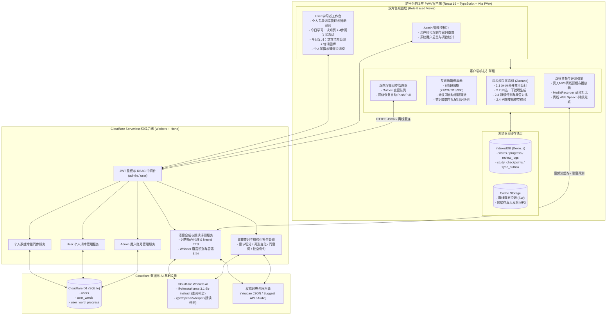
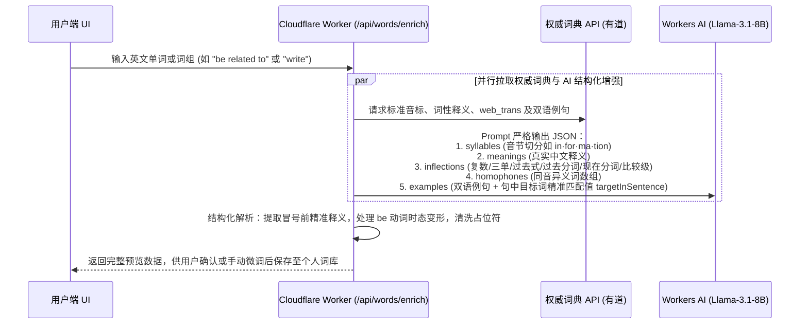

# 技术架构设计 (ARCHITECTURE) - english-word

## 1. 整体系统架构 (System Architecture)

`english-word` 采用 **Local-First PWA (React 19 + TypeScript + Dexie.js IndexedDB)** 结合 **Cloudflare 全家桶 Serverless (Pages + Workers + Hono + D1 SQLite + Workers AI)** 的现代边缘全栈架构：
- **前端与离线引擎层 (PWA Client)**：负责跨平台响应式 UI、四步递进式学习/复习状态机、下划线字母格盲打交互、本地 IndexedDB 数据读写、真人发音 MP3 离线预缓存，以及断网环境下的本地 TTS / 语音识别降级兜底。
- **边缘计算与 AI 服务层 (Cloudflare Workers)**：基于轻量级路由框架 `Hono` 提供 REST API、JWT 角色鉴权（`admin` / `user`）、单词增删改查、增量同步端点，并调用 **Workers AI** 实现「单词/词组结构化智能补全」、「词组高拟真语音合成」与「Whisper 真人跟读语音评测」。
- **云端持久化层 (Cloudflare D1)**：基于边缘分布式 SQLite (`D1`) 存储用户账号（`users`）、个人专属词库（`user_words`）以及用户的学习与艾宾浩斯复习记录（`user_word_progress`）。

### 架构全景图



---

## 2. 技术选型与决策依据 (Tech Stack)

| 层次 / 领域 | 选用技术 | 版本/库 | 选型理由 |
| :--- | :--- | :--- | :--- |
| **前端框架** | **React + TypeScript** | `React 19, TS 5.x` | 组件化生态成熟，严格类型检查保障复杂四步状态机与艾宾浩斯算法零运行时类型错误。 |
| **构建与 PWA 引擎** | **Vite + vite-plugin-pwa** | `Vite 6.x, Workbox` | 开箱即用生成 Service Worker 与 `manifest.webmanifest`，支持静态资源离线缓存与桌面/移动端安装。 |
| **UI 与响应式样式** | **Tailwind CSS + Lucide Icons** | `v3.4+` | 轻松实现 PC 端宽屏、iPad 平板与手机端自适应布局，定制下划线字母格、抖动动画与星级进度条。 |
| **客户端状态管理** | **Zustand** | `v5.x` | 极简响应式状态管理，驱动 `2.1 ~ 2.4` 闯关步骤切换与实时按键反馈。 |
| **客户端离线数据库** | **Dexie.js (IndexedDB)** | `v4.x` | 工业级 IndexedDB 封装，支持复合索引、响应式查询 (`useLiveQuery`)，完美支撑离线单词学习、子步骤断点持久化与增量同步队列。 |
| **边缘后端运行时** | **Cloudflare Workers + Hono** | `Hono v4.x` | 零冷启动、全球边缘低延迟，前后端同仓共享 TypeScript 接口类型。 |
| **云端关系型数据库** | **Cloudflare D1 (SQLite)** | `D1 Serverless` | 原生 SQL 支持单用户词库、学情进度索引，免费额度极高。 |
| **智能补全与语音评测** | **Cloudflare Workers AI** | `@cf/meta/llama-3.1-8b-instruct`<br/>`@cf/openai/whisper` | 无需额外部署 GPU 服务器，直接在 Worker 内免费调用 LLM 生成音节切分/变形/挖空例句，并调用 Whisper 评测跟读音频。 |
| **密码哈希与鉴权** | **Web Crypto API (PBKDF2 + JWT)** | `jose` | 100% 兼容 Cloudflare Workers V8 Isolate 环境，无原生 C++ 依赖，轻量安全。 |

---

## 3. 核心业务管线设计 (Core Technical Pipelines)

### 3.1 词典 + Workers AI 混合智能补全管线



### 3.2 跟读评测与录音对比管线

1. **录音采集与本地暂存**：
   - 用户在 `2.3 跟读评测` 点击录音按钮时，前端通过 `navigator.mediaDevices.getUserMedia` + `MediaRecorder` 录制朗读音频 `Blob`，生成本地 Object URL 供一键回放对比。
2. **双模识别与音素相似度打分**：
   - **在线模式（默认首选）**：音频上传至 Worker 端点 `/api/speech/evaluate`，调用 `@cf/openai/whisper` 转写并打分（得分 $\ge 80$ 判为准确）。
   - **离线模式（断网兜底）**：自动切换浏览器原生 `SpeechRecognition` 进行本地音素匹配。
   - **静音环境兜底**：学生随时开启「静音模式」，转为听音辨音标闯关。

---

## 4. 代码工程目录规范 (Project Structure)

```text
EnglishWord/
├── shared/                         # 前后端严格共享的核心协议与纯逻辑函数
│   ├── types.ts                    # 数据模型定义 (User, Word, Progress, Ebbinghaus 等)
│   ├── inflections.ts              # 词形合并、字母槽位切分 (tokenizeIntoSlots)
│   └── ebbinghaus.ts               # 艾宾浩斯 6 阶段算法与顺延推算器
├── functions/                      # Cloudflare Workers 边缘 API (Hono)
│   └── api/
│       ├── [[route]].ts            # Hono 顶层路由分发
│       ├── middleware/             # auth.ts (JWT 验证与 admin/user 角色控制)
│       ├── routes/
│       │   ├── auth.ts             # 登录、改密、初始化 admin
│       │   ├── admin.ts            # 用户账号管理
│       │   ├── words.ts            # 个人词库增删改查与 enrich 智能补全
│       │   ├── sync.ts             # 个人词库与进度增量同步
│       │   └── speech.ts           # TTS 发音代理与 Whisper 评测
│       └── services/
│           ├── enricher.ts         # 有道词典 + Workers AI 查词补全
│           └── crypto.ts           # PBKDF2 密码哈希与 JWT 签名
├── src/                            # 前端 PWA 源码 (React 19 + TypeScript)
│   ├── db/
│   │   └── index.ts                # Dexie.js 数据库定义 (words, progress, checkpoints)
│   ├── stores/                     # Zustand 状态 (authStore, studyStore, reviewStore)
│   ├── services/                   # apiClient, syncService, speechService
│   ├── components/                 # 学习/复习通用组件 (LetterSlotInput, WordEnrichModal 等)
│   └── pages/                      # 页面路由 (LoginPage, WordLibraryPage, StudyPage, ReviewPage, AdminPage)
└── cloudflare/
    └── worker.js                   # 构建产物
```
