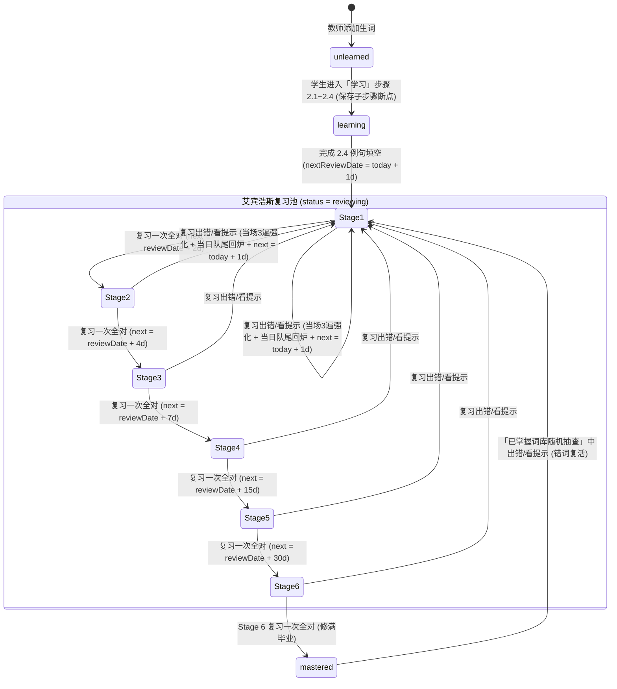

# 详细设计与规范 (SPEC) - english-word

## 1. 数据库模型设计 (Cloudflare D1 SQLite DDL)

系统在 Cloudflare D1 中维护 5 张核心表，兼顾「多对多师生归属」与「跨教师同词学生进度全局互通」：

```sql
-- 1. 用户表 (涵盖 admin / teacher / student 三类角色)
CREATE TABLE IF NOT EXISTS users (
    id TEXT PRIMARY KEY,                          -- UUID
    username TEXT NOT NULL UNIQUE,                -- 登录账号 (唯一，如 "admin", "teacher_zhang", "stu_li")
    display_name TEXT NOT NULL,                   -- 显示姓名/昵称
    password_hash TEXT NOT NULL,                  -- PBKDF2-SHA256 哈希值
    role TEXT NOT NULL CHECK (role IN ('admin', 'teacher', 'student')),
    created_at INTEGER NOT NULL,                  -- Unix 毫秒时间戳
    updated_at INTEGER NOT NULL
);

-- 2. 师生多对多绑定关系表 (Admin 在教师名下新建或关联已有学生)
CREATE TABLE IF NOT EXISTS teacher_students (
    teacher_id TEXT NOT NULL,
    student_id TEXT NOT NULL,
    bound_at INTEGER NOT NULL,
    PRIMARY KEY (teacher_id, student_id),
    FOREIGN KEY (teacher_id) REFERENCES users(id) ON DELETE CASCADE,
    FOREIGN KEY (student_id) REFERENCES users(id) ON DELETE CASCADE
);
CREATE INDEX IF NOT EXISTS idx_ts_student ON teacher_students(student_id);

-- 3. 教师词库表 (每位教师维护自己的生词/词组列表，对本教师名下全体学生生效)
CREATE TABLE IF NOT EXISTS teacher_words (
    id TEXT PRIMARY KEY,                          -- UUID
    teacher_id TEXT NOT NULL,                     -- 所属教师 ID
    text TEXT NOT NULL,                           -- 原始单词或词组 (如 "information", "look forward to")
    normalized_text TEXT NOT NULL,                -- 标准化小写去首尾空格标识 (用于去重及跨教师学生进度互通)
    syllables TEXT NOT NULL,                      -- 分音节展示字符串 (如 "in·for·ma·tion"，单音节或词组则同 text)
    phonetic_us TEXT DEFAULT '',                  -- 美式音标 (如 "/ˌɪnfərˈmeɪʃn/")
    phonetic_uk TEXT DEFAULT '',                  -- 英式音标
    audio_us_url TEXT DEFAULT '',                 -- 美音真人发音 URL
    audio_uk_url TEXT DEFAULT '',                 -- 英音真人发音 URL
    meanings_json TEXT NOT NULL,                  -- JSON: Array<{ pos: string, zh: string }>
    inflections_json TEXT NOT NULL,               -- JSON: WordInflections (复数/三单/过去式/过去分词/现在分词/比较级/最高级)
    homophones_json TEXT NOT NULL DEFAULT '[]',   -- JSON: string[] 同音异义词列表 (如 ["right", "rite"])
    examples_json TEXT NOT NULL,                  -- JSON: Array<{ en: string, zh: string, targetInSentence: string }>
    tags_json TEXT NOT NULL DEFAULT '[]',         -- JSON: string[] 标签数组
    created_at INTEGER NOT NULL,
    updated_at INTEGER NOT NULL,
    UNIQUE(teacher_id, normalized_text),          -- 同一教师名下禁止重复录入同一单词/词组
    FOREIGN KEY (teacher_id) REFERENCES users(id) ON DELETE CASCADE
);
CREATE INDEX IF NOT EXISTS idx_tw_teacher ON teacher_words(teacher_id);
CREATE INDEX IF NOT EXISTS idx_tw_norm ON teacher_words(normalized_text);

-- 4. 学生单词学习与艾宾浩斯复习进度表 (按 student_id + normalized_text 全局互通)
CREATE TABLE IF NOT EXISTS student_word_progress (
    student_id TEXT NOT NULL,
    normalized_text TEXT NOT NULL,                -- 对应单词标准化文本 (跨教师同词共享同一进度)
    status TEXT NOT NULL DEFAULT 'unlearned' CHECK (status IN ('unlearned', 'learning', 'reviewing', 'mastered')),
    ebbinghaus_stage INTEGER NOT NULL DEFAULT 0,  -- 0:未入池, 1:+1d, 2:+2d, 3:+4d, 4:+7d, 5:+15d, 6:+30d
    next_review_date TEXT DEFAULT NULL,           -- 下次到期复习本地日期 "YYYY-MM-DD" (未复习则因 <= today 自然顺延)
    last_studied_at INTEGER DEFAULT NULL,         -- 最近一次学习/复习毫秒时间戳
    last_reviewed_date TEXT DEFAULT NULL,         -- 最近一次完成复习的本地日期 "YYYY-MM-DD"
    study_checkpoint_json TEXT DEFAULT NULL,      -- JSON: 学习模块子步骤断点 (如 {"step":"2.3","readPassCount":2})
    total_review_count INTEGER NOT NULL DEFAULT 0,-- 累计完成复习次数
    error_count INTEGER NOT NULL DEFAULT 0,       -- 累计出错/看提示次数 (供教师薄弱错词榜排序)
    stage_reset_count INTEGER NOT NULL DEFAULT 0, -- 累计被重置回 Stage 1 的次数
    last_error_step TEXT DEFAULT NULL,            -- 最近一次卡壳步骤 ('2.1' | '2.2' | '2.3' | '2.4')
    updated_at INTEGER NOT NULL,
    PRIMARY KEY (student_id, normalized_text),
    FOREIGN KEY (student_id) REFERENCES users(id) ON DELETE CASCADE
);
CREATE INDEX IF NOT EXISTS idx_swp_review ON student_word_progress(student_id, status, next_review_date);
```

---

## 2. 核心 TypeScript 数据结构定义 (`shared/types.ts`)

```typescript
export type UserRole = 'admin' | 'teacher' | 'student';

export interface WordMeaning {
  pos: string; // 词性，如 "n.", "v.", "adj.", "phr."
  zh: string;  // 中文释义，如 "信息；资料"
}

export interface WordInflections {
  plural?: string;             // 名词复数 (如 "books", "children")
  thirdPerson?: string;        // 动词第三人称单数 (如 "writes", "looks forward to")
  presentParticiple?: string;  // 现在分词 (如 "writing", "looking forward to")
  pastTense?: string;          // 过去式 (如 "wrote", "looked forward to")
  pastParticiple?: string;     // 过去分词 (如 "written", "looked forward to")
  comparative?: string;        // 比较级 (如 "better")
  superlative?: string;        // 最高级 (如 "best")
}

/**
 * 经过「相同拼写自动合并」处理后的待拼写变形项
 * 例如 worked 同时是过去式和过去分词，合并为 { labels: ["过去式", "过去分词"], form: "worked" }
 */
export interface MergedInflectionItem {
  labels: string[];            // 如 ["过去式", "过去分词"]
  form: string;                // 如 "played"
}

export interface WordExample {
  en: string;                  // 英文原句，如 "She wrote three letters yesterday."
  zh: string;                  // 中文翻译，如 "她昨天写了三封信。"
  targetInSentence: string;    // 句中实际出现的目标词或变形，如 "wrote" (忽略大小写精准挖空)
}

export interface TeacherWord {
  id: string;
  teacherId: string;
  teacherName?: string;
  text: string;
  normalizedText: string;
  syllables: string;           // 如 "in·for·ma·tion"
  phoneticUs: string;
  phoneticUk: string;
  audioUsUrl: string;
  audioUkUrl: string;
  meanings: WordMeaning[];
  inflections: WordInflections;
  homophones: string[];        // 同音异义词数组 (小写)，如 ["right", "rite"]
  examples: WordExample[];
  tags: string[];
  createdAt: number;
  updatedAt: number;
}

/**
 * 学生端「学习」模块子步骤断点持久化结构 (保存在 IndexedDB 与 D1)
 */
export interface StudyCheckpoint {
  step: '1' | '2.1' | '2.2' | '2.3' | '2.4';
  dictationTargetIndex: number; // 0 表示原词，1..N 表示合并后的第几个词形变化
  dictationRepCount: number;    // 当前项已盲打正确遍数 (0..3)
  pronunciationPassCount: number; // 2.3 已累计达标的准确读音次数 (0..3)
  clozeSentenceIndex: number;   // 2.4 当前正在填空的例句索引
  updatedAt: number;
}
```

---

## 3. 关键业务算法与状态机规范

### 3.1 词形变化「相同拼写自动合并」规则 (`shared/inflections.ts`)
在 `2.1 单词听写` 中，为了避免规则动词因 `pastTense === pastParticiple`（甚至与原词相同，如 `cut / cut / cut`）导致无效重复拼写：
1. 按固定顺序扫描 `inflections`：`plural (复数)` -> `thirdPerson (第三人称单数)` -> `presentParticiple (现在分词)` -> `pastTense (过去式)` -> `pastParticiple (过去分词)` -> `comparative (比较级)` -> `superlative (最高级)`。
2. 若某个变化形式的标准化文本与**原词 (`text`)** 完全一致（如 `cut` 的过去式仍是 `cut`），或与前序某个变化形式完全一致（如 `played` 的过去式与过去分词相同），则将其中文名称追加到同一 `MergedInflectionItem.labels` 中（显示为 `请拼写：过去式 / 过去分词`），只作为 **1 组**进行考核（学习模式盲打 3 遍，复习模式默认盲打 1 遍）。

### 3.2 下划线字母格分词与校验规范 (`LetterSlotInput`)
- 给定目标字符串 `target`（如单词 `"information"` 或词组 `"look forward to"` 或带连字符 `"well-known"`）：
- 将连续的英文字母 `[a-zA-Z']` 解析为可输入槽位（Slot），空格 `' '` 与连字符 `'-'` 作为静态分隔符直接渲染在槽位之间，无需学生敲空格键（若学生按了空格键也自动跳过并聚焦到下一个单词首字母槽位）。
- **实时校验模式**：
  - 每输入一个字符（不区分大小写，统一按小写比对），若与当前槽位目标字母一致，槽位填入字母、变绿并播放清脆按键音（Web Audio API 合成短促木鱼/机械键盘音），自动跳至下一格；
  - 若输入字母错误，当前槽位泛红并触发 200ms 水平抖动动画，提示音为低沉提示音，不推进游标。
  - 若学生在单次盲打中连续按错字母超过 3 次，或在「复习」模式第 1 步盲听写中点击了「看一眼提示」，则判定为**触发提示/出错**。

### 3.3 同音异义词盲听歧义保护算法 (`StepDictation` in Review Mode)
- 在「复习」模式的 `2.1 单词听写` 中，界面不展示中文释义，但展示**词性标签提示**（如 `v.` 或 `adj.`，取自 `word.meanings.map(m => m.pos).join(' / ')`）。
- 为支持同音词整词判定，在复习模式的原词盲打中允许学生逐字母输入完整词并按回车（或输满格子时比对）：若学生尝试输入的字母序列恰好匹配 `word.homophones` 中的某个同音词（例如目标词是 `right`，而学生开头输入了 `w` 或输入了 `write`）：
  - 系统立即弹出黄色温和气泡：**“检测到同音词 `write`，本题考察的是另一个同音词（词性：`adj. / n.`），请重新输入”**；
  - 清空输入框，但**绝不计入错题，不触发 3 遍强化惩罚，不重置艾宾浩斯阶段，也不加入队尾回炉池**。

### 3.4 艾宾浩斯 6 阶段状态机与顺延/重置规则 (`shared/ebbinghaus.ts`)



---

## 4. REST API 接口规范 (`functions/api`)

所有接口均以 `/api` 为前缀，除 `/api/auth/login` 外均需在 Header 携带 `Authorization: Bearer <jwt_token>`。

### 4.1 认证与个人密码接口
- `POST /api/auth/login`
  - Request: `{ "username": "admin", "password": "P@ss=w0rd" }`
  - Response `200`: `{ "token": "eyJ...", "user": { "id": "...", "username": "admin", "displayName": "系统管理员", "role": "admin" } }`
- `POST /api/auth/change-password`
  - Request: `{ "currentPassword": "...", "newPassword": "..." }`
  - Response `200`: `{ "success": true }`

### 4.2 Admin 租户与师生层级管理接口 (仅 `role === 'admin'`)
- `GET /api/admin/teachers`
  - 说明：获取所有教师列表及其名下关联的学生数量、词库数量。
- `POST /api/admin/teachers`
  -说明：创建新教师（默认密码自动设为 `passw0rd`）。
  - Request: `{ "username": "teacher_wang", "displayName": "王老师" }`
- `DELETE /api/admin/teachers/:teacherId`
  - 说明：删除指定教师。Query 参数 `?deleteOrphanStudents=true` 控制是否连带删除仅归属该教师的独占学生。
- `GET /api/admin/teachers/:teacherId/students`
  - 说明：获取该教师名下已绑定的学生列表，以及系统中可被关联的其他现有学生列表 (`availableStudents`)。
- `POST /api/admin/teachers/:teacherId/students`
  - 说明：在指定教师名下**新建学生账号**（默认密码 `passw0rd`）并自动绑定到该教师，或**绑定现有学生**。
  - Request (新建): `{ "mode": "create", "username": "stu_ming", "displayName": "小明" }`
  - Request (绑定现有): `{ "mode": "bind_existing", "studentIds": ["uuid-1", "uuid-2"] }`
- `DELETE /api/admin/teachers/:teacherId/students/:studentId`
  - 说明：支持两种模式 `?action=unbind`（仅从该教师名下移出解绑，若该生无其他归属教师则返回 `409 LAST_TEACHER_WARNING` 要求确认彻底删除）或 `?action=delete_account`（彻底删除该学生账号）。
- `POST /api/admin/users/:userId/reset-password`
  - 说明：将指定教师或学生的密码一键重置为默认密码 `passw0rd`。

### 4.3 教师端词库与学情接口 (仅 `role === 'teacher'`)
- `POST /api/teacher/words/enrich`
  - 说明：输入英文单词或多词词组（如 `be related to`, `look forward to`, `a sense of humour`），调用权威词典接口（有道 JSON API / Suggest API）+ Cloudflare Workers AI，自动解析地道中文释义、真声音标及双语例句：
    - **词性与中文释义拆分**：支持单词标准 `pos.` 拆分；针对短语自动识别为 `pos: 'phr.'`，并智能截取中文冒号前的核心精准释义（例如 `与……有关：指两个或多个...` -> `与……有关`，`幽默感：一种能够...` -> `幽默感`）；
    - **短语网络释义与真实双语例句**：支持从 `web_trans` 及 `blng_sents_part` 提取真实中英双语例句（严禁使用“这是关于xxx的例句”或“请编辑输入中文释义”等占位符）；
    - **系动词与时态派生**：支持 `be` 及其复合词组的不规则形态（`is / was / being / been`）智能匹配例句。
  - Request: `{ "text": "look forward to" }`
  - Response `200`: 返回填充好的 `Omit<TeacherWord, 'id' | 'teacherId' | 'createdAt' | 'updatedAt'>` 对象。
- `GET /api/teacher/words`
  - 说明：获取本教师词库列表（支持搜索、日期、标签过滤）。
- `POST /api/teacher/words`
  - 说明：保存单条生词/词组。若 `(teacher_id, normalized_text)` 已存在，返回 `409 DUPLICATE_WORD` 及已有词条详情。
- `PUT /api/teacher/words/:wordId` & `DELETE /api/teacher/words/:wordId`
  - 说明：编辑或删除词条。
- `GET /api/teacher/analytics/students`
  - 说明：获取本教师名下所有学生的学习进度概览（总词数、未学、学习中、已掌握、今日待复习完成度、最近学习时间）。
- `GET /api/teacher/analytics/students/:studentId/weak-words`
  - 说明：获取指定学生的「高频错词 / 多次重置回第 1 阶段的顽固薄弱词榜单」。

### 4.4 语音合成代理与跟读评测接口
- `GET /api/speech/tts?text=look+forward+to&accent=us`
  - 说明：返回真人词典原声或高拟真 Neural TTS MP3 音频流（带 `Cache-Control: public, max-age=31536000` 供客户端 Service Worker / Cache Storage 永久离线缓存）。
- `POST /api/speech/evaluate`
  - 说明：接收学生跟读录音（`multipart/form-data` 或 Base64 audio + `targetText`），通过 Workers AI (`@cf/openai/whisper`) 识别并返回准确度评分。
  - Response `200`: `{ "recognizedText": "information", "score": 92, "isAccurate": true, "feedback": "发音非常标准！" }`

### 4.5 学生端离线双向增量同步接口 (仅 `role === 'student'`)
- `GET /api/student/sync/pull?since=1730000000000`
  - 说明：拉取学生所关联的所有教师词库增量更新、关联教师列表、以及学生在其他设备上的 `student_word_progress` 变更。
- `POST /api/student/sync/push`
  - 说明：批量推送本地离线期间产生的学习完成、子步骤断点 (`studyCheckpoint`)、艾宾浩斯复习结果与错题计数变更（采用 `updated_at` 结合进度水位线的冲突合并策略，取更高掌握度或最新操作记录）。
