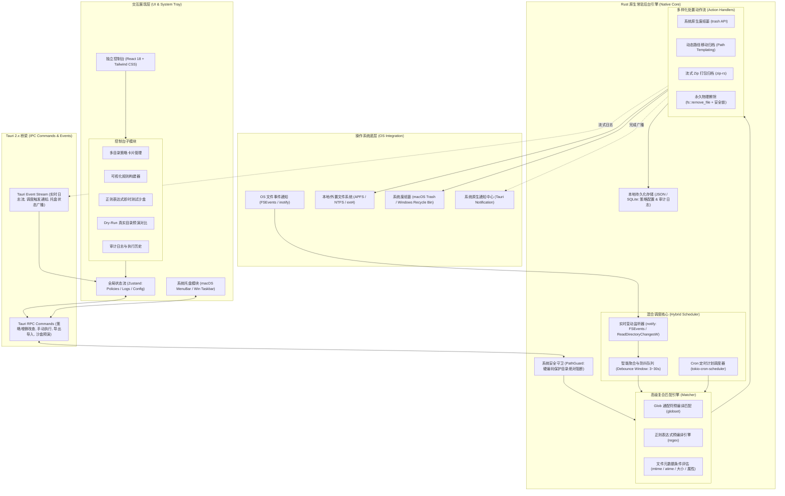
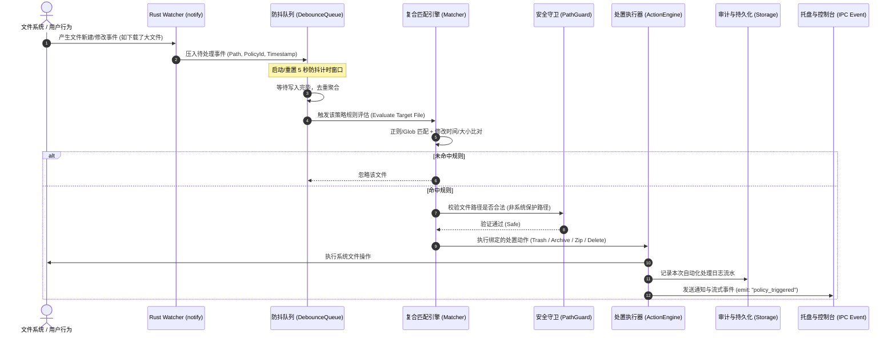
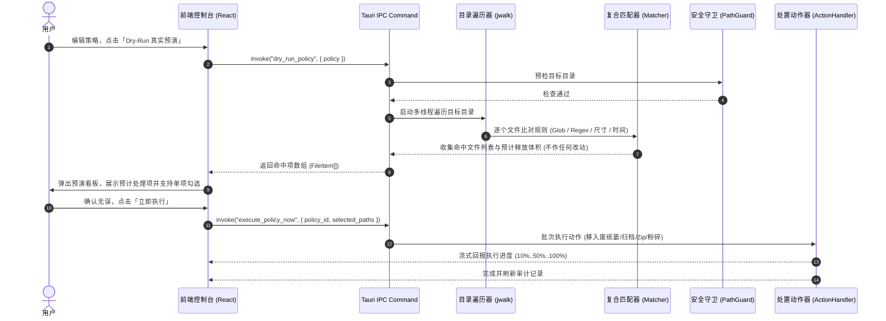
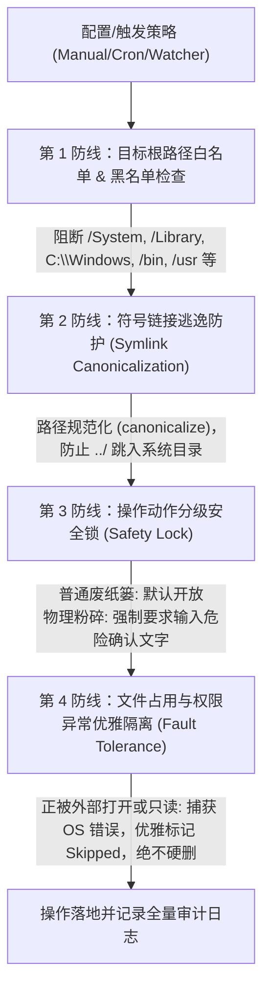

# FilePurger 技术架构设计 (ARCHITECTURE)

---

## 1. 架构总览 (System Architecture Overview)

FilePurger 采用 **Tauri 2.x** 跨平台体系架构，以 **Rust** 构建常驻后台核心服务，以 **React 18 + Tailwind CSS** 构建现代化的管理控制台与规则沙盒。

### 1.1 分层架构与核心模块拓扑图 (Architecture Diagram)



---

## 2. 模块职责与工程目录结构 (Module Responsibilities & Layout)

推荐的标准 Tauri 2.x 独立工程目录组织规范如下：

```text
file-purger/
├── src-tauri/                         # Rust 后端原生工程
│   ├── Cargo.toml                     # Rust 依赖清单
│   ├── tauri.conf.json                # Tauri 2.x 窗口、托盘、权限与插件声明
│   ├── src/
│   │   ├── main.rs                    # 托盘创建、后台常驻初始化与生命周期
│   │   ├── commands/                  # 暴露给前端的 Tauri Command 集合
│   │   │   ├── mod.rs
│   │   │   ├── policy.rs              # 策略 CRUD 指令
│   │   │   ├── execution.rs           # 手动触发策略、单策略跑批
│   │   │   ├── preview.rs             # 规则匹配 Dry-Run 预演指令
│   │   │   ├── sandbox.rs             # 正则与 Glob 沙盒测试
│   │   │   └── history.rs             # 审计日志读写与导出
│   │   ├── core/                      # 原生核心引擎层
│   │   │   ├── mod.rs
│   │   │   ├── path_guard.rs          # 系统保护路径绝对阻断器
│   │   │   ├── matcher/               # 高级复合匹配引擎
│   │   │   │   ├── mod.rs
│   │   │   │   ├── glob_engine.rs     # Glob 通配符预编译与匹配
│   │   │   │   ├── regex_engine.rs    # 正则表达式验证与匹配
│   │   │   │   └── rule_evaluator.rs  # 时间/大小/属性综合评估
│   │   │   ├── scheduler/             # 调度与事件监听
│   │   │   │   ├── mod.rs
│   │   │   │   ├── cron_manager.rs    # 定时调度任务注册与管理
│   │   │   │   ├── watcher_manager.rs # notify 文件目录监听器
│   │   │   │   └── debounce_queue.rs  # 变动事件防抖与去重队列
│   │   │   └── actions/               # 处置动作执行器
│   │   │       ├── mod.rs
│   │   │       ├── trash.rs           # 移入原生废纸篓
│   │   │       ├── archive.rs         # 动态模板移动归档
│   │   │       ├── zip.rs             # 打包为 Zip 归档并清理
│   │   │       └── hard_delete.rs     # 物理擦除与安全锁保护
│   │   ├── models/                    # 数据契约模型 (Rust Structs)
│   │   │   ├── policy.rs              # 策略与规则模型
│   │   │   ├── action.rs              # 处置动作枚举与参数
│   │   │   ├── schedule.rs            # 调度模式配置
│   │   │   └── audit.rs               # 审计流水模型
│   │   └── storage/                   # 持久化存储驱动
│   │       └── store.rs               # 策略与日志 JSON 本地存储
├── src/                               # React 18 前端控制台工程
│   ├── index.html                     # 控制台主模板
│   ├── package.json                   # 前端依赖配置
│   ├── vite.config.ts                 # Vite 构建配置
│   ├── tailwind.config.js             # Tailwind CSS 样式配置
│   └── src/
│       ├── main.tsx                   # 前端入口
│       ├── App.tsx                    # 控制台根布局与主路由
│       ├── api/                       # Tauri IPC 强类型封装
│       │   ├── policy.ts              # 策略调用 API
│       │   ├── preview.ts             # 预览与沙盒 API
│       │   └── history.ts             # 审计日志 API
│       ├── store/                     # Zustand 状态切片
│       │   ├── usePolicyStore.ts      # 策略列表状态
│       │   ├── useAuditStore.ts       # 实时审计流与历史记录
│       │   └── useAppStore.ts         # 控制台外观与全局配置
│       ├── components/                # 业务组件
│       │   ├── PolicyCard.tsx         # 策略卡片 (展示状态/路径/动作/调度)
│       │   ├── PolicyEditorModal.tsx  # 策略编辑弹窗 (全配置项)
│       │   ├── RuleBuilder.tsx        # 可视化规则构建器 (条件行增删)
│       │   ├── RegexSandboxModal.tsx  # 正则测试沙盒 (实时命中调试)
│       │   ├── DryRunModal.tsx        # 真实目录 Dry-Run 预演清单表格
│       │   ├── ActionConfigurator.tsx # 处置动作配置组件 (Trash/Archive/Zip/Hard)
│       │   ├── SchedulePicker.tsx     # 调度选择器 (Cron / Watcher / Manual)
│       │   ├── AuditTable.tsx         # 审计历史虚拟滚动表格
│       │   └── HeaderBar.tsx          # 顶栏快捷操作 (全局运行/暂停/添加策略)
│       ├── types/                     # 共享类型定义 (与 Rust 模型对齐)
│       │   └── index.ts
│       └── utils/                     # 辅助工具函数
│           ├── format.ts              # 字节换算与相对时间格式化
│           └── path_template.ts       # 归档路径模板预解析
```

---

## 3. 技术选型与选型理由 (Tech Stack & Rationale)

| 技术模块 | 选型组件 | 核心选型考量与优势 |
| :--- | :--- | :--- |
| **桌面托盘与跨平台底座** | **Tauri 2.x** | 原生托盘能力（`tray-icon` 插件）；相比 Electron，内存常驻仅 ~30MB，启动极速，开机自启无卡顿。 |
| **原生后台语言** | **Rust (1.75+)** | 内存安全、零成本抽象，完美胜任 7x24 小时后台稳定运行，杜绝内存泄漏。 |
| **文件变动监听** | **notify (v6.x)** | Rust 工业级文件监听库，深度集成 macOS FSEvents、Windows ReadDirectoryChangesW 和 Linux inotify，支持异步流式处理。 |
| **正则与通配符** | **regex + globset** | `regex` crate 具备无回溯线性时间复杂度保障，彻底防范正则表达式 ReDoS 拒绝服务攻击；`globset` 支持将多条通配符预编译为 DFA 单次匹配。 |
| **原生废纸篓集成** | **trash (v5.x)** | 跨平台原生 API 支持（macOS `NSFileManager` / Windows `IFileOperation`），且能自动适配外置 USB 驱动器上的回收区。 |
| **流式 Zip 归档** | **zip (v2.x)** | 原生 Rust 编写，支持 Deflate 压缩与流式文件打包写入，无需依赖外部系统命令。 |
| **定时调度引擎** | **tokio-cron-scheduler** | 配合 Tokio 异步事件循环的轻量 Cron 调度器，支持秒/分级精度，资源开销趋近于零。 |
| **前端交互体系** | **React 18 + Vite + Tailwind** | 组件化开发效率高，Tailwind 提供极客感精致暗色/亮色外观；Zustand 极简单向数据流。 |
| **超大列表虚拟滚动** | **TanStack Virtual v3** | 用于 Dry-Run 预演和审计日志，支持万级文件 60fps 流畅滚动渲染。 |

---

## 4. 核心工作流与时序设计 (Core Sequence Diagrams)

### 4.1 实时变动监听与智能防抖处理流 (Watcher & Debounce Flow)



### 4.2 策略 Dry-Run 预演与手动执行流 (Dry-Run & Manual Execution Flow)



---

## 5. 安全防御架构 (PathGuard & Defense-in-Depth)

作为一款具备“自动文件操作与粉碎”能力的强大工具，系统构建 4 重纵深安全防护盾：



1. **绝对禁飞区 (Restricted Root Blacklist)**:
   - 系统级核心根路径严禁作为策略监控目录或归档目标。
   - 包含：macOS（`/`, `/System`, `/Library`, `/Applications`, `/usr`, `/bin`, `/private`, `~/.Trash`）；Windows（`C:\`, `C:\Windows`, `C:\Program Files`, `C:\Program Files (x86)`, `C:\ProgramData`）；Linux（`/`, `/bin`, `/boot`, `/etc`, `/lib`, `/usr`, `/var`）。
2. **规范化防穿透 (Canonicalize Path)**:
   - 任何相对路径、包含 `..` 的路径均被解析为物理绝对路径后再进行黑名单碰撞，防止路径穿越攻击。
   - 默认禁止追踪符号链接软链（`follow_symlinks = false`），杜绝指向系统目录的软链被误操作。
3. **物理粉碎动作安全隔离**:
   - 若策略动作选择“永久物理粉碎 (Hard Delete)”，前端弹窗给出高对比度告警标识，必须由用户手动输入特定确认词汇方可保存策略。
   - Rust 后端对永久删除动作执行二次 PathGuard 校验，双重把关。
