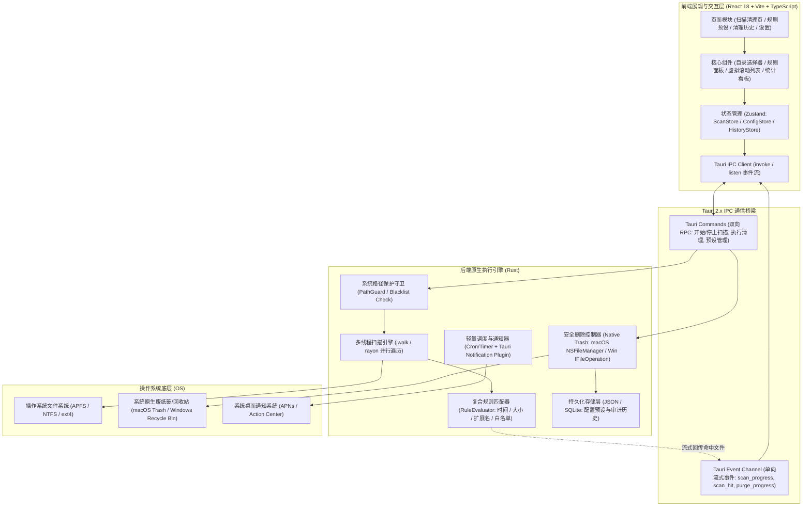
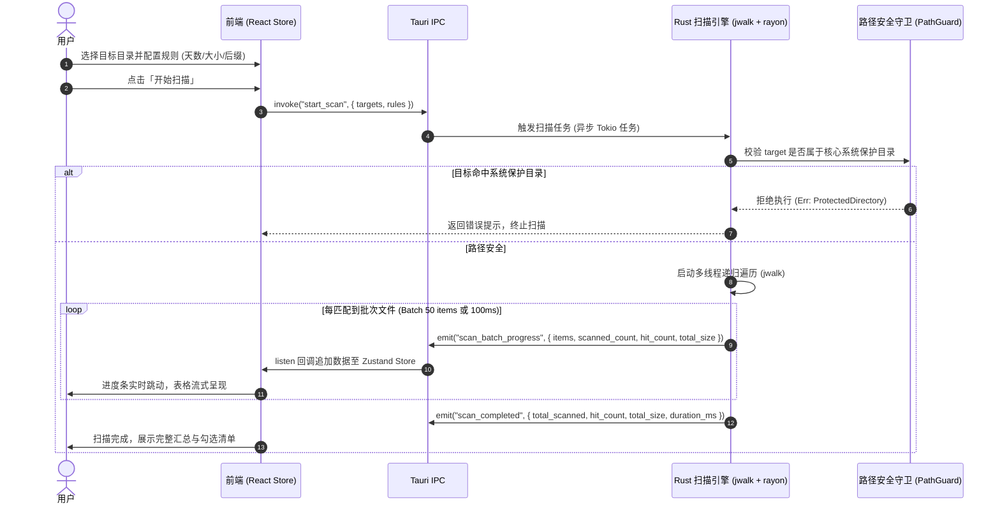
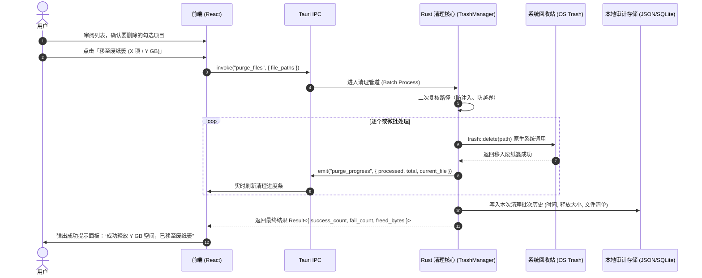
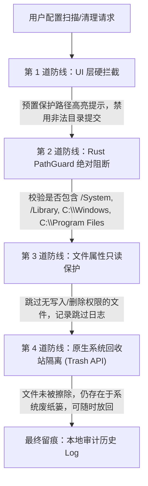

# FilePurger 技术架构设计 (ARCHITECTURE)

---

## 1. 架构总览 (System Architecture Overview)

FilePurger 采用 **Tauri 2.x** 架构，将现代 Web 前端的用户交互优势与 Rust 原生语言的高并发、高吞吐、低内存与强安全特性深度结合。

### 1.1 分层架构图 (Layered Architecture Diagram)



---

## 2. 模块职责与目录结构 (Modules & Directory Structure)

推荐的标准 Tauri 2.x 独立工程目录组织规范如下：

```text
file-purger/
├── src-tauri/                       # Rust 原生后端工程
│   ├── Cargo.toml                   # Rust 依赖声明
│   ├── tauri.conf.json              # Tauri 配置文件（窗口、权限、插件）
│   ├── src/
│   │   ├── main.rs                  # 应用主入口与生命周期管理
│   │   ├── commands/                # 暴露给前端的 Tauri Command 集合
│   │   │   ├── mod.rs
│   │   │   ├── scan.rs              # 扫描控制指令 (start_scan, cancel_scan)
│   │   │   ├── purge.rs             # 清理执行指令 (purge_files)
│   │   │   ├── config.rs            # 配置与预设管理指令
│   │   │   └── history.rs           # 审计历史读写指令
│   │   ├── core/                    # 核心业务逻辑实现
│   │   │   ├── mod.rs
│   │   │   ├── scanner.rs           # 多线程文件系统递归扫描实现
│   │   │   ├── rule_engine.rs       # 复合规则评估过滤引擎
│   │   │   ├── trash_manager.rs     # 系统废纸篓操作与批量回退保障
│   │   │   └── path_guard.rs        # 系统关键路径防护守卫
│   │   ├── models/                  # 数据结构模型 (Rust Structs)
│   │   │   ├── file_item.rs         # 文件元数据与命中模型
│   │   │   ├── rule.rs              # 规则定义与条件模型
│   │   │   └── history.rs           # 历史批次模型
│   │   └── storage/                 # 持久化驱动 (配置与历史记录)
│   │       └── store.rs
├── src/                             # 前端 React 工程
│   ├── index.html                   # HTML 模板
│   ├── package.json                 # 前端依赖配置
│   ├── vite.config.ts               # Vite 构建配置
│   ├── tailwind.config.js           # Tailwind CSS 样式配置
│   └── src/
│       ├── main.tsx                 # 前端入口
│       ├── App.tsx                  # 根组件与主布局
│       ├── api/                     # Tauri IPC 封装层 (Typed Invokers & Listeners)
│       │   ├── scan.ts
│       │   ├── purge.ts
│       │   └── history.ts
│       ├── store/                   # Zustand 状态管理
│       │   ├── useScanStore.ts      # 扫描进度、结果列表与勾选状态
│       │   ├── useRuleStore.ts      # 规则配置与当前选用预设
│       │   └── useHistoryStore.ts   # 历史审计记录状态
│       ├── components/              # 业务组件
│       │   ├── Header.tsx           # 顶栏状态与快捷操作
│       │   ├── DirectorySelector.tsx# 目标目录选择与快捷路径添加
│       │   ├── RuleFilterBar.tsx    # 复合规则快速调节栏（天数、大小、扩展名）
│       │   ├── FileResultTable.tsx  # 虚拟滚动文件结果表格（高性能渲染）
│       │   ├── SummaryFooter.tsx    # 底部已选统计与「移入回收站」执行按钮
│       │   ├── HistoryModal.tsx     # 历史记录弹窗
│       │   └── RulePresetModal.tsx  # 规则预设保存与编辑弹窗
│       ├── types/                   # TypeScript 类型定义（与 Rust 模型保持一致）
│       │   └── index.ts
│       └── utils/                   # 工具函数（格式化字节、相对时间等）
│           └── format.ts
```

---

## 3. 技术选型与理由 (Tech Stack & Rationale)

| 技术选型 | 选用版本 | 关键考量与优势 |
| :--- | :--- | :--- |
| **Tauri** | `v2.x` | 极高能效比，包体积小（10~20MB），内存占用比 Electron 减少 80%+；原生支持安全沙箱与插件体系。 |
| **Rust** | `1.75+ (edition 2021)` | 提供极致的文件 I/O 速度与安全并发，杜绝空指针与数据竞争。 |
| **jwalk / rayon** | 最新稳定版 | `jwalk` 在多核 CPU 下并行读取目录结构，比标准库 `WalkDir` 吞吐量提升 3~5 倍，对大容量磁盘非常友好。 |
| **trash crate** | `v5.x` | 工业级跨平台废纸篓库，内部使用 macOS `NSFileManager trashItemAtURL` 和 Windows `IFileOperation` 原生 API，确保文件可被系统回收站追踪和原路还原。 |
| **React 18 + Vite** | `React 18.x` | 成熟的前端生态，配合 Vite 毫秒级热更新，组件化架构清晰。 |
| **TanStack Virtual** | `v3.x` | 虚拟列表滚动解决方案，针对 5 万条以上的文件列表，仅渲染视口内的 DOM 节点，保障 60fps 丝滑滚动。 |
| **Tailwind CSS** | `v3.x` | 原子化样式，现代化暗黑/明亮模式支持，开发效率高，产物体积极小。 |
| **Zustand** | `v4.x` | 极简无样板代码的前端全局状态流，避免 Redux 的繁琐冗余，配合 TypeScript 类型提示友好。 |

---

## 4. 核心数据流设计 (Core Data Flows)

### 4.1 极速扫描与流式反馈数据流 (Scanning Flow)



### 4.2 安全清理执行数据流 (Purge Flow)



---

## 5. 安全防护模型 (Safety & Protection Model)

作为一款文件清理工具，安全是最高等级的生命线。系统设计多重纵深防御机制：



1. **第 1 层：系统路径硬编码阻断清单**:
   - macOS: `/`, `/System`, `/Library`, `/Applications`, `/bin`, `/sbin`, `/usr`, `~/.Trash`。
   - Windows: `C:\`, `C:\Windows`, `C:\Program Files`, `C:\Program Files (x86)`, `C:\Users\Public`。
   - Linux: `/`, `/bin`, `/etc`, `/lib`, `/usr`, `/var/log`。
2. **第 2 层：非永久抹除（默认废纸篓）**:
   - 绝不调用 `std::fs::remove_file` 或 `remove_dir_all` 进行磁盘物理级删除。
   - 统一走 `trash::delete`，让文件进入系统操作系统的回收站。用户即便发现手抖，直接在桌面废纸篓点击“放回原处”即可 100% 无损恢复。
3. **第 3 层：只读与占用防崩溃**:
   - 针对正被其他应用打开写入的文件，捕获 OS 错误，优雅标记为 `Skipped (In-Use)`，绝不卡死主进程。
