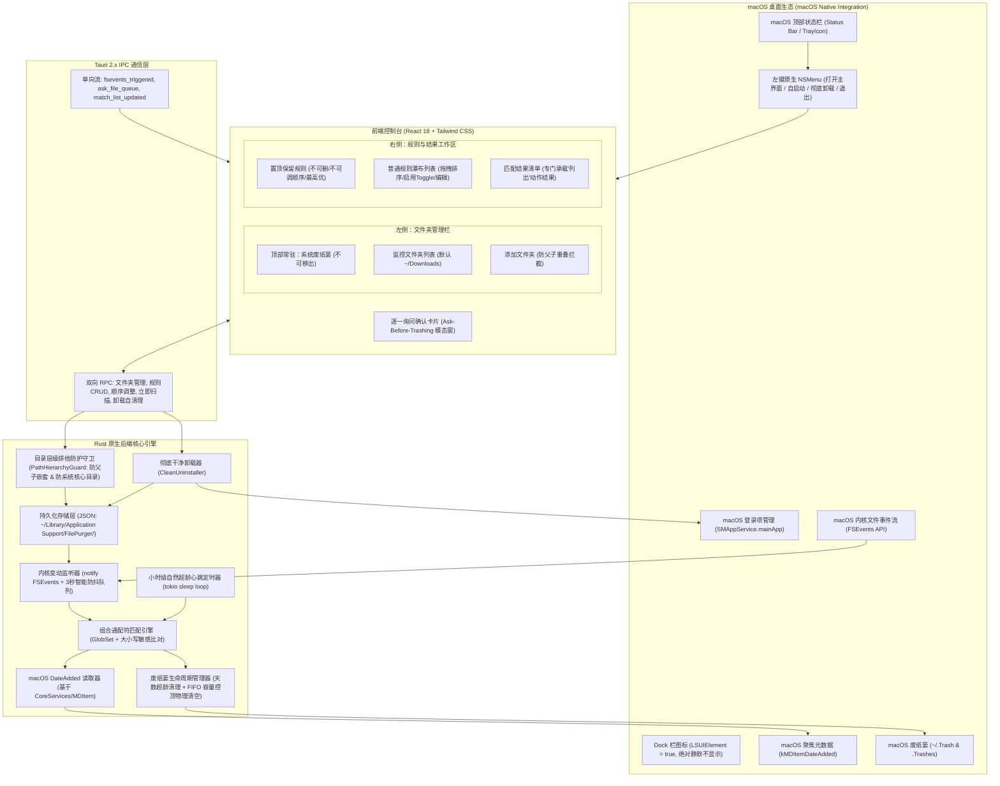
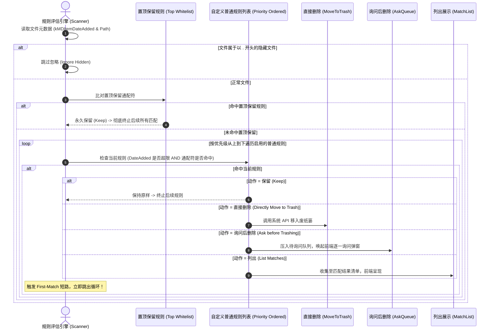
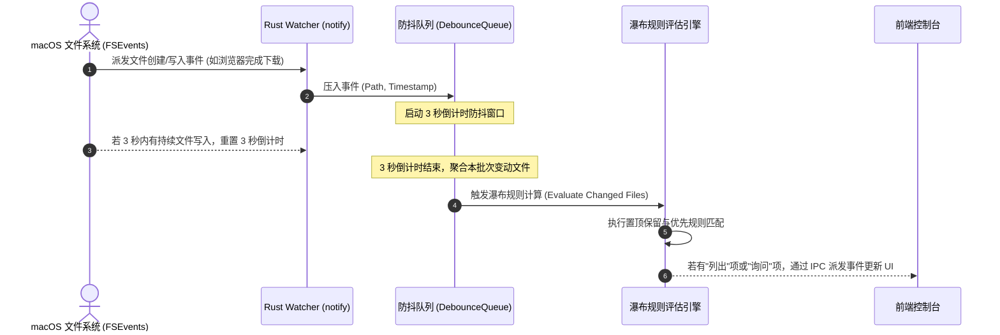
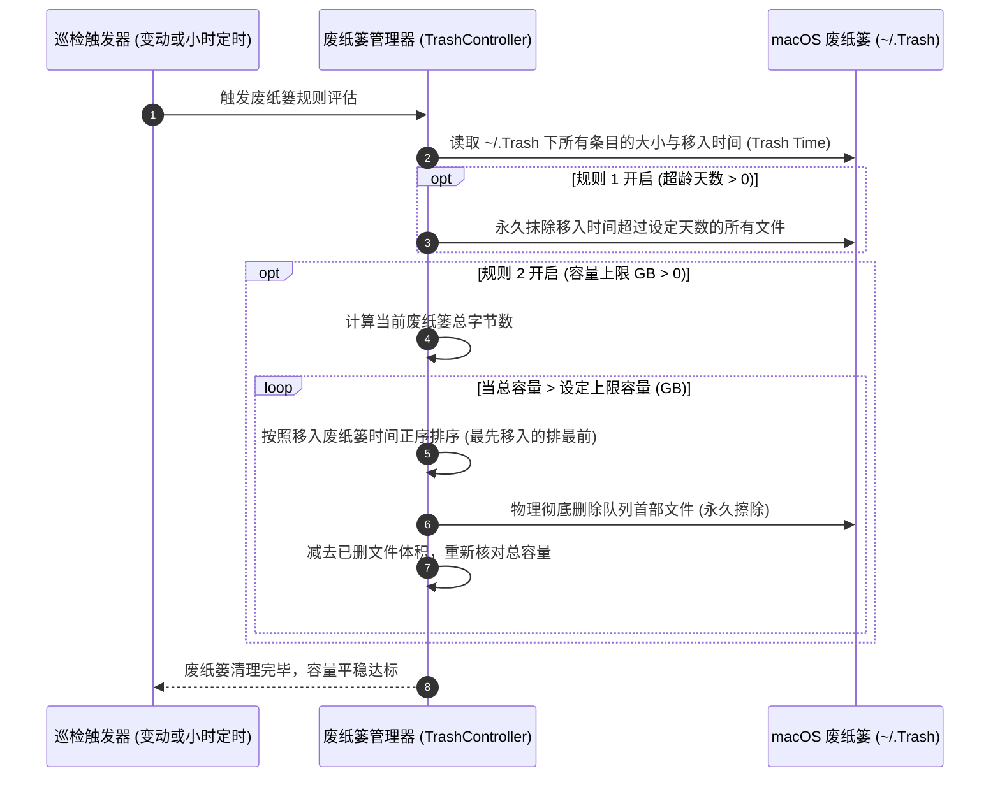

# FilePurger 技术架构设计 (ARCHITECTURE)

---

## 1. 架构总览 (System Architecture Overview)

FilePurger 是深度针对 **macOS** 平台优化的轻量级系统菜单栏应用。整体基于 **Tauri 2.x** 构建，后端采用 **Rust (edition 2021)** 提供内存安全、低资源占用与系统底层 API 调用，前端采用 **React 18 + Tailwind CSS** 呈现精致的原生风格双栏界面。

### 1.1 系统分层拓扑图 (System Layer Diagram)



---

## 2. 模块职责与工程目录结构 (Module Responsibilities & Layout)

推荐的标准 Tauri 2.x macOS 独立工程目录组织规范如下：

```text
file-purger/
├── src-tauri/                         # Rust 原生后端工程
│   ├── Cargo.toml                     # Rust 依赖声明
│   ├── tauri.conf.json                # 配置 LSUIElement=true、菜单栏与权限
│   ├── Info.plist                     # macOS 属性列表 (LSUIElement, NSHighResolutionCapable)
│   ├── src/
│   │   ├── main.rs                    # 菜单栏创建、左键菜单绑定与应用生命周期
│   │   ├── commands/                  # 暴露给前端的 Tauri Command 集合
│   │   │   ├── mod.rs
│   │   │   ├── folder.rs              # 文件夹添加(防重叠检查)、删除、读取
│   │   │   ├── rule.rs                # 规则增删改查、优先级重新排序
│   │   │   ├── trash_rule.rs          # 回收站超龄与容量配置
│   │   │   ├── execution.rs           # 立即扫描、询问项决策回复
│   │   │   └── system.rs              # 开机自启动切换、一键彻底卸载
│   │   ├── core/                      # 核心业务实现
│   │   │   ├── mod.rs
│   │   │   ├── path_hierarchy_guard.rs# 文件夹父子包含关系检测与系统目录拦截
│   │   │   ├── date_added.rs          # 提取 macOS 原生 kMDItemDateAdded 时间戳
│   │   │   ├── pattern_matcher.rs     # 大小写敏感路径通配符匹配器 (GlobSet)
│   │   │   ├── waterfall_engine.rs    # 瀑布式优先匹配短路流转引擎
│   │   │   ├── trash_controller.rs    # 系统废纸篓大小统计与 FIFO 淘汰擦除
│   │   │   ├── fsevents_watcher.rs    # macOS FSEvents 变动监听器
│   │   │   ├── debounce_queue.rs      # 3 秒防抖聚合队列
│   │   │   ├── autostart.rs           # SMAppService 原生开机自启动集成
│   │   │   └── uninstaller.rs         # 彻底擦除自身配置与移入废纸篓
│   │   ├── models/                    # 数据契约结构体
│   │   │   ├── folder.rs              # 文件夹实体模型
│   │   │   ├── rule.rs                # 规则实体模型 (通配符, 时间, Action)
│   │   │   ├── trash_config.rs        # 回收站规则模型 (天数, 容量GB)
│   │   │   └── match_result.rs        # 匹配文件明细与询问项
│   │   └── storage/                   # 持久化驱动
│   │       └── config_store.rs        # Application Support 下配置文件读写
├── src/                               # 前端 React 18 工程
│   ├── index.html
│   ├── package.json
│   ├── vite.config.ts
│   ├── tailwind.config.js
│   └── src/
│       ├── main.tsx                   # 前端入口
│       ├── App.tsx                    # 主窗口双栏布局与全局事件监听
│       ├── api/                       # Tauri IPC 封装
│       │   ├── folderApi.ts
│       │   ├── ruleApi.ts
│       │   └── systemApi.ts
│       ├── store/                     # Zustand 状态流
│       │   ├── useFolderStore.ts      # 文件夹列表与选中态
│       │   ├── useRuleStore.ts        # 当前选中项的置顶规则与普通规则
│       │   ├── useMatchListStore.ts   # “列出”动作的结果集
│       │   └── useAskQueueStore.ts    # 待逐一询问的文件队列
│       ├── components/                # UI 界面组件
│       │   ├── Sidebar/               # 左侧栏组件
│       │   │   ├── TrashItem.tsx      # 常驻废纸篓卡片
│       │   │   ├── FolderItem.tsx     # 监控文件夹卡片 (带删除按钮)
│       │   │   └── AddFolderModal.tsx # 添加文件夹对话框 (带防重叠警告)
│       │   ├── Rules/                 # 右侧规则组件
│       │   │   ├── TrashRuleView.tsx  # 回收站双规则配置视图
│       │   │   ├── TopWhitelistBar.tsx# 置顶保留规则输入栏
│       │   │   ├── RuleCard.tsx       # 单条普通规则卡片 (拖拽把手, Toggle, 动作徽章)
│       │   │   ├── CreateRuleModal.tsx# 规则创建/修改弹窗 (对应图片设计)
│       │   │   └── MatchListTable.tsx # 下方“列出”结果清单表格
│       │   └── Modals/                # 弹窗组件
│       │       ├── AskConfirmModal.tsx# 逐一询问后删除的确认卡片
│       │       └── UninstallModal.tsx # 彻底卸载二次确认警告
│       └── types/                     # TypeScript 类型定义
│           └── index.ts
```

---

## 3. macOS 核心原生能力集成方案 (macOS Native Integration)

### 3.1 纯菜单栏与 Dock 隐藏 (`LSUIElement`)
- 在 `src-tauri/Info.plist` 中声明：
  ```xml
  <key>LSUIElement</key>
  <true/>
  ```
- 效果：应用程序在启动时不会在 Dock（程序坞）占位，仅在 macOS 菜单栏展示托盘图标。
- 点击菜单栏图标调用 Tauri `tray-icon`，左键直接拉出原生菜单。

### 3.2 获取精确的“添加到文件夹日期”(`kMDItemDateAdded`)
- 在 macOS 中，文件被下载或拖入文件夹的时间由 macOS Metadata 维护，属于属性键 `kMDItemDateAdded`。
- Rust 后端通过 Objective-C / CoreFoundation 绑定读取：
  ```rust
  // 伪代码逻辑
  let url = CFURL::from_path(file_path);
  let md_item = MDItemCreateWithURL(kCFAllocatorDefault, url);
  let date_added = MDItemCopyAttribute(md_item, CFSTR("kMDItemDateAdded"));
  ```
- 容错处理：若该属性因文件系统限制不可读，平滑降级使用文件的 `btime`（创建时间）或 `mtime`（修改时间）。

### 3.3 目录父子重叠检测算法 (`PathHierarchyGuard`)
为彻底避免不同规则在父子目录嵌套中发生冲突，在添加目录时进行双向判定：
- 设待添加路径为 $P_{new}$，已有路径集合为 $\{P_1, P_2, \dots, P_n\}$；
- 先调用 `std::fs::canonicalize` 解析真实物理路径（消除软链和 `.`、`..`）；
- 循环判定：
  1. **父级检测**: 若存在某个已添加路径 $P_i$ 满足 $P_i.starts\_with(P_{new})$ 且 $P_i \ne P_{new}$，则 $P_{new}$ 为现有目录的父级，**直接拒绝**；
  2. **子级检测**: 若 $P_{new}.starts\_with(P_i)$ 且 $P_{new} \ne P_i$，则 $P_{new}$ 为现有目录的子级，**直接拒绝**；
  3. **系统目录检测**: 若 $P_{new}$ 命中 `/System`, `/Library`, `/Applications`, `/usr`, `/bin` 等核心路径，**直接拒绝**。

---

## 4. 核心工作流时序图 (Core Sequence Diagrams)

### 4.1 瀑布式优先匹配短路流转 (Waterfall Rule Execution)



### 4.2 FSEvents 内核变动监听与 3 秒防抖聚合流 (FSEvents & Debounce Flow)



### 4.3 废纸篓容量超限 FIFO 淘汰流程 (Trash FIFO Eviction Flow)


