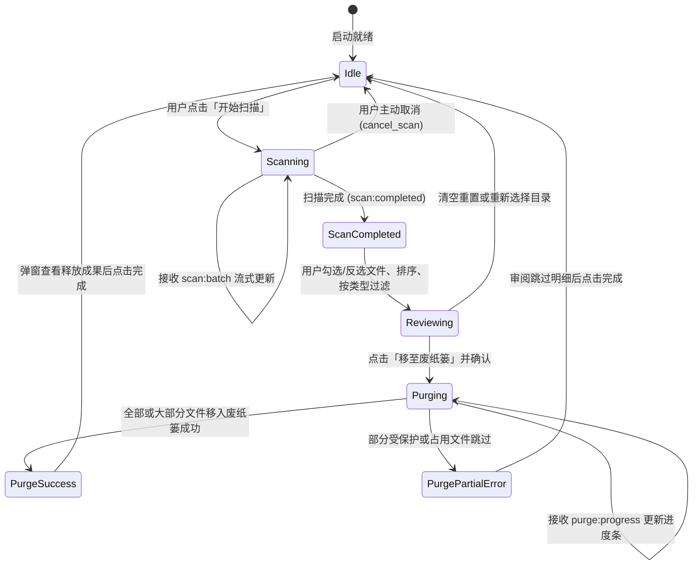

# FilePurger 详细规格说明书 (SPEC)

---

## 1. 核心数据模型 (Core Data Models)

为了保持前端 React (TypeScript) 与后端 Rust 结构的一致性与高序列化性能，所有模型通过 Serde 在 IPC 通信中透明编解码。

### 1.1 文件元数据模型 (`FileItem`)

#### TypeScript 定义 (`src/types/index.ts`)
```typescript
export interface FileItem {
  id: string;                     // 唯一标识 (通常采用 SHA-256 或路径哈希)
  path: string;                   // 文件的绝对路径，如 /Users/username/Downloads/installer.dmg
  filename: string;               // 文件名，如 installer.dmg
  extension: string;              // 扩展名 (无点小写)，如 dmg
  sizeBytes: number;              // 文件大小 (字节)
  sizeFormatted: string;          // 友好可读格式，如 "1.84 GB"
  modifiedAt: number;             // 最后修改时间戳 (毫秒)
  accessedAt: number;             // 最后访问时间戳 (毫秒)
  daysSinceModified: number;      // 距今天数 (向下取整)
  selected: boolean;              // 前端是否勾选待清理
}
```

#### Rust 定义 (`src-tauri/src/models/file_item.rs`)
```rust
use serde::{Deserialize, Serialize};

#[derive(Debug, Clone, Serialize, Deserialize)]
#[serde(rename_all = "camelCase")]
pub struct FileItem {
    pub id: String,
    pub path: String,
    pub filename: String,
    pub extension: String,
    pub size_bytes: u64,
    pub size_formatted: String,
    pub modified_at: i64,
    pub accessed_at: i64,
    pub days_since_modified: u32,
    pub selected: bool,
}
```

---

### 1.2 复合清理规则模型 (`PurgeRule` & `PurgePreset`)

#### TypeScript 定义
```typescript
export type TimeUnit = 'days' | 'months' | 'years';
export type TimeFilterField = 'modified' | 'accessed';

export interface PurgeRule {
  // 时间维度
  timeFilterEnabled: boolean;
  timeFilterField: TimeFilterField; // 'modified' (推荐) 或 'accessed'
  olderThanValue: number;           // 阈值数值，如 30, 90
  olderThanUnit: TimeUnit;          // 单位，默认 'days'

  // 大小维度
  sizeFilterEnabled: boolean;
  minSizeBytes: number;             // 最小文件大小 (字节，如 50 * 1024 * 1024 代表 50MB)

  // 扩展名/类型维度
  extensionFilterEnabled: boolean;
  targetExtensions: string[];       // 目标扩展名列表，如 ["dmg", "pkg", "zip", "iso"]
  isExtensionExcludeMode: boolean;  // false 为仅匹配列表；true 为排除列表

  // 路径与黑名单维度
  excludeHiddenFiles: boolean;      // 是否排除隐藏文件/点开头文件 (默认 true)
  excludeSystemDirs: boolean;       // 是否自动排除 .git, node_modules 等 (默认 true)
  customExcludePatterns: string[];  // 自定义忽略通配符列表，如 ["*.keep", "archive/*"]
}

export interface PurgePreset {
  id: string;
  name: string;                     // 预设名称，如 "下载目录大瘦身"
  description: string;              // 预设描述
  targetDirectories: string[];      // 关联的默认扫描目录
  rule: PurgeRule;                  // 关联的具体规则
  isBuiltin: boolean;               // 是否为系统内置只读预设
}
```

---

### 1.3 审计与历史记录模型 (`HistoryRecord`)

#### TypeScript 定义
```typescript
export interface HistoryRecord {
  id: string;                       // 批次 UUID
  timestamp: number;                // 清理时间戳 (毫秒)
  targetDirectories: string[];      // 扫描来源目录
  totalItemsPurged: number;         // 成功移入废纸篓文件数
  totalBytesFreed: number;          // 释放总字节数
  freedFormatted: string;           // 友好可读格式，如 "14.2 GB"
  durationMs: number;               // 耗时 (毫秒)
  purgedItems: PurgedItemSummary[]; // 清理文件摘要列表 (前 100 项，防止过大)
}

export interface PurgedItemSummary {
  path: string;
  filename: string;
  sizeBytes: number;
  sizeFormatted: string;
}
```

---

## 2. Tauri IPC 通信协议接口 (IPC Commands & Events)

### 2.1 双向指令接口 (Commands: `invoke`)

| 指令名称 | 输入参数 (Payload) | 返回值 (Result) | 说明 |
| :--- | :--- | :--- | :--- |
| `start_scan` | `{ targetDirs: string[], rules: PurgeRule }` | `Result<string, string>` | 发起异步多线程扫描任务，成功返回 session_id |
| `cancel_scan` | `{ sessionId?: string }` | `Result<boolean, string>` | 取消正在执行的扫描任务 |
| `purge_files` | `{ filePaths: string[] }` | `Result<PurgeResultSummary, string>` | 批量将指定文件移动至系统原生废纸篓 |
| `reveal_in_folder` | `{ filePath: string }` | `Result<boolean, string>` | 在操作系统文件管理器 (Finder/Explorer) 中高亮定位指定文件 |
| `get_system_paths` | `None` | `Result<SystemPathRecommendation, string>` | 获取用户当前操作系统的常用目录（下载、桌面、缓存等） |
| `load_presets` | `None` | `Result<PurgePreset[], string>` | 获取所有预设规则（包含内置推荐与用户自定义） |
| `save_preset` | `{ preset: PurgePreset }` | `Result<boolean, string>` | 新增或保存用户自定义规则预设 |
| `delete_preset` | `{ presetId: string }` | `Result<boolean, string>` | 删除指定用户自定义预设（内置预设不可删） |
| `get_history` | `None` | `Result<HistoryRecord[], string>` | 获取历史清理审计日志列表 |
| `clear_history` | `None` | `Result<boolean, string>` | 清空本地历史审计记录 |

---

### 2.2 流式事件接口 (Event Channels: `listen`)

后端扫描与清理属于高频长时间任务，通过 Tauri Event 机制进行流式分批派发，防止单次数据过大导致 IPC 序列化卡顿：

#### 1. `scan:batch`
- **触发时机**: 扫描引擎累积匹配到 50 个文件或每隔 100ms 派发一次。
- **Payload**:
  ```json
  {
    "sessionId": "sess_1730000000",
    "batchItems": [ ...FileItem ],
    "scannedCount": 35200,
    "hitCount": 142,
    "hitSizeBytes": 4580210000,
    "currentScanningDir": "/Users/aubreyhan/Downloads/Software"
  }
  ```

#### 2. `scan:completed`
- **触发时机**: 全量遍历完成。
- **Payload**:
  ```json
  {
    "sessionId": "sess_1730000000",
    "totalScannedFiles": 84210,
    "totalHitFiles": 328,
    "totalHitSizeBytes": 15420000000,
    "durationMs": 1480
  }
  ```

#### 3. `purge:progress`
- **触发时机**: 正在批量移动至废纸篓时，每处理 1 个文件派发。
- **Payload**:
  ```json
  {
    "total": 50,
    "current": 23,
    "percentage": 46.0,
    "currentPath": "/Users/aubreyhan/Downloads/large_video.mov"
  }
  ```

---

## 3. 前端状态机模型 (Frontend State Machine)



---

## 4. 边界条件与异常处理矩阵 (Edge Cases & Fault Tolerance)

| 场景序号 | 边界/异常场景 | 发生原因 | 系统的处理与防御机制 |
| :--- | :--- | :--- | :--- |
| **EC-01** | 用户选择根目录或系统核心路径 | 误操作添加 `/` 或 `C:\Windows` | `PathGuard` 在前端提交与后端接收两端均强制拦截，提示“该目录属于受保护系统区域，为保障系统安全禁止扫描”。 |
| **EC-02** | 符号链接 (Symlinks) 循环引用 | 目录中存在指向父目录的软链 | 扫描器默认**禁用追随软链 (Follow Symlinks = false)**，仅将软链本身当作普通文件评估，绝不陷入无限递归。 |
| **EC-03** | 文件正被其他应用独占打开 (In-Use) | 用户正在播放视频或写入文件 | `trash::delete` 会返回 OS 拒绝错误。系统捕获错误后将其记录为 `Skipped (File Locked)`，进度条继续推进，不打断整体批次。 |
| **EC-04** | 文件在扫描后被外部删除 (Stale Path) | 用户在扫描完成后手动在访达中删除了该文件 | 清理执行前调用 `std::path::Path::exists()` 验证，若已不存在直接优雅跳过，统计为“无需处理”。 |
| **EC-05** | 单个目录扫描出超 50 万个匹配文件 | 目标目录极其庞大 | 前端集成虚拟列表滚动 (`@tanstack/react-virtual`)，仅渲染当前可视区域的 30 个 DOM 节点，避免 DOM 节点过多导致浏览器崩溃。 |
| **EC-06** | 跨卷移动至废纸篓 (External Drives) | 待删除文件位于挂载的外置移动硬盘或 U 盘 | Rust `trash` crate 原生适配外置卷，将文件安全移动到外置盘的 `.Trashes` 隐藏回收区，保证外置盘可安全移入。 |
