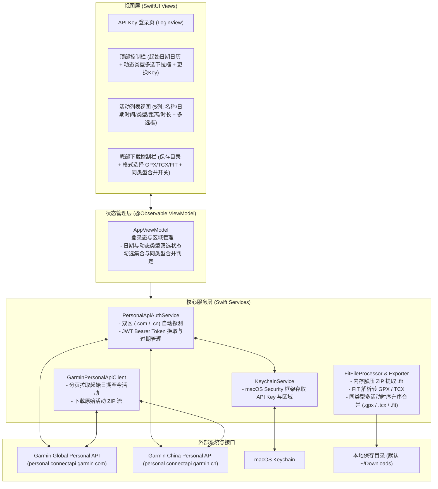
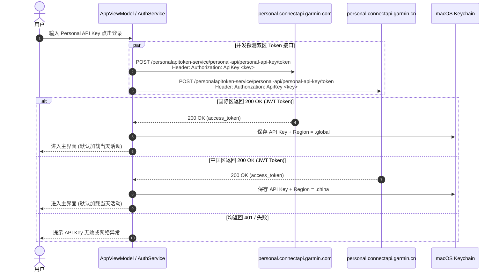

# 技术架构设计 (ARCHITECTURE) - Garmin Activity Exporter (v1)

## 1. 整体系统架构 (System Architecture)

本项目采用纯正的 **macOS 原生桌面架构（Swift 6 + SwiftUI）**，直接对接官方 **Garmin Connect Personal API**，无跨端 WebView 开销、无第三方数据库依赖，架构精简清晰。

### 架构全景图



---

## 2. 技术选型与决策依据 (Tech Stack)

| 模块 | 选用技术 | 说明 |
| :--- | :--- | :--- |
| **开发语言与 UI 框架** | **Swift 6 + SwiftUI** | macOS 原生性能与交互体验，原生支持 `DatePicker`、`Table`、`Menu`、`NSOpenPanel`。 |
| **最低系统版本** | **macOS 14.0 (Sonoma)+** | 原生支持 `@Observable` 宏与现代 SwiftUI 表格/日历组件。 |
| **网络请求** | **Foundation `URLSession` (`async/await`)** | 零外部网络库依赖，原生支持并发请求双区探测与流式下载。 |
| **凭据安全存储** | **macOS `Security` (Keychain Services)** | 系统级安全存储 `Personal API Key` 与所属区域。 |
| **偏好配置存储** | **`UserDefaults` (`@AppStorage`)** | 仅用于记住用户选择的下载保存目录（及 Security-Scoped Bookmark）与默认导出格式；**不保存起始日期**（确保每次打开默认当天）。 |
| **ZIP 解压与 FIT 解析** | **Swift 原生解压 / FIT 解析器** | Garmin Personal API 下载接口返回包含单个 `.fit` 文件的标准 ZIP 流，在内存中直接提取 `.fit` 二进制并解析 Record/Lap/Session 消息。 |

---

## 3. 工程目录结构 (Directory Structure)

在业务仓库 `/Users/aubreyhan/Tools/git_repo/PersonalDev/GarminActivity` 中的推荐结构：

```text
GarminActivity/
├── Package.swift / GarminActivity.xcodeproj
└── Sources/
    └── GarminActivity/
        ├── GarminActivityApp.swift          # 应用入口
        ├── Models/
        │   ├── GarminRegion.swift           # 国际区 (.com) / 中国区 (.cn) 枚举与 BaseURL
        │   ├── ActivityItem.swift           # 活动列表模型 (5大展示字段 + 原始属性)
        │   ├── ExportFormat.swift           # GPX / TCX / FIT 格式枚举
        │   └── ParsedActivityData.swift     # 从 FIT 解析出的轨迹点、分段(Lap)与传感器时序模型
        ├── Services/
        │   ├── KeychainService.swift        # Keychain 读写/清除 API Key 与 Region
        │   ├── PersonalApiAuthService.swift # 双区 Token 接口自动探测与 JWT 过期检查
        │   ├── GarminApiClient.swift        # 活动列表分页拉取与活动 ZIP 下载
        │   ├── ZipExtractor.swift           # 从下载的 ZIP 字节流中提取 .fit 数据
        │   ├── FitParser.swift              # 解析 .fit 二进制中的时间戳、经纬度、高程、心率、踏频、功率、分段
        │   └── ActivityExporter.swift       # 单文件导出与多活动同类型时序升序合并引擎 (GPX/TCX/FIT)
        ├── ViewModels/
        │   └── MainViewModel.swift          # 主视图状态机 (日期重置、动态类型集、多选与合并条件计算)
        └── Views/
            ├── LoginView.swift              # Personal API Key 输入与自动探测状态展示
            ├── MainView.swift               # 主窗口布局
            ├── FilterHeaderView.swift       # 起始日期日历控件 (2000~今天) + 动态类型多选下拉框
            ├── ActivityListView.swift       # 活动列表视图 (复选框 + 5项信息)
            └── DownloadFooterView.swift     # 底部保存目录选择、导出格式、合并复选框与下载按钮
```

---

## 4. 核心交互流程

### 4.1 Token 接口自动探测区域流程



### 4.2 起始日期拉取与动态类型筛选流程

1. **应用启动**：`startDate` 固定初始化为 `Date.now`（当天 `00:00:00`）。
2. **拉取活动**：调用 `GET /activitylist-service/activities/search/activities?startDate=YYYY-MM-DD&start=0&limit=99`（若返回满 99 条则自动递增 `start` 循环拉取，直至获取起始日期至今的全部活动）。
3. **动态生成类型筛选项**：
   - 从拉取到的 `allActivities` 数组中提取所有不重复的 `activityType.typeKey`，按出现频次或字母排序生成 `availableTypes`。
   - 将选中类型集合 `selectedTypes` 默认设为 `Set(availableTypes)`（全选）。
   - 若用户切换多选下拉框中的类型复选框，仅在本地过滤 `filteredActivities = allActivities.filter { selectedTypes.contains($0.typeKey) }`，无需重复请求网络。
   - 当过滤结果变化导致部分已勾选 Activity 不在当前可见列表中时，自动清理不可见项的勾选状态，防止误下载。
