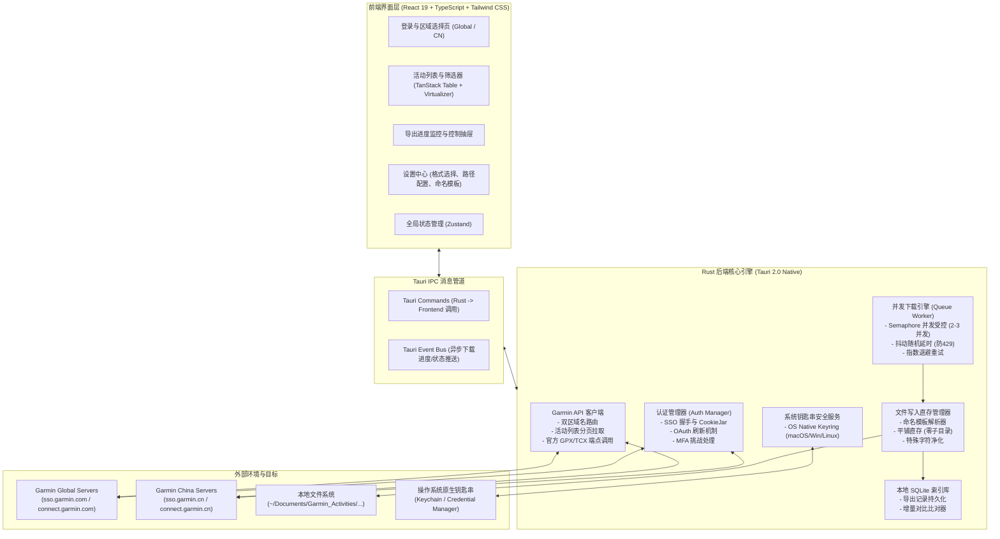
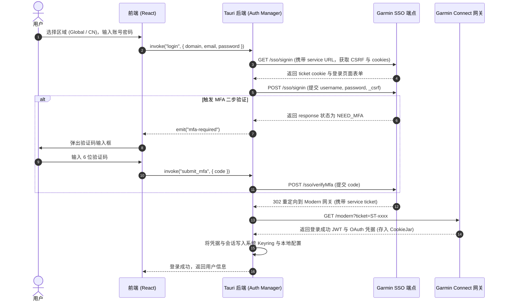
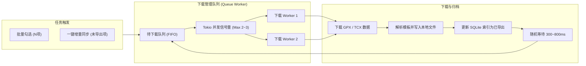

# 技术架构设计 (ARCHITECTURE) - Garmin Activity Exporter

## 1. 整体系统架构 (System Architecture)

`garmin-activity-exporter` 采用 **Tauri 2.0 (Rust) + React 19 (TypeScript)** 现代跨平台桌面架构：
- **前端 (Frontend / Webview)**：专注于 UI 状态呈现、多维检索、虚拟化表格渲染、导出进度可视化与设置交互。
- **后端 (Rust Core)**：专注于 Garmin SSO 协议逆向认证、网络请求与 Cookie Jar 会话池、系统级安全钥匙串（Keychain）存取、并发下载队列与限流调度、本地 SQLite 索引与文件系统 I/O。

### 架构全景图



---

## 2. 技术选型与决策依据 (Tech Stack)

| 层次 / 领域 | 选用技术 | 版本/库 | 选型理由 |
| :--- | :--- | :--- | :--- |
| **桌面运行时** | **Tauri 2.0** | `2.x` | 相比 Electron，内存消耗减少 80%（~40MB vs ~200MB），安装包体积仅 ~15MB，无 Chromium 冗余打包，直接调用 OS Webview。 |
| **核心后端语言** | **Rust** | `2021 Edition` | 极高并发控制能力、内存安全、原生文件 I/O 吞吐、与操作系统底层 Keychain/Keyring 原生绑定无损耗。 |
| **HTTP 与网络客户端** | **reqwest** | `0.12` (with rustls, cookies) | 工业级异步 HTTP 客户端，原生支持持久化 CookieJar，自定义 Header 与重定向策略，稳定处理 Garmin SSO。 |
| **系统凭据存储** | **keyring-rs** | `3.x` | 跨平台对接 macOS Keychain、Windows Credential Manager、Linux Freedesktop Secret Service，确保密码机密性。 |
| **本地元数据持久化** | **rusqlite** / **bundled SQLite** | `0.31` | 轻量单文件内嵌数据库，毫秒级快速索引数万条已导出活动元数据，支撑秒级增量状态比对。 |
| **前端框架** | **React + TypeScript** | `React 19, TS 5.x` | 类型完备，生态丰富，组件化程度高。 |
| **构建工具** | **Vite** | `6.x` | 极速 HMR 热更新与优化的现代化打包。 |
| **UI 与样式组件** | **Tailwind CSS + Lucide Icons** | `v3.4+` | 原子化样式，极高定制自由度，支持深色/浅色模式自适应。 |
| **高性能大列表** | **@tanstack/react-virtual** + **@tanstack/react-table** | `v3 / v8` | 虚拟化 DOM 渲染，即使加载上千条运动数据仍能保证 60 FPS 流畅滚动。 |
| **客户端状态管理** | **Zustand** | `5.x` | 轻量直观，避免 React Context 频繁重渲染问题。 |

---

## 3. 推荐工程目录结构 (Directory Structure)

未来在独立业务工程仓库中进行编码实现时，推荐的标准代码组织结构如下：

```text
garmin-activity-exporter/
├── src-tauri/                       # Rust 核心后端工程
│   ├── Cargo.toml                  # Rust 依赖声明
│   ├── tauri.conf.json             # Tauri 2.0 配置文件 (权限、窗口、插件)
│   ├── src/
│   │   ├── main.rs                 # 应用程序入口
│   │   ├── lib.rs                  # 核心库逻辑与 command 注册
│   │   ├── auth/                   # 认证子系统
│   │   │   ├── mod.rs
│   │   │   ├── sso.rs              # Garmin SSO 握手与 OAuth 获取
│   │   │   ├── session.rs          # 会话管理与 Cookie 持久化
│   │   │   └── keychain.rs         # OS Keyring 密码读写接口
│   │   ├── garmin/                 # Garmin API 交互层
│   │   │   ├── mod.rs
│   │   │   ├── endpoints.rs        # 域名路由器 (CN vs Global URL 端点)
│   │   │   ├── activities.rs       # 活动搜索与分页接口
│   │   │   └── download.rs         # GPX / TCX 下载流
│   │   ├── exporter/               # 导出流水线与本地归档
│   │   │   ├── mod.rs
│   │   │   ├── queue.rs            # 并发受控的下载队列调度器
│   │   │   ├── template.rs         # 文件名格式化模板引擎
│   │   │   ├── merger.rs           # 多活动 GPX/TCX 无损轨迹合并引擎 (时序对齐/传感器保真)
│   │   │   └── file_writer.rs      # 文件写入与平铺直存管理 (无需创建子目录)
│   │   ├── db/                     # 本地 SQLite 数据层
│   │   │   ├── mod.rs
│   │   │   ├── schema.rs           # 数据库初始化表结构
│   │   │   └── history_repo.rs     # 导出历史查询与增量对比
│   │   └── commands/               # 前端调用的 Tauri Commands
│   │       ├── auth_commands.rs
│   │       ├── activity_commands.rs
│   │       └── export_commands.rs
├── src/                            # 前端工程 (React 19 + TypeScript)
│   ├── index.html
│   ├── package.json
│   ├── tsconfig.json
│   ├── vite.config.ts
│   ├── tailwind.config.js
│   └── src/
│       ├── main.tsx
│       ├── App.tsx                 # 主页面框架与导航
│       ├── api/                    # 包装 Tauri invoke 的类型化 API 客户端
│       │   ├── auth.ts
│       │   ├── activities.ts
│       │   └── exporter.ts
│       ├── components/             # 可复用 UI 组件
│       │   ├── ActivityTable.tsx   # 虚拟滚动运动表格
│       │   ├── ActivityCard.tsx    # 运动卡片视图
│       │   ├── FilterBar.tsx       # 时间与运动分类多维筛选器
│       │   ├── ExportDrawer.tsx    # 导出任务队列抽屉
│       │   ├── SettingsDialog.tsx  # 设置对话框 (路径/模板/格式)
│       │   └── LoginModal.tsx      # 双区登录弹窗与 MFA 验证码输入
│       ├── store/                  # Zustand 状态切片
│       │   ├── authStore.ts
│       │   ├── activityStore.ts
│       │   └── exportStore.ts
│       ├── types/                  # 全局 TypeScript 接口定义
│       │   ├── garmin.ts
│       │   ├── activity.ts
│       │   └── export.ts
│       └── utils/                  # 格式化与辅助工具
│           ├── formatters.ts       # 配速、心率、距离格式转换
│           └── path.ts
```

---

## 4. 核心子系统流程与交互机制

### 4.1 Garmin SSO 双区认证时序 (Authentication Flow)

Garmin 的认证流程基于 SSO 重定向与 OAuth 握手。不同区域（Global vs China）的 URL 基址与 SSO 服务域名不同：
- Global: `https://sso.garmin.com/sso` 与 `https://connect.garmin.com`
- China: `https://sso.garmin.cn/sso` 与 `https://connect.garmin.cn`



### 4.2 导出流水线与限流设计 (Export Pipeline)

为防止短时间内大批量请求导致用户 IP 被 Garmin 防爬系统风控拦截，设计了并发受控的队列模型：



---

## 5. 错误恢复与异常边界设计

1. **Garmin 429 Too Many Requests (限流处理)**：
   - 当收到 HTTP 429 或连接被重置时，队列自动暂停。
   - 采用指数退避算法：初次延时 5s，若仍失败则等待 15s、30s，并在 UI 队列上明确提示“触发限流保护，正在降速重试中”，避免盲目重试导致封号。
2. **Session 过期与静默续约**：
   - 在活动列表翻页或下载过程中若返回 HTTP 401 / 403，Rust 客户端自动利用当前会话上下文执行一次快速 ticket 重新认证。
   - 若重新认证失败，通知前端抛出“登录凭据已过期，请重新登录”的友好弹窗，且下载队列进入安全暂停态，保留当前下载进度不丢失。
3. **文件名非法字符与系统兼容性**：
   - 用户在 Garmin 上的活动标题常包含表情包、斜杠或特殊符号（如 `晨跑 / 5km (PB! 🎉)`）。
   - 文件命名引擎会通过内置净化器自动过滤或替换跨平台非法字符（`\ / : * ? " < > |` 及换行符），将不可打印字符替换为下划线，避免 macOS / Windows 保存文件抛出 I/O 错误。
