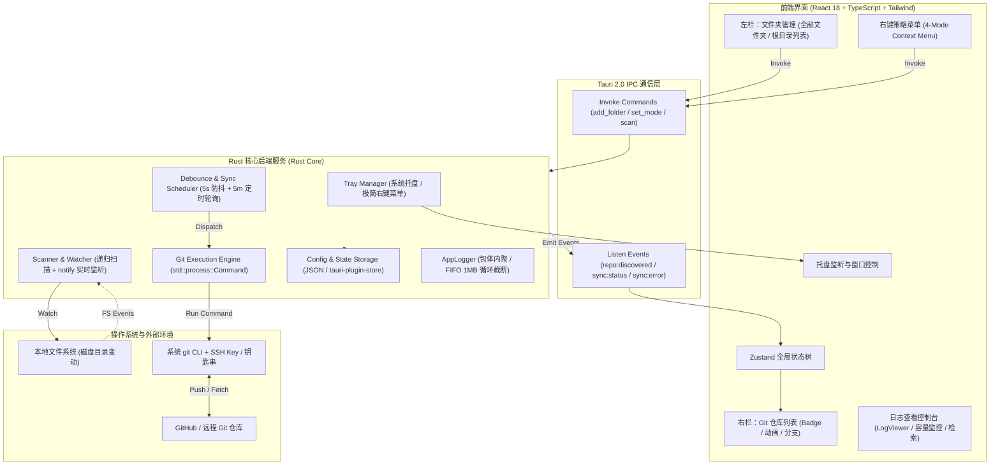
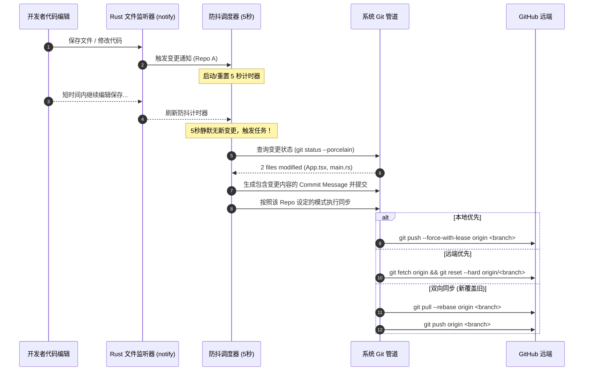

# 技术架构设计文档 (ARCHITECTURE) - GitHub 自动同步

## 1. 架构总览 (System Architecture)

本项目采用 **Tauri 2.0** 架构。前端使用现代化 Web 技术栈（React + TypeScript + Tailwind CSS），后端使用高性能、内存安全的 Rust。

* **UI 渲染层 (Frontend)**：负责主界面左右双栏布局、状态徽标呈现、右键菜单响应与用户交互。
* **Rust 核心服务层 (Backend Core)**：负责系统托盘常驻管理、文件系统递归扫描与实时监听、Git 进程调度管道、防抖调度器与持久化存储。
* **进程间通信 (IPC)**：通过 Tauri 2.0 Command (Rust to Frontend) 与 Event (Frontend to Rust) 实现零延迟异步解耦通信。



---

## 2. 技术选型与权衡 (Technology Stack & Rationale)

| 技术层 | 选用技术 | 版本要求 | 选型理由 |
| :--- | :--- | :--- | :--- |
| **桌面运行时** | **Tauri 2.0** | `>= 2.0.0` | 极小体积（打包安装包 < 15MB），运行时常驻内存仅 25~35MB，原生跨平台托盘（macOS MenuBar / Windows Tray）API 支持成熟。 |
| **系统后端语言** | **Rust** | `>= 1.75` | 极高并发控制能力与类型安全。使用 `notify` 监听大规模文件系统占用极低 CPU，多线程防抖调度安全可靠。 |
| **前端框架** | **React** + **Vite** | React 18/19 | 配合 TypeScript 提供强类型约束，生态完善，组件库与右键菜单实现简便。 |
| **样式与图标** | **Tailwind CSS** + **Lucide React** | 最新版 | 快速搭建整洁、现代化的双栏 Mac-like 扁平化质感界面。 |
| **状态管理** | **Zustand** | `>= 4.5` | 轻量级、少样板代码，轻松同步 Tauri IPC 推送的事件并响应式重绘界面。 |
| **Git 驱动方式** | **宿主系统 `git` CLI** | 系统预装 Git | 避免纯纯 Rust git 库（如 git2/libgit2）缺少 SSH 密钥链集成、导致要求用户重新输入 PAT 密钥的糟糕体验。直接调用系统 `git` 完美无缝复用用户的全局 SSH Key 和系统凭据。 |
| **开机自启动插件** | **`tauri-plugin-autostart`** | `>= 2.0.0` | 官方跨平台自启插件，支持 macOS LaunchAgents 与 Windows 注册表，无需手动维护 plist/注册表脚本。 |

---

## 3. 推荐工程目录结构 (Project Directory Tree)

未来生成的实际工程项目推荐目录结构如下：

```text
github-auto-sync/
├── src-tauri/                      # Rust 核心后端
│   ├── Cargo.toml                  # Rust 依赖声明
│   ├── tauri.conf.json             # Tauri 窗口、权限与打包配置
│   ├── src/
│   │   ├── main.rs                 # 主程序入口、插件注册与生命周期
│   │   ├── tray.rs                 # 系统托盘初始化与极简菜单处理 (Open/Quit)
│   │   ├── scanner/                # 目录扫描与变动监听模块
│   │   │   ├── mod.rs
│   │   │   ├── discovery.rs        # 异步递归遍历查找 .git 目录
│   │   │   └── watcher.rs          # notify crate 文件变动与增删 repo 监听
│   │   ├── git/                    # Git 命令执行与策略管道
│   │   │   ├── mod.rs
│   │   │   ├── runner.rs           # 异步调度系统 git 命令并捕获输出
│   │   │   ├── strategies.rs       # 双向同步(新覆盖旧)、本地优先、远端优先
│   │   │   └── commit_formatter.rs # 提取变更文件列表生成结构化 Commit Message
│   │   ├── scheduler/              # 防抖与定时任务调度
│   │   │   ├── mod.rs
│   │   │   └── debouncer.rs        # 5秒本地变动防抖与 5分钟远程定时轮询
│   │   ├── storage/                # 本地持久化 (配置与仓库列表状态)
│   │   │   ├── mod.rs
│   │   │   └── store.rs            # 存储已加文件夹与每个 Repo 的同步模式
│   │   └── commands.rs             # 暴露给前端调用的 Tauri IPC Commands
├── src/                            # 前端 React 界面
│   ├── index.html
│   ├── package.json
│   ├── tailwind.config.js
│   ├── tsconfig.json
│   ├── src/
│   │   ├── main.tsx                # React 挂载入口
│   │   ├── App.tsx                 # 主窗口框架与事件分发中心
│   │   ├── types/                  # 强类型定义
│   │   │   ├── repo.ts             # GitRepo, SyncMode, SyncStatus 等接口
│   │   │   └── folder.ts           # WatchedFolder 接口
│   │   ├── store/                  # Zustand 状态管理
│   │   │   └── useAppStore.ts      # 维护 folders, repos, selectedFolderId
│   │   ├── components/             # UI 组件
│   │   │   ├── layout/
│   │   │   │   ├── TitleBar.tsx    # 自定义无边框标题栏 / 窗口控制
│   │   │   │   └── SplitLayout.tsx # 左右双栏分栏容器
│   │   │   ├── sidebar/
│   │   │   │   ├── FolderList.tsx  # 左栏文件夹列表与“全部文件夹”
│   │   │   │   └── AddFolderBtn.tsx# 添加文件夹触发按钮
│   │   │   ├── repolist/
│   │   │   │   ├── RepoList.tsx    # 右栏仓库网格/列表容器
│   │   │   │   ├── RepoCard.tsx    # 单个仓库项 (Badge/动画/分支)
│   │   │   │   └── StatusBadge.tsx # 4 色状态徽标
│   │   │   └── common/
│   │   │       └── ContextMenu.tsx # 右键策略菜单 (4 种同步模式)
│   │   └── lib/
│   │       └── tauri.ts            # Tauri IPC 封装助手 (invoke & listen)
```

---

## 4. 核心工作流与线程模型 (Workflows & Concurrency)

### 4.1 目录扫描与动态监听流程
1. 用户在前端点击添加文件夹，选择 `/Users/aubrey/Work`。
2. 前端调用 `add_folder` Command，后端存入持久化配置并启动后台异步任务：
   * **初始扫描**：`discovery.rs` 深度遍历 `/Users/aubrey/Work`，遇到含有 `.git` 的子目录即记录为 `GitRepo`，过滤忽略 `node_modules`、`target`、`.build` 等无关大目录。
   * **启动 Watcher**：`watcher.rs` 将该目录加入 `notify` 监听池，监听文件系统事件。
3. 若检测到某目录下新增了 `.git` 或删除了 `.git`，Rust 后端主动向前端广播 `repo:discovered` 或 `repo:removed` 事件，前端 Zustand store 自动增量更新，无需全量刷新。

### 4.2 本地变动防抖与同步管道 (Mode C)



---

## 5. 安全性与异常容灾

1. **防爆力推送保护**：本地优先模式下执行 push 时，优先使用 `--force-with-lease` 而非硬性 `--force`，避免误抹除他人刚刚推上去的关键改动。
2. **Git 目录保护**：监听器自动忽略 `.git/` 内部目录的所有写入事件（如 `.git/index.lock`、`.git/FETCH_HEAD`），杜绝死循环自触发。
3. **网络离线检测**：在执行远端操作前若无法解析域名或检测到离线，标记该仓库状态为 `[网络异常待重试]`，避免频繁无意义抛错。
