# 技术架构设计 (ARCHITECTURE) - M5Track-Tab5

---

## 1. 硬件连接与引脚定义 (Hardware Interconnect)

系统主控平台为 **M5Stack Tab5**（主控芯片为高性能双核 RISC-V 400MHz 的 **ESP32-P4**，搭配 16MB Flash 与 **32MB 超大 PSRAM**；无线协处理器为 **ESP32-C6**），外部扩展模组选用 **M5Stack Module GNSS (M135 / u-blox NEO-M9N)**。

### 1.1 硬件通信拓扑与引脚映射

| 外部模块 / 内部外设 | 接口协议 | ESP32-P4 引脚映射 | 说明 |
| :--- | :--- | :--- | :--- |
| **u-blox NEO-M9N (M135)** | 高速 UART | **GPIO 38 (RX0)** $\leftarrow$ M9N TXD<br>**GPIO 37 (TX0)** $\rightarrow$ M9N RXD | 经由 M5-Bus 高速串口总线互联，波特率 38400 / 115200bps；SMA 标准外置天线接口引向前挡玻璃 |
| **BMP280 (气压/高程计)** | 硬件 I2C | GPIO 7 (SDA), GPIO 8 (SCL) | Module GNSS 板载集成，I2C 地址 `0x76`；用于 10Hz 气压定高互补融合与道路坡度计算 |
| **BMM150 (3轴地磁罗盘)** | 硬件 I2C | GPIO 7 (SDA), GPIO 8 (SCL) | Module GNSS 板载集成，I2C 地址 `0x10`；用于 0 车速静止状态下绝对磁北航向保持 |
| **BMI270 (6轴 IMU 惯导)** | 硬件 I2C | GPIO 7 (SDA), GPIO 8 (SCL) | Tab5 主板板载集成，I2C 地址 `0x68`；用于车身姿态角、G-Force 摩擦力靶图、隧道惯导推算与静默微动唤醒 |
| **RX8130CE (硬件 RTC)** | 硬件 I2C | GPIO 7 (SDA), GPIO 8 (SCL) | Tab5 主板板载集成，I2C 地址 `0x32`；由 $70000\mu\text{F}$ 超级电容维持掉电走时，实现冷启动秒级注入 |
| **INA226 (高精度库仑计)** | 硬件 I2C | GPIO 7 (SDA), GPIO 8 (SCL) | Tab5 主板板载集成，I2C 地址 `0x40`；经 $20\text{m}\Omega$ 精密分流电阻监测电压、充放电电流与整机功耗 |
| **IP2326 + MP4560** | 电源与充放电管理 | 内部硬件管理电路 | 管理背部快拆 **NP-F550** (约 2000mAh/7.4V) 锂电池，支持 USB-C (PD/QC) 及 6~24V HVIN 宽压车载供电 |
| **5.0" IPS 高清屏** | MIPI-DSI (双通道) | ESP32-P4 专用 MIPI-DSI 接口 | 1280×720 分辨率，60Hz 刷新率，支持全贴合大画幅双缓冲渲染 |
| **电容触控控制器** | 专用触控 I2C / INT | 专用触控总线 | 支持多点触控、大热区点选与全屏滑动手势识别 |
| **MicroSD (TF 卡槽)** | 专用硬件高速 SPI | 专用 SPI 接口 | 采用 `SdFat` 库，原生支持长文件名 (LFN) 与机内 FAT32 格式化，双流记录 GPX |
| **触觉马达 / 蜂鸣器** | 专用 PWM / GPIO | 专用控制引脚 | Page 1 里程卡片长按 2 秒归零短震触觉确认，超速/陡坡声音警示 |

> [!TIP]
> **I2C 物理总线正交架构**：
> - Tab5 板载芯片：`BMI270` (`0x68`)、`RX8130CE` (`0x32`)、`INA226` (`0x40`)；
> - Module GNSS 堆叠芯片：`BMM150` (`0x10`)、`BMP280` (`0x76`)；
> 5 大传感器地址完全独立，I2C 总线零冲突，物理寻址极其轻量稳定。

---

## 2. 屏幕朝向与车规宽屏视口划分 (Viewport & Left Dock)

依据 M5GFX 官方硬件标准定义：
- M5Stack Tab5 在 `M5GFX` 库中采用标准横屏车载仪表盘模式：
  - `M5.Display.setRotation(1)`：**标准宽屏 (1280 × 720)**；
  - **物理布局**：机身侧面集成标准 **1/4"-20 摄影/车载螺孔**，直连车载吸盘球头支架；背部支持 NP-F550 电池卡扣快拆；SMA 外置天线接头由 Module GNSS 稳固引出；正面为整块全贴合高清防刮触控玻璃。
- **全屏坐标划分布局**：

```text
+------+-------------------------------------------------------------+ (1280 x 720)
|  🏠  |                                                             |
| 仪表 |                                                             |
|------|                                                             |
|14:35 |                                                             |
|28 秒 |                                                             |
|------|                                                             |
| 🛰️   |                                                             |
|18 3D |                   【 主内容安全绘制视口 】                  |
|------|                                                             |
| 📶   |                       1120 x 720 像素                       |
|热点  |                   (X: 160~1279, Y: 0~719)                   |
|------|                                                             |
| 🔋   |                   (BasePage 独占 720px 全高)                |
| 95%  |                                                             |
|------|                                                             |
| ☀️   |                                                             |
|24.5℃ |                                                             |
|------|                                                             |
|  ⚙️  |                       ● ○ ○ ○ ○ ○ ○ ○                       |
| 工具 |                 (切页浮现，3秒无操作自动隐藏)               |
+------+-------------------------------------------------------------+
(左侧160px 常驻Dock)                  (右侧1120px 全高主视口)
```

1. **左侧常驻触控 Dock (`X: 0~159, Y: 0~719`, 宽 160px, 全高 720px)**：
   - 彻底解放纵向像素，为驾驶员右手提供 6 大高频触控方块（每个方块约 $160 \times 105\text{px}$，触控面积极大，盲操容错率 100%）：
     - `🏠 仪表`：专职回首页；
     - `14:35`：专职跳 Page 7 世界时钟；
     - `🛰️ 18`：专职跳 GPS 详情；
     - `📶 热点`：专职跳网络配网；
     - `🔋 95%`：INA226 库仑计实时电量与充放电；
     - `☀️ 24.5℃`：专职跳 Page 6 天气预报；
     - `⚙️ 工具`：专职跳 Page 8 系统工具箱。
2. **右侧主内容安全视口 (`X: 160~1279, Y: 0~719`, 宽 1120px, 高 720px)**：
   - 比例为接近 16:10 的黄金视窗（1120×720），所有子页面均在此区域内进行全画幅独立绘制。

---

## 3. 系统整体架构拓扑图 (System Architecture)

```mermaid
flowchart TB
    subgraph Hardware Layer ["硬件外设层 (Hardware Layer)"]
        N9N["u-blox NEO-M9N<br>(M5-Bus UART 38/37)"]
        BARO["BMP280 Baro<br>(I2C 0x76)"]
        MAG["BMM150 Compass<br>(I2C 0x10)"]
        IMU["BMI270 6-Axis<br>(I2C 0x68)"]
        RTC["RX8130CE RTC<br>(I2C 0x32)"]
        INA["INA226 Fuel Gauge<br>(I2C 0x40)"]
        LCD["5.0寸 IPS LCD<br>(MIPI-DSI 1280x720)"]
        SD["MicroSD Slot<br>(Hardware SPI)"]
        C6["ESP32-C6 Co-SoC<br>(Wi-Fi 6 / BLE 5)"]
    end

    subgraph Driver & HAL ["驱动与硬件抽象层 (M5Unified / HAL)"]
        drv_gnss["SparkFun u-blox GNSS Lib<br>(UBX-NAV-PVT / UBX-MGA)"]
        drv_i2c["I2C Bus Manager<br>(0x68/0x32/0x40/0x76/0x10)"]
        drv_rtc["RX8130CE RTC Driver"]
        drv_ina["INA226 Driver & Regs"]
        drv_gfx["M5GFX MIPI Engine<br>(32MB PSRAM Double Buffering)"]
        drv_tp["M5.Touch Gesture Manager"]
        drv_fs["SdFat File System Driver"]
    end

    subgraph Service Engines ["核心业务引擎层 (Core Services)"]
        engine_gnss["GNSS 数据解算器<br>(车载动态模式/静止死区锁/四星)"]
        engine_baro["气压-GNSS 高程互补滤波引擎<br>(BMP280 / 分米级平滑定高)"]
        engine_time["双源自适应时钟引擎<br>(GPS原子钟 ⇋ NTP ⇋ RX8130CE)"]
        engine_agps["u-blox AGPS (AssistNow) 极速注入服务"]
        engine_pwr["INA226 复合库仑计服务<br>(安时积分 + OCV 静态曲线校准)"]
        engine_weather["GPS 坐标反查实时气象引擎<br>(Open-Meteo REST / 12h双时段)"]
        engine_track["GPX 轨迹双流记录器<br>(WGS84+GCJ02/连续切片/自愈)"]
        engine_dr["隧道盲区 IMU 航位推测与单维轴线锁死"]
        engine_net["Wi-Fi 6 管理器 & SoftAP 导出<br>(Multi-SSID / 独立热点分享)"]
    end

    subgraph Presentation ["UI 展示与触控路由 (Presentation Layer)"]
        dock["左侧 160px 常驻 Dock<br>(主页/时钟/GPS/WiFi/电池/天气/工具)"]
        subgraph MainPages ["右侧 1120x720 全高视口 (左右滑动路由)"]
            p1["Page 1: 驾驶主仪表盘 (360px大罗盘/车速热区/长按2s清零)"]
            p2["Page 2: 海拔高度与1050px宽连续起伏折线图"]
            p3["Page 3: 车速变化与1050px宽连续折线图 (MAX/AVG)"]
            p4["Page 4: 矢量自驾轨迹 (全画幅自适应铺满+悬浮HUD)"]
            p5["Page 5: 车辆动态 G 值靶图 (400px) 与越野姿态水平仪"]
            p6["Page 6: 12小时大字双时段天气预报 (前后12h一键切)"]
            p7["Page 7: 多时区世界时钟 (2x2宽幅530x320大卡片)"]
            p8["Page 8: 2x2动态扩展工具箱 (TF管理/WiFi/GPS/设置)"]
        end
        dock -.->|点击🏠| p1
        dock -.->|点击时钟| p7
        dock -.->|点击天气| p6
        dock -.->|点击工具| p8
    end

    N9N --> drv_gnss --> engine_gnss
    BARO --> drv_i2c --> engine_baro
    MAG --> drv_i2c --> engine_dr
    IMU --> drv_i2c --> engine_dr
    RTC --> drv_rtc --> engine_time
    INA --> drv_ina --> engine_pwr
    SD --> drv_fs --> engine_track
    C6 --> engine_net
    engine_gnss --> MainPages
    engine_baro --> MainPages
    engine_time --> dock
    engine_pwr --> dock
    engine_weather --> MainPages
    engine_dr --> p4
```



---

## 4. FreeRTOS 多核多任务并发设计 (ESP32-P4 Dual RISC-V 400MHz)

ESP32-P4 拥有双核高性能 RISC-V 处理器（主频高达 400MHz），具备超强算力与独立中断流水线。为确保 **10Hz/25Hz 高频 GPS 串口零丢包**、**1280×720 大画幅 60fps 丝滑双缓冲渲染** 与 **网络/写入不阻塞实时仪表**，任务划分如下：

| 任务名称 (Task) | 运行核心 (Core) | 优先级 | 职责与周期 |
| :--- | :--- | :--- | :--- |
| **`gnssTask`** | **Core 0** | 优先级 5 (高) | 负责从 UART 高频读取 NEO-M9N 的 UBX 帧（5Hz/10Hz），实时解析 `NAV-PVT` 与 `NAV-SIG`，填充线程安全全局数据池。 |
| **`netTask`** | **Core 0** | 优先级 2 (低) | 调度 ESP32-C6 协处理器执行 Wi-Fi 6 扫描、SoftAP 直连 Web 响应、NTP 时间同步与 AssistNow 星历下载。异步非阻塞。 |
| **`uiTask`** | **Core 1** | 优先级 4 (中高) | 负责 M5GFX 双缓冲绘制（在 32MB PSRAM 中以 60fps 刷新 1120×720 画布）、调度左侧 Dock 点击与全屏滑动手势。 |
| **`trackLoggerTask`** | **Core 1** | 优先级 3 (中) | 周期性（1Hz）读取最新位置，流式格式化 XML GPX 双文件追加至 TF 卡，定期触发 `file.sync()`。 |
| **`pwrTask`** | **Core 1** | 优先级 1 (低) | 500ms 周期读取 INA226 (`0x40`) 寄存器，运行安时积分与 OCV 电池校准，监听车充电压通断。 |

---

## 5. 核心模块与业务算法设计

### 5.1 双源高精时钟与地库极速热启动引擎 (Dual-Source Time & Warm-Start Engine)
1. **地库出库极速温启动 (Fast Warm-Start)**：
   - 熄火断电时，将最后一次有效 3D 坐标自动持久化至片上 Flash NVS；
   - 再次冷开机时，系统从 **RX8130CE 硬件 RTC（I2C `0x32`）** 读取当前真实时间，结合 NVS 历史坐标，通过 `UBX-MGA-INI-POS_LLH` 与 `UBX-MGA-INI-TIME_UTC` 注入 M9N 串口；
   - 驶出地库锁星耗时从 35s+ 骤降至 10~15s。
2. **权威时钟闭环**：
   - 定位成功后，NEO-M9N 卫星原子钟时间（纳秒级精度）接管系统主时钟，自动计算大地经度时区偏移（中国为 UTC+8），并反向校准 RX8130CE，保证长年离线精度。

### 5.2 左侧常驻 Dock 与 1120×720 画布双缓冲 (UI Engine)
- 利用 ESP32-P4 的 **32MB 超大 PSRAM**，分配完整的 1280×720 16-bit 显存双缓冲画布（每帧仅耗费约 1.8MB PSRAM，内存极度富余）；
- **左侧 160px 常驻 Dock**：单点直达各个专职页面，完全解耦“主页”与“时钟/天气”手势冲突；
- **右侧 1120×720 安全视口**：子页面在此画布中渲染，每一帧前调用 `canvas.fillRect(160, 0, 1120, 720, TFT_BLACK)`。

### 5.3 轨迹流式写入、50%容量配额与断电自愈 (Safe GPX Logging & SdFat)
- **底层文件系统引擎 (SdFat)**：选用 `SdFat` 库，开启长文件名 (LFN) 支持；
- **双文件并行命名**：`W-yyyymmdd-hhmmss.gpx`（原始 WGS-84）与 `C-yyyymmdd-hhmmss.gpx`（国测局 GCJ-02 火星坐标，多项式转换 $<15\mu\text{s}$）；
- **1 小时自动截断切片**：连续行驶每满 3600 秒（3600 点）自动闭合双文件并在下一秒新建分卷，保障长途自驾单文件体量适中且合并无缝；
- **TF 卡 50% 容量配额与自动循环覆盖**：
  - 严格限制 `/tracks/` 目录总占用不超过 TF 卡总容量的 **50%**（例如 32GB 卡配额为 16GB，可记录 3000+ 小时自驾）；
  - 达到 50% 阈值时自动成对删除最古老的 `W-` 与 `C-` 历史轨迹，释放至 40% 以下，确保存储永不写满并为用户保留 50% 空间；
- **4 级断电自愈**：每点预写尾标签 `</trkseg></trk></gpx>`、10 秒定时 `file.sync()`，开机毫秒级扫描修复。
- **MagSafe 强磁免疫航向算法**：为支持机身粘贴 MagSafe 磁吸环，系统在底层旁路屏蔽 BMM150 地磁计，航向角 100% 由 GPS 地面真航向与 BMI270 陀螺仪 Z 轴高频积分融合，停稳锁死零漂。

### 5.4 板载 INA226 复合软硬件库仑计体系 (Power Management & INA226)

```text
       +--------------------------------------------------------------+
       |               Tab5 主板板载电源与测量架构                    |
       |  +--------------------+         +-------------------------+  |
       |  | NP-F550 快拆电池组 | ------> | 20mΩ 精密分流电阻 (Rs)  |  |
       |  | (2000mAh, 7.4V)    |         +------------+------------+  |
       |  +--------------------+                      |               |
       |                                              v               |
       |                              +----------------------------+  |
       |                              | TI INA226 (I2C: 0x40)      |  |
       |                              | 16-bit ΔΣ ADC (Vbus, Ish)  |  |
       |                              +---------------+------------+  |
       +----------------------------------------------|---------------+
                                                      | I2C (Wire)
                                                      v
+---------------------------------------------------------------------+
| ESP32-P4 主控 (Core 1 - pwrTask) - PowerMonitorService              |
|                                                                     |
|  +---------------------------------------------------------------+  |
|  | 500ms 周期采样与物理量换算 (Physical Measurement)              |  |
|  | - Vbus = REG_02 * 1.25 mV (总线实时电压)                       |  |
|  | - I    = REG_04 * 0.1 mA  (充放电瞬态电流, CAL=2560)           |  |
|  | - P    = REG_03 * 2.5 mW  (即时功耗)                           |  |
|  +-------------------------------+-------------------------------+  |
|                                  |                                  |
|  +-------------------------------v-------------------------------+  |
|  | 动态软件安时积分器 (Coulomb Integrator)                        |  |
|  | - ΔQ = I * Δt * η (放电 η=1.0, 充电 η=0.95)                   |  |
|  | - Q_rem = clamp(Q_rem + ΔQ, 0, 2000 mAh)                      |  |
|  +-------------------------------+-------------------------------+  |
|                                  |                                  |
|  +-------------------------------v-------------------------------+  |
|  | 静态开路电压漂移自动校准 (OCV Calibrator)                      |  |
|  | - 条件: |I| < 20mA 持续 5 秒 (车辆静置/停车平稳态)             |  |
|  | - 动作: 查表 11 节点锂电 OCV 曲线计算 SoC_ocv                  |  |
|  | - 更新: Q_rem = 2000 * SoC_ocv / 100 (消除长时累积零漂)       |  |
|  +-------------------------------+-------------------------------+  |
|                                  |                                  |
|  +-------------------------------v-------------------------------+  |
|  | 状态派发与续航预测 (Event Broadcast)                          |  |
|  | - SoC% = round(Q_rem / 2000 * 100)                             |  |
|  | - 写入全局 SystemState，驱动左侧 Dock 电池图标与双色渲染      |  |
|  |   (有外接电源显绿色 ⚡ 95%，无外接电源显红色 🔋 95%)          |  |
|  +---------------------------------------------------------------+  |
+---------------------------------------------------------------------+
```

1. **芯片配置与校准推导**：
   - 寄存器配置字 `0x4127`（16次平均采样，1.1ms 转换周期）；
   - 分流电阻 $R_{\text{shunt}} = 20\text{ m}\Omega$，选取电流分辨率 $\text{Current\_LSB} = 0.1\text{ mA/bit}$，推导出校准寄存器：
     $$\text{CAL} = \text{trunc}\left(\frac{0.00512}{0.0001 \times 0.02}\right) = 2560\ (0\text{x}0\text{A}00)$$
2. **复合算法优势**：
   - **动态抗压降**：行车大功率时电压波动不引起电量跳变，积分电量极度稳定；
   - **静态抗漂移**：静置（$|I| < 20\text{mA}$ 保持 5 秒）自动以 11 节点 OCV 标定表对冲归零，长效精准。

---

## 6. 代码工程目录结构设计 (PlatformIO 推荐结构)

```text
m5-vehicle-tracker/
├── platformio.ini              # PlatformIO 项目依赖与编译配置 (board = m5stack-tab5)
├── src/
│   ├── main.cpp                # 系统入口、FreeRTOS 任务初始化与分发
│   ├── config.h                # 引脚配置、常量参数、波特率
│   ├── model/
│   │   └── SystemState.h       # 全局系统状态结构体（线程安全数据交换池）
│   ├── driver/
│   │   ├── GnssDriver.h/.cpp   # NEO-M9N 串口与车载模式/死区调优
│   │   ├── BaroDriver.h/.cpp   # Module GNSS 板载 BMP280 气压/温度 I2C 驱动
│   │   ├── CompassDriver.h/.cpp# Module GNSS 板载 BMM150 地磁电子罗盘驱动
│   │   ├── ImuDriver.h/.cpp    # Tab5 板载 BMI270 6 轴姿态驱动
│   │   ├── RtcDriver.h/.cpp    # Tab5 板载 RX8130CE 硬件 RTC 读写
│   │   ├── Ina226Driver.h/.cpp # Tab5 板载 INA226 (0x40) 寄存器底层驱动
│   │   └── HapticDriver.h/.cpp # 触觉马达震动控制
│   ├── service/
│   │   ├── AltitudeFusion.h/.cpp # 气压计与 GNSS 高程互补滤波算法
│   │   ├── DeadReckoningService.h/.cpp # 盲区 6 轴 IMU 陀螺仪偏航角与速度推算
│   │   ├── TunnelService.h/.cpp  # 全国特长隧道自动吸附与单维轴线约束引擎
│   │   ├── TunnelDb.h            # 全国特长隧道微型数据库 (LittleFS / PSRAM)
│   │   ├── PowerMonitorService.h/.cpp # INA226 复合库仑计服务 (安时积分 + OCV)
│   │   ├── TimeService.h/.cpp  # 双源时钟调度（NTP / GPS / RTC 闭环）
│   │   ├── AgpsService.h/.cpp  # u-blox AssistNow 网络拉取与注入
│   │   ├── WeatherService.h/.cpp # GPS 坐标反查实时天气 (12h 双时段)
│   │   ├── TrackLogger.h/.cpp  # GPX 轨迹双流并行落盘与自动切片
│   │   └── NetworkManager.h/.cpp # ESP32-C6 Multi-SSID 管理、Web 配网与文件下载
│   └── ui/
│       ├── UiManager.h/.cpp    # 屏幕旋转设置、全宽 1120x720 视口管理
│       ├── components/
│       │   ├── LeftDock.h/.cpp       # 左侧 160px 常驻 Dock (主页/时钟/GPS/WiFi/电池/天气/工具)
│       │   └── PageIndicator.h/.cpp  # 底部悬浮页码指示器 (8圆点，3秒自动隐藏)
│       └── pages/
│           ├── BasePage.h            # 页面基类（封装 1120x720 安全视口裁剪）
│           ├── PageInit.h/.cpp       # 开机自检与初始化搜星页
│           ├── PageWifiConfig.h/.cpp # Wi-Fi 配网二维码与引导页
│           ├── Page1Dashboard.h/.cpp # 核心驾驶仪表盘 (360px大罗盘/车速热区/长按2s清零)
│           ├── Page2Altitude.h/.cpp  # 海拔高度1050px宽连续折线图与极值详情
│           ├── Page3Speed.h/.cpp     # 车速变化1050px宽连续折线图与最高时速 (MAX/AVG)
│           ├── Page4Trail.h/.cpp     # 矢量自驾轨迹地图 (全画幅自适应铺满+悬浮HUD)
│           ├── Page5Dynamics.h/.cpp  # 车辆动态G值圆 (400px靶图) 与姿态坡度水平仪
│           ├── Page6Weather.h/.cpp   # 12小时大字双时段气象预报 (前后12h一键切换)
│           ├── Page7WorldClock.h/.cpp # 多时区世界时钟 2x2 宽幅 530x320 大卡片
│           ├── SubPageEditClock.h/.cpp # 世界时钟卡片修改子页 (GPS经度定位 / 区域大热区)
│           ├── PageToolsGrid.h/.cpp  # 2x2 宽幅工具箱主页 (支持>4自动扩页)
│           └── tools/
│               ├── ToolTfManager.h/.cpp  # 工具1: TF卡存储管理 (格式化/轨迹列表/WiFi直传)
│               ├── ToolWifi.h/.cpp       # 工具2: Wi-Fi网络管理 (已存列表/删除/增加网络)
│               ├── ToolGnss.h/.cpp       # 工具3: GPS卫星详情 (四星分布/载噪比C/N0柱状图)
│               └── ToolSettings.h/.cpp   # 工具4: 屏幕背光与系统偏好/库仑计实时功耗
```
