# 技术架构设计 (ARCHITECTURE) - M5Track-M9N

---

## 1. 硬件连接与引脚定义 (Hardware Interconnect)

系统主控为 **M5Stack Core2**，外部 GNSS 模组选用 **u-blox NEO-M9N**。

### 1.1 硬件通信拓扑与引脚映射

| 外部模块 / 内部外设 | 接口协议 | ESP32 GPIO 引脚 | 说明 |
| :--- | :--- | :--- | :--- |
| **u-blox NEO-M9N (M135)** | UART2 (Serial2) | **GPIO 13 (RX2)** $\leftarrow$ M9N TXD<br>**GPIO 14 (TX2)** $\rightarrow$ M9N RXD | 三层 M-Bus 紧凑堆叠（免外部连线）；DIP 拨码严格拨向 GPIO 13/14（避开 Core2 的 GPIO 16/17 PSRAM 专用线）；SMA 标准外置天线接口位于右侧 |
| **BMP280 (气压/温度)** | 硬件 I2C (Wire) | GPIO 21 (SDA), GPIO 22 (SCL) | Module GNSS 板载集成，I2C 地址 `0x76`；用于高程互补滤波融合与真实车内气温采样 |
| **BMI270 (6轴 IMU)** | 硬件 I2C (Wire) | GPIO 21 (SDA), GPIO 22 (SCL) | Module GNSS 板载集成，I2C 地址 `0x68`；用于车身姿态、G-Force、隧道惯导推算与静默微动唤醒 |
| **AXP192 (PMIC)** | 内部 I2C (Wire1) | GPIO 21 (SDA), GPIO 22 (SCL) | 负责供电轨、锂电池充放电检测、Type-C VBUS 电源通断检测与 Deep Sleep 唤醒管理 |
| **BM8563 (RTC)** | 内部 I2C (Wire1) | GPIO 21 (SDA), GPIO 22 (SCL) | 硬件独立实时时钟芯片，掉电时由内部纽扣备用电池维持时间 |
| **FT6336U (触摸屏)** | 内部 I2C (Wire1) | GPIO 21 (SDA), GPIO 22 (SCL), GPIO 39 (INT) | 电容触摸屏控制器，支持点击、滑动手势识别 |
| **ILI9342C (LCD 屏)** | 高速 SPI | MOSI 23, MISO 38, SCLK 18, CS 5, DC 15 | 320x240 分辨率，驱动频率 40MHz |
| **MicroSD (TF 卡)** | 独立硬件 SPI | SCK: 18, MISO: 38, MOSI: 23, CS: 4 | 选用 `SdFat` 库：原生支持 **长文件名 (LFN)** 与机内 FAT32 格式化，引脚显式绑定 SPI |
| **电源与电池系统 (自适应)** | M-Bus / Type-C | AXP192 / INA226 (0x45) | 支持车载 USB 5V 直供（无底座 0mAh，电量显空）；装上 Base Dual 16340 后免改代码自动识别双 16340 (1400mAh) |

---

## 2. 屏幕朝向与显示旋转适配 (Orientation Mapping)

严格依据 M5GFX 官方硬件标准定义：
- M5Stack Core2 在 `M5GFX` 库中采用标准横屏车载仪表盘模式：
  - `M5.Display.setRotation(1)`：**标准横屏 (320 × 240)**。
  - **物理布局**：
    - 屏幕正面为整块纯平电容触摸屏，交互全面基于全屏滑动手势与大卡片触控热区；全机唯一机械实体按键为左侧电源键；
    - Type-C 供电接口与物理电源键位于机身**左侧**（便于插 L 型弯头线隐蔽出风口走线）；
    - SMA 外置高增益天线接口位于机身**右侧**；
    - 纯黑屏幕顶部 24px 状态栏一体化集成时间、GNSS、Wi-Fi、电池电量与当地温湿度。
- 初始化标准代码：
  ```cpp
  M5.Display.setRotation(1); // 标准横屏，三按键在下方，Type-C 在左侧，M5Unified 自动将 FT6336U 电容触摸坐标映射对齐
  ```

---

## 3. 系统整体架构图 (System Architecture)

```mermaid
flowchart TB
    subgraph Hardware Layer ["硬件外设层 (Hardware Layer)"]
        N9N["u-blox NEO-M9N<br>(Port.C UART2)"]
        AXP["AXP192 PMIC<br>(VBUS/Battery)"]
        RTC["BM8563 RTC<br>(I2C)"]
        LCD["ILI9342C LCD<br>(SPI 320x240)"]
        TP["FT6336U Touch<br>(I2C)"]
        SD["MicroSD Card<br>(SPI/SD)"]
    end

    subgraph Driver & HAL ["驱动与硬件抽象层 (M5Unified / HAL)"]
        drv_gnss["SparkFun u-blox GNSS Lib<br>(UBX-NAV-PVT / UBX-MGA)"]
        drv_pwr["AXP192 Power Driver"]
        drv_rtc["BM8563 RTC Driver"]
        drv_gfx["M5GFX Display Engine<br>(Double Buffering / Sprites)"]
        drv_tp["M5.Touch Gesture Manager"]
        drv_fs["SD File System API"]
    end

    subgraph Service Engines ["业务核心引擎 (Core Services)"]
        engine_gnss["GNSS 数据解算器<br>(车载动态模式/静止死区锁/四星)"]
        engine_baro["气压-GNSS 高程互补滤波引擎<br>(BMP280 / 分米级平滑)"]
        engine_time["双源自适应时钟引擎<br>(GPS原子钟 ⇋ NTP ⇋ RTC)"]
        engine_agps["u-blox AGPS (AssistNow) 注入服务"]
        engine_weather["GPS 坐标反查实时天气引擎<br>(Open-Meteo REST 温湿度)"]
        engine_track["GPX 轨迹流式记录器<br>(车速检测/自动切片/Flush)"]
        engine_net["Wi-Fi 管理器 & 按需独立热点<br>(Multi-SSID / 专属热点文件导出)"]
        engine_pwr["车载电源监视器<br>(10s 掉电安全落盘)"]
    end

    subgraph Presentation ["UI 展示与手势状态机 (UI & State Machine)"]
        sm["系统主状态机<br>(INIT / WIFI_CONFIG / MAIN_APP)"]
        view_init["初始化搜星页"]
        view_wifi["Wi-Fi 配网页"]
        subgraph MainPages ["正式多页面 (左右滑动切换 / 动态路由)"]
            p1["Page 1: 驾驶主仪表盘 (罗盘/车速热区/海拔热区)"]
            p2["Page 2: 海拔高度与1小时折线图 (最高/最低海拔)"]
            p3["Page 3: 车速变化与1小时折线图 (最高时速)"]
            p4["Page 4: 矢量自驾轨迹与返航地图"]
            p5["Page 5: 车辆动态G值圆与姿态倾角/坡度"]
            p6["Page 6: 小时级天气预报 (24小时折线/降水)"]
            p7["Page 7: 多时区世界时钟 (2x2四宫格卡片)"]
            p8["Page 8+: 4宫格工具箱 (动态扩页 / 自动顺延)"]
        end
        p1 -.->|点击海拔热区| p2
        p1 -.->|点击车速热区| p3
        topbar["顶部常驻状态栏 (StatusBar)"]
        topbar -.->|点击左侧时间| p7
        topbar -.->|点击右侧温湿度| p6
        p7 -.->|点击卡片修改| sub_clock["卡片编辑子页 (SubPageEditClock)"]
        p8 -.->|点击工具卡片| sub_tool["工具二级子页 (ToolSubPages)"]
    end

    N9N --> drv_gnss --> engine_gnss
    AXP --> drv_pwr --> engine_pwr
    RTC --> drv_rtc --> engine_time
    LCD --> drv_gfx
    TP --> drv_tp
    SD --> drv_fs --> engine_track

    engine_net -.->|NTP UTC / 星历包| engine_time
    engine_time -->|UBX-MGA-INI-TIME| drv_gnss
    engine_agps -->|UBX-MGA-BDS/GPS| drv_gnss
    engine_gnss -->|经纬度/速度/海拔/星数| engine_track
    engine_gnss -->|GPS 纳秒授时| engine_time

    sm --> view_init
    sm --> view_wifi
    sm --> MainPages
    drv_tp -->|左右滑动手势| MainPages
    MainPages --> drv_gfx
```



---

## 4. FreeRTOS 多核多任务并发设计

ESP32 拥有双核 Xtensa LX6 处理器（240MHz）。为了保证 **GPS 串口数据零丢包**、**UI 渲染 30fps+ 不卡顿** 以及 **网络/配网不阻塞定位**，采用多任务绑定机制：

| 任务名称 (Task) | 运行核心 (Core) | 优先级 | 职责与周期 |
| :--- | :--- | :--- | :--- |
| **`gnssTask`** | **Core 0** | 优先级 5 (高) | 负责从 UART2 高频读取 NEO-M9N 的 UBX 帧（5Hz/10Hz），解析 `NAV-PVT` 与 `NAV-SIG`，填充系统全局共享数据结构（互斥锁保护）。 |
| **`netTask`** | **Core 0** | 优先级 2 (低) | 负责 Wi-Fi 扫描、Captive Portal Web 响应、NTP 时间同步、AssistNow 星历下载。异步非阻塞，即使网络卡顿绝不影响定位与屏幕。 |
| **`uiTask`** | **Core 1** | 优先级 4 (中高) | 负责 M5GFX 双缓冲绘制（30fps）、处理电容触摸滑动手势、更新全黑主题控件。 |
| **`trackLoggerTask`** | **Core 1** | 优先级 3 (中) | 周期性（1Hz）读取最新位置，格式化为 XML GPX 字符串并追加到 TF 卡文件，定期 flush。 |
| **`pwrTask`** | **Core 1** | 优先级 1 (低) | 监听 AXP192 外部供电引脚状态，检测断电倒计时触发安全关机。 |

---

## 5. 核心模块与业务逻辑设计

### 5.1 双源自适应时钟与地库极速热启动引擎 (Dual-Source Time & Warm-Start Engine)
时钟与定位初始化引擎负责向全系统提供标准时间，并形成互哺闭环：
1. **地库出库极速温启动 (Fast Warm-Start)**：
   - 每次熄火断电时，将最后一次有效 3D 坐标（经纬度与海拔）自动写入 ESP32 NVS 闪存。
   - 再次冷开机时，系统从 BM8563 硬件 RTC 读取当前真实时间，结合 NVS 历史坐标，通过 `UBX-MGA-INI-POS_LLH` 与 `UBX-MGA-INI-TIME_UTC` 注入 M9N 串口。
   - 模组立即基于粗位置与时间约束频偏搜索，地库驶出后锁星耗时从 35s+ 骤降至 10~15s。
2. **网络优先阶段（搜星期间）**：
   - Wi-Fi 连通后，调用 `sntp` 同步时间。
   - 写入 Core2 硬件 RTC（BM8563）。
   - 将当前 NTP 时间注入 NEO-M9N 串口，辅助模组快速收敛星历时钟偏差。
3. **GNSS 权威阶段（定位成功）**：
   - 一旦 `NAV-PVT` 报文的 `validDate` 与 `validTime` 置位且 FixType $\ge 3$（3D Fix），GPS 时间立即接管系统主时钟。
   - 根据当前经度粗略算法（$\text{Timezone} = \text{round}(\text{Longitude} / 15.0)$）计算本地偏移（中国境内自动计算为 UTC+8）。
   - 校准硬件 RTC，保证即使下次离线冷开机，硬件 RTC 仍持有准确实时时间。
4. **动力学合理性抗跳变离群滤波 (Kinematic Plausibility Filter)**：
   - 在将 GNSS 解算点送往 UI 与 GPX 写盘前，通过动力学合理性检验：$\Delta v > 180\text{ km/h}$ 或瞬态加速度 $> 1.2\text{G}$ 的单秒点判定为边缘多径粗大误差飞点，予以丢弃抑制，彻底消除地图尖刺拉线。

### 5.2 页面手势切换与纯黑画布双缓冲 (UI Engine)
- 使用 `M5GFX` 的 `M5Canvas`（内存画布）作为双缓冲容器（尺寸 320x240，16位色或 8位索引色）。
- **纯黑背景渲染**：每一帧渲染前，调用 `canvas.fillScreen(TFT_BLACK)`。
- **手势引擎 (2D Gesture State Machine)**：
  - 监听 `M5.Touch.getDetail()`。
  - **水平滑动手势 (Swipe Left / Right)**：位移 $|\Delta X| > 50$ 像素且 $|\Delta X| > 1.5 \times |\Delta Y|$，在同级页面（Page 1 ~ Page 8）之间线性横向切换。
  - **顶部状态栏热区点击 (Top Bar Tap Direct Jump)**：
    - 点击左侧时间区域（`X: 0~110, Y: 0~29`）：全局秒级直达 **Page 7（多时区世界时钟页）**；
    - 点击右侧温湿度区域（`X: 210~319, Y: 0~29`）：全局秒级直达 **Page 6（小时级天气预报页）**。
  - **垂直滑动手势 (Vertical Swipe Up / Down - 上下时段/层级返回)**：位移 $|\Delta Y| > 40$ 像素且 $|\Delta Y| > 1.5 \times |\Delta X|$：
    - 若当前处于 **Page 6（小时级天气预报页）**：
      - **Swipe Up (向上滑)**：切换至 **下一个 8 小时预报时段**（时段 1 -> 2 -> 3）；
      - **Swipe Down (向下滑)**：切换至 **上一个 8 小时预报时段**。
    - 若当前处于 **Page 7 世界时钟卡片修改子页 (SubPageEditClock)** 中：
      - **Swipe Up**：撤销本次修改，平滑退出并返回 2×2 世界时钟主页。
    - 若当前处于 **工具二级子页面/弹窗** 中：
      - **Swipe Up**：触发 `popSubPage()`，安全退出并返回上一级 4 宫格工具箱。
    - 若当前处于 **Page 8 工具箱 4 宫格主页** 上：
      - **Swipe Up**：触发 `returnToHome()`，直接跨页秒级重置回 **Page 1（驾驶主仪表盘）**。
  - **卡片点击交互 (Card Tap)**：
    - Page 1 点击左下角【ALT】直达 Page 2 海拔折线；点击右侧【车速】直达 Page 3 车速折线；
    - **Page 1 长按右下角【TRIP】卡片 2 秒**：触发触觉震动反馈，调用 `TripService::resetFullTrip()` 执行全系统行程广播重置：
      - `TripService`：重置里程 `distanceKm=0`、用时、均速、累计爬升；
      - `AltitudeService`：海拔折线图采样环形缓冲清空重置，最高/最低海拔极值归位为当前值；
      - `SpeedService`：车速折线图采样环形缓冲清空重置，最高时速归位；
      - `TrailService`：清空历史航迹点，当前 GPS 坐标设定为新的 Green Flag 起点，距起点距离重置为 0；
      - `DynamicsService`：行程峰值横向与纵向 G 值清零；
      - `TrackLogger`：当前 GPX 写入 `</trkseg><trkseg>` 开启新轨迹分段；
    - Page 7 点击任意时钟卡片直接唤起 `SubPageEditClock`，支持【GPS 自动定位】与四大区域（亚太/美洲/欧洲/UTC）38px 大热区免打字点选，单点秒存并退出。
  - 切页时唤醒悬浮指示小圆点（8 颗），3 秒静止无操作自动淡出隐藏。

### 5.3 轨迹流式写入、长文件名与断电保护 (Safe GPX Logging & SdFat)
- **底层文件系统引擎 (SdFat) 与双坐标系双流落盘 (Dual Coordinate Logging)**：
  - 选用 `SdFat` (Bill Greiman) 库取代旧版 SD 包装器，开启 **长文件名 (LFN)** 支持与 **机内 FAT32 格式化**。
  - **双文件并行命名与坐标转换 (大写前缀 W/C)**：
    - 每次建档同时创建两份文件：`W-yyyymmdd-hhmmss.gpx`（原始 WGS-84 坐标）与 `C-yyyymmdd-hhmmss.gpx`（China 国测局 GCJ-02 火星坐标，内置超轻量多项式转换算法，$<15\mu\text{s}$ 执行完毕）；
    - 时间戳前缀基于车载当地时间（Local Time），与车主真实时刻一致。
  - **格式不兼容机内格式化**：开机自检或热插拔若检测到卡格式异常（exFAT/NTFS/损坏），UI 弹出居中确认弹窗，确认后调用 `sdFormatter.format()` 直接快速重建标准 FAT32 与 `/tracks/` 目录并自动重挂载。
- 采用增量追加模式写入 SD 卡：
  - **自动触发建档条件 (严格 AND 双条件 - 选项 A)**：
    - 仅在 `车速 > 3.0 km/h` 且 `fixType >= 3D Fix 且 HDOP < 2.0`（高可靠卫星定位）同时满足时触发创建新文件；
    - 在地下车库内行驶或原地搜星时不创建、不打假点，待驶出地库捕获首个高精度 3D 定位点时创建文件并写入第一点，确保 GPX 轨迹绝对纯净。
  - 文件头部在创建时立即写入 `<gpx version="1.1">...<trk><trkseg>`。
  - 每一个定位点以 `<trkpt lat="..." lon="...">...</trkpt>` 追加（进出盲区/隧道始终保持在单段 `<trkseg>` 内连续 1Hz 写入，进出盲区不断线）。
  - **1 小时自动截断切片 (Hourly Slicing - 方案 B)**：
    - 连续行车每满 3,600 秒（3,600 点）自动闭合当前双文件，并在下一秒（$T+1$）严格以时序不重叠方式新建 `W-yyyymmdd-hhmmss.gpx` 与 `C-yyyymmdd-hhmmss.gpx` 继续流式写入；
    - 保证各分卷时间戳严格单调递增，合并后线段连续无空白，且无时间冲突警告。
  - **存储容量低水位安全监控与循环清理**：
    - 剩余空间 $<200\text{MB}$ 触发预警，默认开启自动循环覆盖，按时间成对清理最古老的 `W-` 与 `C-` 历史文件，释放空间至 500MB 以上，保障行车记录永不卡死。
  - **实时预闭合与极端掉电自愈机制**：
    - 每次追加 `<trkpt>` 后，立即在文件末尾写入尾标签 `</trkseg></trk></gpx>`；下一秒新点写入前调用 `file.seekSet(pos)` 回退覆盖；保证 SD 卡物理扇区在任意时刻拔出均包含合法 XML 闭合标签；
    - 每记录 10 个点（10 秒）调用一次 `file.sync()`，同步物理扇区 FAT 表与 FileSize；
    - 启动阶段执行 `TrackLogger::recoverIncompleteTracks()`，若上一次意外断电造成尾部残缺，在 5ms 内自动修补闭合，100% 保障轨迹文件完整性。
- **断电保护、静止30分钟自动休眠与智能起步开机 (Power & Motion State Machine)**：
  - **供电架构与自适应电池识别**：支持纯车载 USB 直供（无底座 0 mAh）与 Base Dual 16340 底座（双 16340 1400mAh 可拆换电芯），通过 AXP192 与 INA226 (I2C 0x45) 自动探测识别并管理充放电。
  - **外部断电监听**：调用 `M5.Power.getVBUSVoltage() > 4000` 准确判断 5V USB 车载电源是否通电。拔线时激活 10 秒倒计时防抖，结束后安全落盘。
  - **静止 30 分钟无信号自动休眠 (Standstill 30-Min Auto Deep Sleep)**：
    - 当车速为 0（或在地下车库零卫星信号时，读取 BMI270 3 轴加速度与角速度方差持续处于静止底噪 $\text{Var} < 0.005\text{ m/s}^2$）持续满 **30 分钟 (1800 秒)** 时，触发自动关机。
    - 自动追加 GPX 尾标签 `</trkseg></trk></gpx>` 并调用 `file.close()`，最后持久化坐标至 NVS。
    - 配置 BMI270 Any-Motion 硬件中断映射至 ESP32 RTC 唤醒引脚，系统切入 **超低功耗深度睡眠模式 (Deep Sleep)**（整机电流仅约 $25\sim 35\mu\text{A}$，1400mAh 电池可守候 12 个月以上）。
  - **双阶段抗干扰车辆移动唤醒流水线 (Two-Stage Anti-Noise Wakeup Pipeline)**：
    - **阶段 1 (微动硬件唤醒)**：车辆晃动时 BMI270 中断唤醒 ESP32，但**背光严禁点亮，保持纯黑，不启动 GPS/Wi-Fi**，进入 3~5 秒静默评估窗口（Silent Assessment State）。
    - **阶段 2 (特征判定与噪声过滤)**：
      - *噪声场景（开关车门 / 人员就坐上下车 / 拿放行李）*：单次高频孤立冲击（$<0.5$ 秒），角速度积分 $\int |\omega_z| dt \approx 0$，无持续前进位移。$\rightarrow$ 判定为误唤醒，0.5 秒内秒级退回 Deep Sleep，对电池零损耗。
      - *真正起步（车辆移动行驶）*：持续纵向推背加速度（$>1.5$ 秒）+ 10~30Hz 连续路面微振动能量。$\rightarrow$ 判定起步成功，点亮屏幕，启动 NEO-M9N 串口，恢复轨迹记录（自动开机）。

### 5.4 全画幅 HUD 视口划分与状态栏一体化指示架构 (Safe Viewport & Top Status Bar)

状态与信号全部由屏幕顶部 **24px 自适应状态栏** 一体化呈现；屏幕主内容获得完整的 **320 像素全画幅安全视口**：

```
+-------------------------------------------------------------+ (320 x 240)
| 14:35:28 (24H)                 24.5°C  52%RH                | <-- Top StatusBar (0~23)
| =========================================================== |
|                                                             |
|                   全宽主内容视口 (Full-Width Viewport)         |
|                   X: 0 ~ 319 (全宽 320px)                    |
|                   Y: 24 ~ 239 (高度 216px)                  |
|                                                             |
|  所有子页面 BasePage 独占 320x216 空间 (setClipRect(0,24,320,216)) |
|                                                             |
|           [悬浮 OSD 指示器: 触发时浮现 3 秒覆盖在底部中央]            |
| =========================================================== |
+-------------------------------------------------------------+
   ^                                                       ^
   |                                                       |
```

1. **`StatusBar`**：`X: 0~319, Y: 0~23`。负责 24 小时制系统时间与基于 GPS 坐标反查的当地温湿度绘制；
   - **左半区时间点击热区 (`X: 0~110, Y: 0~29`)**：在任意页面点击均可直接跳转至 **Page 7 世界时钟页**；
   - **右半区温湿度点击热区 (`X: 210~319, Y: 0~29`)**：在任意页面点击均可直接跳转至 **Page 6 天气预报页**。
2. **`Full-Width Safe Content Area` (全宽主内容区)**：
   - 坐标约束：`X: 0 ~ 319` (全宽 320px), `Y: 24 ~ 239` (高度 216px)。
   - 所有页面基类 `BasePage` 在绘制前自动设置剪裁窗口 (`setClipRect(0, 24, 320, 216)`)，彻底摆脱侧边挤压感。
3. **`PageIndicator` (悬浮 HUD 浮层)**：
   - 作为 OSD 浮层悬浮绘制在 `Y: 228~235` 中央。
   - 当发生页面滑动、按键切换或触摸时激活并浮现；**持续 3 秒无交互后自动完全隐形**，把整块底部区域 100% 留给页面主内容。
4. **`StatusBar` 一体化指示引擎**：
   - 居中呈现 🛰️GNSS 信号徽章（搜星/3D锁定/DR模式/星数）与 📶Wi-Fi 状态；
   - 常驻呈现 🔋/🪫 电池电量：未装底座显示空电池 `🪫 0%`，装上底座自动无缝点亮为真实电量 `🔋 85%` 与充电闪电 `⚡`。

### 5.5 车内环境 GNSS 深度调优与气压高程互补融合 (Baro-GNSS Fusion)
- **NEO-M9N 车载专属底层指令注入**：
  - `setDynamicModel(DYN_MODEL_AUTOMOTIVE)`：切换为车载动力学平台。
  - `setStaticHoldThreshold(50)`：设置 0.5 m/s 静止死区门限，杜绝等红灯原地漂移。
  - `setMinElev(12)` 与 `setMinCN0(24)`：过滤机盖反光与前挡车内弱星。
  - **RAIM 完好性与多径抑制**：配置 `UBX-CFG-NAV5` 开启接收机自主完好性监测，配合气压计爬坡斜率判定高架桥上下层。
  - **车内射频干扰与天线诊断**：周期性轮询 `UBX-MON-RF`，上报 `jamFlags`（干扰严重度）与 `antStatus`（天线短路/断线），在 UI 及时告警。
- **板载 BMP280 互补滤波融合算法**：
  - 采样周期：10Hz 读取气压计算瞬时相对高程增量 $\Delta H_{\text{baro}}$。
  - 动态基准修正：在 GPS 3D Fix 可信时（HDOP $< 1.2$），以低通滤波系数 $\alpha = 0.02$ 渐进修正海平面参考基准气压 $P_0$。
  - 融合输出：$H_{\text{fusion}} = H_{\text{baro\_calibrated}}$，彻底消弭 GPS $\pm 15$ 米垂直跳跃，使 Page 2 海拔曲线达到平滑米级精度。

### 5.6 隧道/盲区 6 轴 IMU 航位推算与特长隧道轴线吸附引擎 (Dead Reckoning & Tunnel Snapping)
- **双阶推算状态机 (Two-Tier Architecture)**：
  - **Tier 1: 通用短盲区/普通隧道 (Standard DR - 最长 60s)**：
    - 当跌落为 No Fix 时激活。
    - 航向更新：50Hz 采样 6 轴 IMU 陀螺仪 Z 轴（Yaw 角速度 $\omega_z$）连续积分更新偏航角。
    - 平面位移更新：以进入前平稳速度结合纵向加速度推算经纬度。
    - 高程更新：由 BMP280 气压计以 10Hz 相对高程累加维持，不受隧道遮挡影响。
    - 超时保护：普通盲区推算持续最长 60 秒，超限后冻结平面累加，避免无限制漂移。
  - **Tier 2: 特长公路隧道轴线约束 (Super-Long Tunnel 1D Snapping - 免人工自动化)**：
    - **片上闪存与 PSRAM 零延时存储架构**：
      - 物理存储位于 ESP32 片上 **16MB NOR Flash 独立 `LittleFS` 分区**（文件 `/littlefs/tunnels.bin`），绝不落入 TF 卡。
      - 开机耗时 $<2\text{ms}$ 将全量数据加载入 **8MB PSRAM 内存缓存**，行驶中空间计算 100% 内存化运行，零 I/O 阻塞。
      - 代码内置出厂预设 (`TunnelDb.h` PROGMEM) 作为多重兜底。
    - **双通道在线随时热更新**：
      - 通道 1：Wi-Fi 连通时自动静默检测云端哈希，增量拉取写入 Flash LittleFS 并更新 PSRAM。
      - 通道 2：AP 热点 Web 页面 (`192.168.4.1`) 提供直传接口，手机浏览器秒级上传更新。
    - **入口自动触发**：车机接近入口 200m 且航向吻合时，自动锁定该隧道，并在仪表盘弹出隧道提示。
    - **单维轴线锁死 (1D Constraint)**：在隧道内 15~20 分钟内，将车辆坐标严格约束在隧道真实中心线上递推，彻底消除消费级陀螺仪零漂导致的横向穿山偏移。
    - **静止零速校准 (ZUPT)**：堵车停稳时自动校准零偏。
  - **恢复模式 (`STATE_GNSS_RECOVERY`)**：出隧道重新获取 3D Fix 后，经纬度采用一阶低通平滑滤波过渡 2 秒，消除瞬间跳变。

### 5.6 电源管理与自适应软硬件库仑计架构 (Power Management & INA226 Coulomb Counter)

```
       +--------------------------------------------------------------+
       |                  Base Dual 16340 物理底座                    |
       |  +--------------------+         +-------------------------+  |
       |  | 双 16340 并联锂电  | ------> | 20mΩ 分流电阻 (Rs)      |  |
       |  | (1400mAh, 3.7V)    |         +------------+------------+  |
       |  +--------------------+                      |               |
       |                                              v               |
       |                              +----------------------------+  |
       |                              | TI INA226 (I2C: 0x45)      |  |
       |                              | 16-bit ΔΣ ADC (Vbus, Ish)  |  |
       |                              +---------------+------------+  |
       +----------------------------------------------|---------------+
                                                      | I2C (Wire)
                                                      v
+---------------------------------------------------------------------+
| ESP32-D0WDQ6-V3 (Core2 主控) - PowerMonitorService                  |
|                                                                     |
|  +---------------------------------------------------------------+  |
|  | 硬件自适应探测 (Hardware Detection)                           |  |
|  | - 探测 I2C 0x45: ACK -> 有底座模式; NACK -> 纯线电直供模式     |  |
|  +-------------------------------+-------------------------------+  |
|                                  | (有底座模式)                     |
|  +-------------------------------v-------------------------------+  |
|  | 500ms 周期采样与物理量换算 (Physical Measurement)              |  |
|  | - Vbus = REG_02 * 1.25 mV (实时总线电压)                       |  |
|  | - I    = REG_04 * 0.1 mA  (充放电瞬态电流, CAL=2560)           |  |
|  | - P    = REG_03 * 2.5 mW  (即时功耗)                           |  |
|  +-------------------------------+-------------------------------+  |
|                                  |                                  |
|  +-------------------------------v-------------------------------+  |
|  | 软件安时积分器 (Coulomb Integrator)                            |  |
|  | - ΔQ = I * Δt * η (放电 η=1.0, 充电 η=0.95)                   |  |
|  | - Q_rem = clamp(Q_rem + ΔQ, 0, 1400 mAh)                      |  |
|  +-------------------------------+-------------------------------+  |
|                                  |                                  |
|  +-------------------------------v-------------------------------+  |
|  | 静态开路电压漂移自动校准 (OCV Calibrator)                      |  |
|  | - 条件: |I| < 20mA 持续 5 秒 (车辆静置/熄火平稳态)             |  |
|  | - 动作: 查表 11 节点锂电 OCV 曲线计算 SoC_ocv                  |  |
|  | - 更新: Q_rem = 1400 * SoC_ocv / 100 (归零长时累积误差)       |  |
|  +-------------------------------+-------------------------------+  |
|                                  |                                  |
|  +-------------------------------v-------------------------------+  |
|  | 预测与事件派发 (Prediction & Event Broadcast)                  |  |
|  | - SoC% = round(Q_rem / 1400 * 100)                             |  |
|  | - 放电剩余时长 = (Q_rem / |I_avg30s|) * 60 分钟                |  |
|  | - 写入全局 SystemState，驱动所有页面顶部 24px 状态栏平滑重绘   |  |
|  +---------------------------------------------------------------+  |
+---------------------------------------------------------------------+
```

1. **硬件设计与电量读取本质**：
   - Base Dual 16340 底座未采用内置电量算法的单片式电量计（如 BQ27441），而是配备了车规工业级 **TI INA226 数字功率监测 IC**（$20\text{m}\Omega$ 检流电阻 + DW01A 锂电保护）。
   - INA226 不具备直接输出百分比的寄存器，其职责是向 ESP32 提供微安级高精度电压和充放电瞬时电流。
2. **复合式安时积分 + OCV 校准算法优势**：
   - **动态抗波动**：传统仅凭电压估算电量在汽车点火、屏幕高亮、喇叭震动时会因内阻压降（$\Delta V = I \cdot R_i$）导致电量百分比反复跳变；通过 INA226 硬件连续对电流积分（$\int I \, dt$），行车过程中电量显示极其平滑稳定。
   - **静态抗漂移**：纯积分算法若长时间不校准会因电流零漂产生累积误差；当车机静止或停车熄火（$|I| < 20\text{mA}$ 保持 5s）时，算法自动以 11 节点 OCV 曲线强制校准基准容量，两全其美。
3. **两阶段硬件零缝切换与全屏无感适配**：
   - **无底座阶段（阶段一）**：I2C `0x45` 无应答，状态栏自动显示 `🪫 0%`，标识外部 USB 直供且无备用电。
   - **装上底座阶段（阶段二）**：系统即刻探测到 INA226，状态栏电池图标自动变为填充式电量条 `🔋 85%` 或动态充电闪电 `⚡ 85%`，所有页面同步点亮，代码完全通用。

---

## 6. 代码工程目录结构设计 (PlatformIO 推荐结构)

```text
m5-vehicle-tracker/
├── platformio.ini              # PlatformIO 项目依赖与编译配置
├── src/
│   ├── main.cpp                # 系统入口、FreeRTOS 任务初始化与分发
│   ├── config.h                # 引脚配置、常量参数、波特率
│   ├── model/
│   │   └── SystemState.h       # 全局系统状态结构体（线程安全数据交换池）
│   ├── driver/
│   │   ├── GnssDriver.h/.cpp   # NEO-M9N 串口与车载模式/死区调优
│   │   ├── BaroDriver.h/.cpp   # 复合模块板载 BMP280 气压/温度 I2C 驱动
│   │   ├── PowerDriver.h/.cpp  # AXP192 电源监视与安全关机
│   │   ├── RtcDriver.h/.cpp    # BM8563 硬件 RTC 读写
│   │   └── ButtonDriver.h/.cpp # 侧面 BtnPWR 物理按键与全屏触控手势事件调度
│   ├── service/
│   │   ├── AltitudeFusion.h/.cpp # 气压计与 GNSS 高程互补滤波融合算法
│   │   ├── DeadReckoningService.h/.cpp # 盲区 6 轴 IMU 陀螺仪偏航角与速度推算
│   │   ├── TunnelService.h/.cpp  # 全国特长隧道自动吸附与单维轴线约束引擎
│   │   ├── TunnelDb.h            # 全国特长隧道微型数据库 (~20KB PROGMEM)
│   │   ├── PowerMonitorService.h/.cpp # INA226 硬件能量计量驱动 (0x45 电流/电压/功耗采集)
│   │   ├── TimeService.h/.cpp  # 双源时钟调度（NTP / GPS / RTC 闭环）
│   │   ├── AgpsService.h/.cpp  # u-blox AssistNow 网络拉取与注入
│   │   ├── WeatherService.h/.cpp # GPS 坐标反查实时天气 (网络温湿度备选)
│   │   ├── TrackLogger.h/.cpp  # GPX 轨迹流式落盘与自动切片
│   │   └── NetworkManager.h/.cpp # Multi-SSID 管理、Web 配网与文件下载
│   └── ui/
│       ├── UiManager.h/.cpp    # 屏幕旋转设置、手势分发、黑色底色与全宽 320x216 视口管理
│       ├── pages/
│       │   ├── BasePage.h            # 页面基类（封装 320x216 全宽视口裁剪）
│       │   ├── PageInit.h/.cpp       # 初始化搜星页
│       │   ├── PageWifiConfig.h/.cpp # Wi-Fi 配网二维码/提示页
│       │   ├── Page1Dashboard.h/.cpp # 核心驾驶仪表盘 (左圆形罗盘/右均衡车速/海拔/里程/卫星状态)
│       │   ├── Page2Altitude.h/.cpp  # 海拔高度1小时折线图与极值详情页 (支持Page1热区直达)
│       │   ├── Page3Speed.h/.cpp     # 车速1小时折线图与最高时速详情页 (支持Page1热区直达)
│       │   ├── Page4Trail.h/.cpp     # 轻量矢量自驾轨迹与返航地图 (远景全路径贴合+近景5km跟随)
│       │   ├── Page5Dynamics.h/.cpp  # 车辆动态G值摩擦圆与姿态俯仰/侧倾/道路坡度
│       │   ├── Page6Weather.h/.cpp   # 24小时逐小时天气预报折线与降水概率柱状图
│       │   ├── Page7WorldClock.h/.cpp # 多时区世界时钟2x2网格主页 (本地/UTC/纽约/东京)
│       │   ├── SubPageEditClock.h/.cpp # 世界时钟卡片修改子页 (GPS自动 / 区域城市大热区点选)
│       │   ├── PageToolsGrid.h/.cpp  # 4宫格工具箱页面 (数据驱动顺延至Page8，支持>4自动扩页)
│       │   └── tools/
│       │       ├── ToolTfManager.h/.cpp  # 工具1: TF卡管理二级菜单 (格式化/列出文件/仅热点模式WiFi下载)
│       │       ├── ToolWifi.h/.cpp       # 工具2: Wi-Fi网络管理二级菜单 (已存列表查看/删除/增加WiFi)
│       │       ├── ToolGnss.h/.cpp       # 工具3: GPS信息详情二级菜单 (Fix状态/经纬度/四星星图/HDOP)
│       │       └── ToolSettings.h/.cpp   # 工具4: 屏幕背光与偏好设置二级页
│       └── components/
│           ├── StatusBar.h/.cpp      # 顶部常驻状态条（24H时间/GPS当地温湿度）
│           └── PageIndicator.h/.cpp  # 底部悬浮页码指示器 (自适应总页数与自动隐藏)
```
