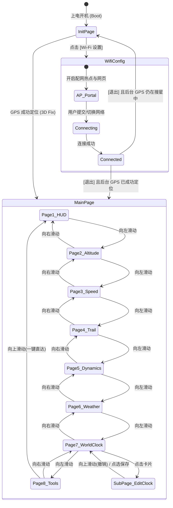

# 产品需求文档 (PRD) - M5Track-M9N 车载高精度轨迹记录仪

---

## 1. 项目背景与目标

车载日常通勤、自驾越野以及摩托车骑行场景中，车主需要一款**启动迅速、定位精准、屏幕直观且易于离线与无线导出**的独立轨迹记录仪。
本项目基于 **M5Stack Core2**（ESP32主控，集成 320x240 LCD 电容屏、AXP192 电源管理、BM8563 RTC）与 **u-blox NEO-M9N**（多星并发高精度 GNSS 模组），打造一款高灵敏度、操作极简的车载数字仪表与轨迹记录器。

### 核心设计目标
1. **秒级开机搜星**：结合 Wi-Fi AGPS 辅助注入与 NTP 时间闭环，解决传统 GPS 模组在楼宇遮挡下冷启动漫长的问题。
2. **纯粹车载交互**：物理接口向下利于走线，全黑极客夜视主题，左右滑动手势流畅切换核心仪表信息。
3. **安全闭环免维护**：点火自启、动静自适应录制、断电 10 秒倒计时保存关机，无需人工反复操作。

---

## 2. 核心用户角色与典型用例

### 用户角色：车载/骑行驾驶者 (Driver)
- **用例 1 (日常通勤点火即走)**：上车通电，设备自动开机，若有已知 Wi-Fi（如手机热点）自动秒连并拉取 AGPS 辅助数据，数秒内完成定位并自动跳转至黑色大字车速仪表盘。车开动后自动在 TF 卡生成 GPX 轨迹。
- **用例 2 (Wi-Fi 首次配网)**：首次使用或更换热点时，在搜星初始化页点击 [Wi-Fi 设置]，手机连接临时热点并自动弹出配网页，输入车载热点密码保存。若此时后台 GPS 已定好位，保存退出后直接进入正式仪表盘。
- **用例 3 (轨迹复盘与无线导出)**：停车到达目的地或周末自驾归来，手机连接同个局域网，浏览器访问设备 IP 即可直接查看并一键下载 `.gpx` 文件，无需拔出 TF 卡。
- **用例 4 (熄火安全关机)**：车辆熄火或拔掉 Type-C 电源线，设备感知供电断开，屏幕显示 10 秒安全关机倒计时，完整保存当次轨迹文件后软关机，防止文件损坏。

---

## 3. 功能需求详细说明与验收标准

### 3.1 屏幕方向、纯黑主题与全屏常驻电池自适应状态栏 (Theme, Viewport & Status Bar)
- **横屏车载视野与接口朝向**：
  - 屏幕驱动采用 `setRotation(1)`（标准横屏 320x240）；
  - Type-C 供电线位于机身左侧（便于从中控台或 A 柱隐蔽布线走线）；
  - 高频外置有源天线 SMA 接口位于机身右侧，垂直引出直通前挡风玻璃吸盘天线；
  - 实体电源键 `BtnPWR` 位于机身左侧；若安装 Base Dual 16340 底座，其侧面带有机械滑动硬件电源开关。
- **纯黑沉浸式夜视界面规范 (Pure Dark Dashboard Theme)**：
  - 全系统背景强制纯黑（RGB565: `#000000` / `TFT_BLACK`），夜间行车零刺眼眩光；
  - 前景读数采用高对比度荧光青绿（`#00FFAA`）、竞速荧光黄（`#FFD700`）与纯白（`#FFFFFF`）；
  - 告警元素采用醒目琥珀橙（`#FFA500`）与警示红（`#FF3B30`）。
- **状态栏三段式全屏常驻自适应架构 (Adaptive Tri-Zone Top Status Bar)**：
  - 高度 24px (`X: 0~319, Y: 0~23`)，常驻浮现在所有主页面顶部：
    1. **左侧时间与直达热区 (`X: 0~95, Y: 0~23`)**：
       - 24 小时制精确时分秒 (`HH:mm:ss`)；
       - 全局触控热区（`X: 0~95, Y: 0~29`），任意页面点击直接跳转至 **Page 7（世界时钟页）**。
    2. **中央车机状态与电池电量自适应区 (`X: 96~225, Y: 0~23`)**：
       - **🛰️ GNSS 信号徽章**：搜星黄色呼吸小圆点（如 `🛰️ 4`）/ 3D 定位纯绿高亮点（如 `🛰️ 22`）/ 隧道推算 `DR` / 故障闪红；
       - **📶 Wi-Fi 状态图标**：未连隐形 / 连接中水波微动 / 已连青蓝信号弧线 / AP配网模式洋红胶囊；
       - **🔋/🪫 全屏常驻电池电量显示 (自适应即插即用)**：
         - **无底座/无电池时（阶段一）**：显示空电池框 `🪫 0%` 或虚线空标，清晰标识当前由外部 USB 直供，无内置电池；
         - **装上底座时（阶段二）**：**无需重新烧录固件**，开机或热插拔时底层自动检测到 INA226 (`0x45`) 与电池电压，电量图标立即平滑点亮，显示真实电池电量格与百分比（如 `🔋 85%`）；接入 USB 充电时呈现动态闪电 `⚡ 85%`。
    3. **右侧温湿度与直达热区 (`X: 226~319, Y: 0~23`)**：
       - 基于 GPS 坐标反查的当地实时温湿度（如 `25.6°C 58%`，离线显示 `--°C --%`）；
       - 全局触控热区（`X: 226~319, Y: 0~29`），任意页面点击直接跳转至 **Page 6（天气预报页）**。
- **全画幅主内容安全视口升级 (Full-Width 320px Safe Content Area)**：
  - **区域范围：`X: 0 ~ 319` (全宽 320px), `Y: 24 ~ 239` (高度 216px)**。
  - 子页面 BasePage 统一设置 `setClipRect(0, 24, 320, 216)`，左右不设多余黑边，所有图表与大卡片完全独占 320 像素宽绰空间。
- **悬浮式自动隐藏页面指示点 (Floating OSD Indicator)**：
  - 8 个小圆点作为悬浮 HUD 浮层覆盖在安全区底部中央（`Y: 228~235`）；
  - 滑动切页时唤醒浮现 3 秒，3 秒静止无操作后彻底隐形。
- **验收标准 (Acceptance Criteria)**：
  - [ ] 屏幕以 320x240 横屏正常正向显示，文字无镜像倒置，触摸坐标完全精准对应。
  - [ ] 屏幕两侧不再绘制 8px 信号竖条，安全视口占据完整 320px 宽度。
  - [ ] 顶部状态栏中央微型图标随 GPS 搜星/3D锁定/隧道DR模式及 Wi-Fi 信号强度精准动态更新；常驻呈现电池图标与真实/空电状态。
  - [ ] 所有子页面元素均被严格约束在安全视口 `X: 0~319, Y: 24~239` 内，绝不侵入顶部状态栏。

---

### 3.2 页面流转与生命周期系统 (Page Lifecycle)



#### 3.2.1 初始化等待页 (Init Page)
- **展示内容与硬件自检**：
  - 硬件自检状态图标（SD卡挂载状态、NEO-M9N 串口通信状态）。
  - **TF 卡格式不兼容自动提示与格式化**：若开机自检检测到 TF 卡格式不兼容（非 FAT32、exFAT/NTFS 或文件系统损坏），屏幕**自动弹出提示弹窗**（“TF 卡格式不兼容，是否立即格式化为标准格式？[取消] / [确认格式化]”）。用户点击确认后直接在机内将其快速格式化为标准 FAT32，自动重建 `/tracks/` 目录并挂载，无需车主拔卡到电脑操作。
  - GPS 搜星状态：当前可见卫星数（GPS/北斗/GLONASS/Galileo 合计与分类）、定位状态（No Fix / Searching）、HDOP 指标、雷达旋转或脉冲搜星动效。
  - 屏幕右上角或中下部提供醒目的 **[Wi-Fi 设置]** 触摸按钮。
- **流转行为**：
  - 一旦 GPS 成功获取有效定位（3D Fix 且可用星数 $\ge 4$），**无需用户点击，自动平滑切入正式页面**。

#### 3.2.2 Wi-Fi 设置页面 (Wi-Fi Config)
- **交互方式**：
  - 点击 [Wi-Fi 设置] 后进入该页，Core2 启动配网 SoftAP（SSID: `M5Track-Setup`），并在屏幕中央显示连接提示与 IP 地址（或直连二维码）。
  - 手机连接该热点，自动弹出配网 Web 页面（Captive Portal）。
  - 用户可在手机端：扫描可用网络、输入密码连接、查看已保存历史 Wi-Fi 列表、一键删除指定 Wi-Fi。
- **自动退出与回跳规则**：
  - 当 Wi-Fi 连接成功后，设备自动关闭配网热点并执行退出逻辑：
    - **分支 1（GPS 已就绪）**：若在配网期间后台 GPS 已成功实现 3D Fix 定位，直接进入 **正式页面**。
    - **分支 2（GPS 仍未就绪）**：若后台 GPS 仍在搜星中，退回到 **初始化等待页** 继续搜星。

---

### 3.3 正式多页面系统 (Main Multi-Page System)
- **手势与切换交互**：在屏幕任意区域向左滑动切换至下一页，向右滑动切换至上一页；屏幕底部浮动小圆点指示当前所处页码（切页时显示，**3 秒无操作自动隐藏**）。

#### 页面 1：核心驾驶仪表盘 (Dashboard HUD - 左右双仪表面板)
```text
+----------------------------------------------------------------------+
| 14:35:28 (24H)   [🛰️22 3D] [📶4格] [🪫0%/🔋85%]       24.5°C 58%    | <- 顶部状态栏(Y:0~23)
+----------------------------------------------------------------------+
|       [左半区: 圆形罗盘表盘]      |       [右半区: 实时大字车速]     |
|              ..---..              |                                  |
|            /    N    \            |               108                | <- 点击跳Page 3
|           |  W  ▲  E  |           |              km/h                |
|            \    S    /            |          [ 🛰️18颗 3D Fix ]       |
|              ''---''              |                                  |
|             185°  S               |                                  |
|-----------------------------------+----------------------------------|
|      [海拔卡片 - 点击跳Page 2]     |   [本次里程 - 长按2秒全链路归零]  |
|            ALT 128 m              |            TRIP 24.6 km          |
+----------------------------------------------------------------------+
|                         ● ○ ○ ○ ○ ○ ○ ○                              | <- 浮动指示点(3s自动隐藏)
+----------------------------------------------------------------------+
```
- **视觉重心与布局**（在 320x216 全宽安全视口内采用左右黄金比例排布，纯黑底色，时间已常驻顶部状态栏）：
  - **左半区 · 动态圆形罗盘仪表 (Circular Compass Dial)**：
    - 精致的圆形罗盘表盘（直径约 96px，居中于 `X: 8~136` 区间），外圈标注 N / S / E / W 刻度与角度标线。
    - 动态旋转指北针/航向指针，表盘中央或正下方清晰标注数字航向与方位（如 `185° S`）。
  - **右半区 · 适中醒目车速仪表 (Balanced Speedometer - 支持点击跳转)**：
    - 适度缩减车速字号至协调的 44pt~48pt 发光青/绿色数字（如 `108`，居中于 `X: 140~312` 区间），右侧紧随 `km/h`。**点击车速区域可直接快速跳转至页面 3（车速详情页）**。
    - 右上角保留精致矢量卫星小图标与捕获星数（如 `🛰️ 18`，3D Fix 常亮绿）。
  - **下半部 · 辅助行车数据栏 (Bottom Infobar)**：
    - **当前海拔 (Altitude - 支持点击跳转)**：显示如 `ALT 128 m`，**点击该区域可直接快速跳转至页面 2（海拔高度详情页）**。
    - **本次里程 (Trip - 支持长按清零)**：
      - 显示格式如 `TRIP 24.6 km`；
      - **长按 2 秒全链路行程数据同步归零 (Full Trip Sync Reset)**：
      - 在 Page 1 右下角里程卡片区域（`X: 160~312, Y: 180~230`）持续长按 2 秒，触发机身马达短震（100ms）触觉确认，屏幕中央浮现 `[ ✅ 行程数据已全链路重置 (TRIP Reset) ]`；
      - **全页面联动清零与重新统计规范**：
        1. **Page 1（仪表盘）**：`TRIP` 里程归零为 `0.0 km`，行驶总时长归零，平均时速重置；
        2. **Page 2（海拔高度页）**：【最高海拔 ▲】与【最低海拔 ▼】极值重置为当前实际海拔，【累计爬升】归零，过去 1 小时海拔变化折线图清空历史采样，以当前高度为起点重新开始画线统计；
        3. **Page 3（车速详情页）**：【最高时速 ▲ MAX】与【平均时速 AVG】重置为当前车速，过去 1 小时车速变化折线图清空历史采样，重新开始记录并绘制；
        4. **Page 4（矢量轨迹返航页）**：清空 PSRAM 中已绘制的历史面包屑轨迹点，**将车辆当前位置重新锚定为新的「航程起点（Green Flag 绿旗）」**，【距起点直线距离】重置为 `0.0 km`，重新开始画线铺满；
        5. **Page 5（动态姿态页）**：本次行程【峰值横向 G】与【峰值纵向 G】重置归零；
        6. **TF 卡 GPX 轨迹流**：若正在记录，立即向双文件写入 `</trkseg><trkseg>` 开启全新独立轨迹段；
      - 行车中单手盲操极度便捷，且与全屏其他区域长按（标记 POI 路点）互不冲突。
    - 底部中央悬浮 8 个页面指示小圆点（切页浮现 3 秒后隐形）。

#### 页面 2：海拔高度变化曲线与极值详情页 (Altitude Profile Page)
```text
+----------------------------------------------------------------------+
| 14:35:28 (24H)   [🛰️22 3D] [📶4格] [🪫0%/🔋85%]       24.5°C 58%    | <- 顶部状态栏
+----------------------------------------------------------------------+
| CURRENT ALTITUDE                    ▲ 累计爬升: +420m                |
|          856 m (米级平滑定高)                                        |
|----------------------------------------------------------------------|
| [过去 1 小时海拔变化折线图 - 有效宽 308px]                           |
| 1200m|                                                               |
|      |                  /\_/\                                       |
|  800m|        _/\      /     \                                       |
|      |       /   \__  /       \                                      |
|  400m|______/       \/         \                                     |
|      +-------------------------------------------------------        |
|      -60m                   -30m                            Now      |
|----------------------------------------------------------------------|
|  ▲ 最高海拔: 928 m                  |  ▼ 最低海拔: 112 m             |
+----------------------------------------------------------------------+
|                         ○ ● ○ ○ ○ ○ ○ ○                              | <- 浮动指示点
+----------------------------------------------------------------------+
```
- **进入方式**：
  - 手势切换：在页面 1 向左滑动或在后续页面向右滑动进入。
  - **热区直达**：在页面 1 直接点击【当前海拔】数据卡片直接切入。
- **展示内容与布局规划**（纯黑底色，320x216 全宽视口）：
  - **当前实时海拔**：顶部大字号突出呈现当前实时海拔值（如 `128 m`），发光青/绿色。
  - **最近 1 小时高度变化折线图 (1-Hour Altitude Profile Chart)**：
    - 横轴（时间）：覆盖过去 60 分钟（采样频率如每 30 秒 1 点，环形缓冲区缓存 120 点），有效图表宽度扩展至 **308px**，标有 `-60m`、`-30m`、`Now`。
    - 纵轴（高度）：根据这 1 小时内的最低与最高高度动态自适应拉伸比例尺。
    - 曲线呈现：发光曲线平滑连接各高度点，线下带有浅淡半透明网格线与微弱渐变光晕，直观体现翻山越岭的高程走势。
  - **本次行程高程极值卡片 (Extremes Bar)**：
    - 底部左右并列：
      - **最高海拔 (Max Alt)**：如 `▲ 856 m`（红色/暖橙高光标注）。
      - **最低海拔 (Min Alt)**：如 `▼ 12 m`（蓝色/冷色标注）。

#### 页面 3：车速变化曲线与极速详情页 (Speed Profile Page)
```text
+----------------------------------------------------------------------+
| 14:35:28 (24H)   [🛰️22 3D] [📶4格] [🪫0%/🔋85%]       24.5°C 58%    | <- 顶部状态栏
+----------------------------------------------------------------------+
| CURRENT SPEED                                                        |
|          108 km/h                                                    |
|----------------------------------------------------------------------|
| [过去 1 小时车速变化折线图 - 120点环形采样]                          |
|120km |                   _/\_                                        |
|      |                  /    \     __/\_                             |
| 80km |          _/\    /      \___/     \                            |
|      |         /   \  /                                              |
|  0km |________/     \/                                               |
|      +-------------------------------------------------------        |
|      -60m                   -30m                            Now      |
|----------------------------------------------------------------------|
|  ▲ 最高时速: 126 km/h (MAX)         |  平均时速: 68 km/h (AVG)       |
+----------------------------------------------------------------------+
|                         ○ ○ ● ○ ○ ○ ○ ○                              | <- 浮动指示点
+----------------------------------------------------------------------+
```
- **进入方式**：
  - 手势切换：在页面 2 向左滑动或在页面 4 向右滑动进入。
  - **热区直达**：在页面 1 直接点击【实时车速】区域直接切入。
- **展示内容与布局规划**（纯黑底色，320x216 全宽视口）：
  - **当前实时车速**：顶部大字号突出呈现当前实时车速值（如 `108 km/h`），发光青/绿色。
  - **最近 1 小时车速变化折线图 (1-Hour Speed Profile Chart)**：
    - 横轴（时间）：覆盖过去 60 分钟（采样频率如每 30 秒 1 点，环形缓冲区缓存 120 点），有效图表宽度扩展至 **308px**，标有 `-60m`、`-30m`、`Now`。
    - 纵轴（车速）：依据这 1 小时内最高车速自适应拉伸比例尺（如 0 ~ 140 km/h）。
    - 曲线呈现：发光折线展现车辆巡航、急加速、缓行减速等动态。
  - **本次行程极速卡片 (Speed Extremes)**：
    - **最高时速 (Max Speed)**：醒目展示本次行程最高峰值速度（如 `▲ MAX: 126 km/h`，暖橙/高亮红）。
    - **极简设计约束**：**严格不显示最低时速**（停车即为 0，无实际参考价值），可并列展示本次行程平均车速（如 `AVG: 58.4 km/h`）保持视觉平衡。

#### 页面 4：轻量矢量面包屑自驾轨迹与返航地图 (Breadcrumb Vector Trail Map)
```text
+----------------------------------------------------------------------+
| 14:35:28 (24H)   [🛰️22 3D] [📶4格] [🪫0%/🔋85%]       24.5°C 58%    | <- 顶部状态栏
+----------------------------------------------------------------------+
| [轻量矢量自驾轨迹与返航地图]              [ ⛶ 远景全貌 / 5km跟随 🔄 ]  | <- 点击切模式
|                                          [ 🚩 距起点: 38.5km ↗12° ]  |
|          🚩 起点 (Start)                                             |
|           \                                                         |
|            \__    __..----..                                         |
|               \  /          \                                        |
|                \/            \___                                   |
|                                  \                                   |
|                                   ▲ 当前车位 (Heading 185°)          |
|----------------------------------------------------------------------|
| 状态: GPS 3D 定位良好 (HDOP 0.8)        | 驻留 PSRAM 航点: 142/800   |
+----------------------------------------------------------------------+
|                         ○ ○ ○ ● ○ ○ ○ ○                              | <- 浮动指示点
+----------------------------------------------------------------------+
```
- **进入方式**：手势左右滑动（在页面 3 向左滑动，或在页面 5 向右滑动进入）。
- **设计目标**：无需下载笨重耗时的外部瓦片栅格地图，基于纯矢量算法在全屏黑底上绘制本次自驾完整轨迹，提供直观的路线拓扑轮廓与一键返航指引。
- **展示内容与布局规划**（纯黑底色，320x216 全宽视口）：
  - **动态矢量自适应折线画布 (Vector Trail Canvas)**：
    - 在 PSRAM 中维护本次行程的航迹点链表（经 Douglas-Peucker 空间自适应抽稀，最多缓存 1000 个关键拐点）。
  - **动态双模自适应缩放机制 (Dual-Scale Adaptive Zooming)**：
    - **模态 A · 远景全路径贴合模式 (Fit Entire Path - 恰好显示整个路径)**：
      - 系统实时提取本次行程所有航迹点的经纬度极值（`minLat, maxLat, minLon, maxLon`），自动计算最小外接矩形（Bounding Box）。
      - 保留四周 5% 视口安全边缘内边距，**恰好将从起点到当前车位的整条长途自驾路径（即使长达数百上千公里）完整贴合铺满整个 320x216 屏幕**，无任何裁切或多余空白，完整呈现壮阔的跨区域宏观地理轨迹。
    - **模态 B · 近景动态巡航跟随模式 (Follow Vehicle - 5km/10km 弯道视窗)**：
      - 以车身当前位置为视口中心，覆盖半径 5km（高速时随车速扩展至 10km）高放大倍率局部视窗。
      - 清晰放大展现眼前 1~2 公里内的立交桥匝道分叉、公路急弯与缓弯，车头箭头顺应转弯实时偏转，弯道预见性极佳。
    - **一键丝滑切换**：
      - 点击屏幕右上角切换按钮（或轻触地图空白区域），在**【远景·整径贴合】**与**【近景·弯道跟随】**之间瞬间平滑切换。
  - **关键地标与图元**：
    - **起点标 (Start Pin)**：醒目绿色圆点或小旗 `🟢 START`。
    - **当前车位与航向**：发光三角箭头 `▲`，箭头随 BMM150 地磁罗盘与 GNSS 实时航向 360 度平滑旋转。
    - **途经路点 (POI Markers)**：若自驾途中在屏幕长按标记了特异兴趣点，折线上呈现黄色路点标记 `🚩`。
  - **返航与距离信息 HUD (Return-to-Start HUD)**：
    - 顶部/底部半透明悬浮卡片：
      - 直线距起点：大字显示如 `距起点: 382.4 km`；
      - 起点相对方位：小罗盘指针指向起点真实方位；
      - 本次轨迹总长：如 `轨迹: 415.6 km`。

#### 页面 5：车辆动态 G 值圆与姿态倾角/坡度水平仪 (Vehicle Dynamics & Inclinometer)
```text
+----------------------------------------------------------------------+
| 14:35:28 (24H)   [🛰️22 3D] [📶4格] [🪫0%/🔋85%]       24.5°C 58%    | <- 顶部状态栏
+----------------------------------------------------------------------+
|       [左半区: G-Force 摩擦力靶图]  |       [右半区: 坡度与车身姿态]  |
|                 +制动               |                                |
|                 |                   |  道路坡度:   +7.5 % [陡坡警告] |
|             .---+---.               |                                |
|        -左转|   *   | +右转         |  车身俯仰:   +3.2° (抬头/下压) |
|             '---+---'               |  车身侧倾:   -1.8° (左倾/右倾) |
|                 |                   |                                |
|                 -加速               |  静态死区防漂: ACTIVE (锁定)    |
|      当前合成 G 值: 0.42 G          |  融合模式: GNSS + BMP280 气压  |
|  横向峰值: 0.65G | 纵向峰值: 0.52G  |                                |
+----------------------------------------------------------------------+
|                         ○ ○ ○ ○ ● ○ ○ ○                              | <- 浮动指示点
+----------------------------------------------------------------------+
```
- **进入方式**：手势左右滑动（在页面 4 向左滑动，或在页面 6 向右滑动进入）。
- **设计目标**：100% 榨干板载 BMI270 6 轴高精惯导与 BMP280 气压计，为跑山劈弯、激烈驾驶与越野爬坡提供专业赛车级动态姿态反馈。
- **展示内容与布局规划**（纯黑底色，320x216 全宽视口，左右对称）：
  - **左半区 · 动态 G-Force 摩擦力圆 (Friction Circle)**：
    - 精致的坐标圆形靶图（半径约 45px，中心原点 `(0, 0)`，外圆对应 `1.0G`，内虚线对应 `0.5G`）。
    - 发光小红点随车辆实时加速度矢量在圆内极速游走（纵轴加减速推背/刹车 G，横轴左右变道过弯离心 G）。
    - 动态数值：当前合成总 G 值 $G_{\text{total}} = \sqrt{G_x^2 + G_y^2}$（大字呈现，如 `0.85 G`）。
    - 极值记忆：底部标出本次行程 **峰值横向 G**（如 `▲ LAT: 0.92 G` 记录极限过弯）与 **峰值纵向 G**（如 `▲ LON: 0.78 G` 记录急加速推背）。
  - **右半区 · 越野姿态水平仪与实时道路坡度 (Inclinometer & Grade %)**：
    - **道路坡度指示**：结合气压计高灵敏度高程差与 GNSS 位移，实时计算并大字显示当前道路真实坡度百分比（如 `+7.5% 陡坡`，带上下坡彩色矢量箭头）。
    - **车身俯仰角 (Pitch)**：显示车头前倾/后仰角度（$\pm 45^\circ$，如 `俯仰: +4.2°`，配合微型小车侧视动态图标）。
    - **车身侧倾角 (Roll)**：显示车身左侧倾/右侧倾角度（$\pm 45^\circ$，如 `侧倾: -1.8°`，配合微型小车后视动态图标）。

#### 页面 6：当前位置小时级天气预报页 (Hourly Weather Forecast Page)
```text
+----------------------------------------------------------------------+
| 14:35:28 (24H)   [🛰️22 3D] [📶4格] [🪫0%/🔋85%]       24.5°C 58%    | <- 顶部状态栏
+----------------------------------------------------------------------+
| ☀️ 晴转多云   24.5 °C                时段胶囊: [1/3] 15:00-22:00 ↕️   | <- 上下滑动切时段
| 体感 23°C | 湿度 52% | 东北风 3级 14km/h                             |
|----------------------------------------------------------------------|
| 15:00 16:00 17:00 18:00 19:00 20:00 21:00 22:00 (每小时槽宽 38px)    |
|   ☀️    ⛅    ⛅    🌧️    🌧️    ⛅    🌙    🌙  <- 天气图标        |
|  25°   24°   23°   20°   19°   18°   17°   16° <- 温度折线点      |
|  ---.     .----.     .---.                                           |
|      \   /      \   /     \                                         |
|       \_/        \_/       \_____                                    |
| [降水概率柱状条]                                                     |
|       10%   30%   75%   80%   20%    0%    0%  (>50%深蓝报警)    |
|  ■     ■     ■     █     █     ■                                     |
|----------------------------------------------------------------------|
| ⚠️ 预计 1.5小时后 (17:00) 开始有雨 (概率 75%)，请开启雨刮            |
+----------------------------------------------------------------------+
|                         ○ ○ ○ ○ ○ ● ○ ○                              | <- 浮动指示点
+----------------------------------------------------------------------+
```
- **进入方式**：
  - 手势左右滑动（在页面 5 向左滑动，或在页面 7 向右滑动进入）；
  - **顶部温湿度热区直达**：在任意页面的顶部状态栏点击右半侧实时温湿度（`X: 140~319, Y: 0~30`），秒级一键直达本天气预报页！
- **设计目标**：利用 GNSS 经纬度位置精准反查未来 24 小时逐小时气象走势（温度、降水概率、天气现象、风向风速），提供长途自驾降雨与能见度预警。
- **上下滑动切换时间段机制 (Swipe Up/Down Period Browsing)**：
  - **时段切片架构（兼顾高清呈现与 24 小时全景）**：若一次性在 320px 挤压 24 小时会导致每小时宽度仅 13px 严重遮挡。因此将 24 小时划分为 **3 个 8 小时黄金展示时段**（每小时享有宽达 38px 的充裕像素空间，折线温度与降水柱状条极其精致清晰）：
    - **时段 1（当前时段 · 0~8h）**：如 `15:00 ~ 22:00`（当前至傍晚）；
    - **时段 2（夜间时段 · 8~16h）**：如 `23:00 ~ 次日 06:00`（今晚至明晨）；
    - **时段 3（明日时段 · 16~24h）**：如 `次日 07:00 ~ 14:00`（明日日间）。
  - **手势交互**：
    - **手指向上滑动 (Swipe Up)**：平滑切入 **下一个时间段**（如从当前时段切至今晚夜间时段）；
    - **手指向下滑动 (Swipe Down)**：平滑回切至 **上一个时间段**；
    - **左右滑动手势**：依然维持同级切页（向左切 Page 7 世界时钟，向右切 Page 5 姿态仪）。
    - 右上角配备高对比度时段胶囊标签（如 `[1/3] 15:00-22:00`），上下翻切时带流畅垂直缓动过渡动效。
- **展示内容与布局规划**（纯黑底色，320x216 全宽视口）：
  - **顶部宏观概览栏 (Current Weather Banner)**：
    - 当前天气大图标（☀️ 晴 / ⛅ 多云 / 🌧️ 小雨 / ⛈️ 雷暴）与实时气温（大字 32pt 荧光黄/白色，如 `24.5°C`）。
    - 体感温度、相对湿度（`52%`）、当前风向与风速（如 `东北风 3级 14km/h`）。
    - 右上角显示当前所在时段胶囊及上下翻动提示：`[1/3] 15:00-22:00 ↕️`。
  - **中部逐小时气象与降水预报折线/柱状条 (8-Hour Window Forecast Chart)**：
    - 横向均分 8 个小时插槽（每槽 38px，间距分明）。
    - **逐小时温度走势曲线**：发光渐变温度折线，点位标注清晰温度数字（如 `25°`, `23°`, `20°`）。
    - **逐小时降水概率柱状条 (Precipitation Probability %)**：底部以高亮浅蓝柱状直观体现每小时降水概率（如 `0%`, `30%`, `80%`，降水概率 $>50\%$ 时柱状变深蓝报警）。
    - 每小时顶部配有微型天气现象矢量图标（☀️, ⛅, 🌧️, 🌩️）。
  - **底部行车预警与缓存提示栏 (Driving Weather Advice)**：
    - **降水前瞻预警**：如 `⚠️ 预计 17:00 (1.5小时后) 开始有雨 (概率 75%)，请开启雨刮并减速`。
    - **离线缓存有效性**：Wi-Fi 连接时后台自动静默拉取并缓存在 PSRAM/NVS 中，断网离线时依然可全天候稳定查看未来 24 小时小时级天气预报，标注：`更新于: 14:10 (离线缓存)`。

#### 页面 7：多时区世界时钟页 (World Clock Page - 2×2 四宫格卡片仪表)
```text
+----------------------------------------------------------------------+
| 14:35:28 (24H)   [🛰️22 3D] [📶4格] [🪫0%/🔋85%]       24.5°C 58%    | <- 顶部状态栏
+----------------------------------------------------------------------+
| [多时区世界时钟 - 2×2 四宫格卡片仪表，单点任意卡片直接唤起修改]       |
| +------------------------------+----------------------------------+  |
| | 📍 北京 Beijing (UTC+8)      | 🌐 世界标准时 UTC (UTC+0)        |  |
| |       14:35:28 ☀️            |       06:35:28 ☀️                |  |
| | 10月28日 星期二  [本地基准]   | 时差: 比本地慢 8 小时            |  |
| +------------------------------+----------------------------------+  |
| | 🌐 纽约 New York (EDT-4)     | 🌐 东京 Tokyo (UTC+9)            |  |
| |       02:35:28 🌙            |       15:35:28 ☀️                |  |
| | [夏令时] 比本地慢 12 小时    | 时差: 比本地快 1 小时            |  |
| +------------------------------+----------------------------------+  |
| 提示: 单击卡片修改时区城市 | 向上滑动 Swipe Up 快捷返回主仪表盘       |
+----------------------------------------------------------------------+
|                         ○ ○ ○ ○ ○ ○ ● ○                              | <- 浮动指示点
+----------------------------------------------------------------------+
```
- **进入方式**：
  - 手势左右滑动（在页面 6 向左滑动，或在页面 8 向右滑动进入）；
  - **顶部时间热区直达**：在任意页面的顶部状态栏点击左半侧实时时间（`X: 0~139, Y: 0~30`），秒级一键直达本世界时钟页！
- **设计目标**：针对跨时区自驾长途旅行、跨国商务通勤及天文/航海爱好者，提供直观清晰的全球主要时区对照。在行车视线下一览无余免翻页。
- **2 × 2 四宫格卡片布局规划**（纯黑底色，320x216 全宽视口，4 张对称独立卡片，每张 `152 × 98 像素`，间距 12px，带微弱发光边框）：
  1. **本地时间卡片 (Local Time - 左上)**：
     - **时区与城市**：自动匹配 GPS 经度自适应时区或用户设定默认时区（如 `北京 Beijing (UTC+8)`）。
     - **时间显示**：大字醒目数字时钟 `HH:mm:ss`（荧光黄/翠绿色，字号 26pt）。
     - **辅助信息**：当前公历月日及星期（如 `10月28日 周二`），右侧配日间/夜间发光图标（☀️ / 🌙），标注 `[本地基准]`。
  2. **协调世界时卡片 (UTC / GMT - 右上)**：
     - **时区与城市**：`世界标准时 UTC / 伦敦 GMT (UTC+0)`。
     - **时间显示**：大字数字时钟 `HH:mm`（冰蓝色，字号 24pt），右侧显示秒跳动冒号。
     - **相对本地时差**：醒目标注相对本地时差（如 `-8 小时`），公历月日，配日月昼夜图标。
  3. **美东时间卡片 (New York - 左下)**：
     - **时区与城市**：`纽约 New York (UTC-5 / EDT-4)`。
     - **夏令时自适应 (DST)**：根据当前系统日期自动切换 EST（冬令时 -5）与 EDT（夏令时 -4），标注 `EDT [夏令时]` 或 `EST`。
     - **时间显示**：大字数字时钟 `HH:mm`（琥珀橙色，字号 24pt）。
     - **相对本地时差**：清晰标明 `比本地慢 12 小时`（或 13 小时），公历月日，配日月昼夜图标。
  4. **欧洲/亚太重点城市卡片 (Tokyo / London - 右下)**：
     - **时区与城市**：默认展示 `东京 Tokyo (UTC+9)`（或用户在设置中自定义为 `伦敦 London`、`悉尼 Sydney` 等）。
     - **时间显示**：大字数字时钟 `HH:mm`（纯白色，字号 24pt）。
     - **相对本地时差**：标注 `比本地快 1 小时`，公历月日，配日月昼夜图标。
- **自定义与时钟精准性**：
  - 世界时钟完全依托系统的双源高精时间引擎（NEO-M9N GPS 毫秒级时标 + ESP32 内部 SNTP/RTC），即使长年离线无 Wi-Fi，各时区换算精度始终保持毫秒级无误差；
  - 4 个卡片配置独立保存在 NVS 存储中（跨开机断电持久化）。
- **点击卡片独立修改与小屏交互优化规范 (Card Tap-to-Edit & Small-Screen UI)**：
```text
+----------------------------------------------------------------------+
| 14:35:28 (24H)   [🛰️22 3D] [📶4格] [🪫0%/🔋85%]       24.5°C 58%    | <- 顶部状态栏
+----------------------------------------------------------------------+
| 修改时钟卡片槽位 #3: 目标城市/时区选择          [ 向上滑动 撤销退出 ] |
|----------------------------------------------------------------------|
| 模式: [ 📍 GPS 经度自动定位 (自适应) ]  |  [ 🌐 预置世界城市列表 ]   | <- 顶部模式胶囊
|----------------------------------------------------------------------|
| 区域标签: [ 亚太/国内 ]  [ 美洲地区 ]  [ 欧洲/中东 ]  [ 标准/UTC ]   | <- 28px 分类标签
|----------------------------------------------------------------------|
| [ 38px 大热区免打字点选列表 - 单击即存并返回，上下滑动滚动浏览 ]     |
|   纽约 New York (UTC-5/EDT-4)        即时预览: 02:35 🌙  [当前选中] |
|   洛杉矶/旧金山 (UTC-8/PDT-7)        即时预览: 23:35 🌙             |
|   芝加哥 Chicago (UTC-6/CDT-5)       即时预览: 01:35 🌙             |
|   温哥华 Vancouver (UTC-8/PDT-7)     即时预览: 23:35 🌙             |
+----------------------------------------------------------------------+
```
  - **卡片触控触发**：在 2×2 网格中单点任意一个时区卡片，立即滑入独立的「时钟槽位编辑页面」（`320x216` 全宽安全视口，纯黑底色）。
  - **顶部双模式切换胶囊 (Mode Switcher)**：
    - 屏幕顶部排布两个高对比度大触控胶囊：`[ 📍 GPS 自动定位 ]` 与 `[ 🌐 预置世界城市 ]`。
    - **模式 ①：GPS 自动定位 (Auto GPS Timezone)**：
      - 单击 `[ 📍 GPS 自动定位 ]`，系统立即将当前卡片锁定为根据当前大地经度动态计算：$\text{UTC Offset} = \text{round}(\text{Lon} / 15^\circ)$。
      - 针对长途跨省/跨国自驾（如从华东行驶至新疆中亚、或东南亚自驾出境），时钟自动跟随车轮随地随变，卡片标注 `📍 GPS 自适应` 与当前定位经度时区。
      - 点选后直接闪存持久化并秒级退回 2×2 主页。
    - **模式 ②：小屏免打字世界城市点选 (Category Tabs & Large Item Picker)**：
      - 针对 320x240 车载小屏特化设计，坚决摒弃输入繁琐、极易误触的虚拟软键盘，采用「大类标签 + 大热区卡片流」点选交互：
      - **区域分类大标签条 (Horizontal Tabs, 28px 高度)**：水平排布 4 个大触摸分类标签，单手横切：
        1. `[ 亚太/国内 ]`：包含北京/上海 (UTC+8)、东京 (UTC+9)、首尔 (UTC+9)、悉尼 (UTC+10)、新加坡/香港 (UTC+8)、曼谷 (UTC+7)、迪拜 (UTC+4) 等；
        2. `[ 美洲地区 ]`：包含纽约 (UTC-5/EDT-4)、洛杉矶/旧金山 (UTC-8/PDT-7)、芝加哥 (UTC-6)、温哥华 (UTC-8)、多伦多 (UTC-5)、圣保罗 (UTC-3)、檀香山 (UTC-10) 等；
        3. `[ 欧洲/中东 ]`：包含伦敦 (UTC+0/BST+1)、巴黎/柏林 (UTC+1/CEST+2)、罗马 (UTC+1)、苏黎世 (UTC+1)、莫斯科 (UTC+3) 等；
        4. `[ 标准/UTC ]`：包含世界标准时 UTC (UTC+0)、格林威治 GMT (UTC+0)、国际日期变更线 (UTC+12/UTC-12) 等。
      - **大触控条目列表 (Large Touch Items, 38px 高度)**：
        - 列表项高度宽达 38 像素，行车安全触控无误触；
        - 每行显示：城市中英文名、时区偏移量、夏令时标记，以及**当前即时时间动态预览（如 `04:35`）**与昼夜图标；
        - 支持手指上下顺滑滚动浏览；
        - **点击即保存退出 (Tap to Save)**：单击任意目标城市项，立即将新城市与时区规则保存至 NVS 对应槽位，并平滑退回 2×2 世界时钟主页。
  - **手势返回撤销 (Swipe Up to Cancel)**：
    - 在编辑子页面任意位置**向上滑动 (Swipe Up)**，立即安全关闭编辑页并返回 2×2 主界面，原有配置保持不变。

#### 页面 8（及后续）：动态可扩展工具箱页面 (Tools Box - 4 宫格网格架构)
```text
+----------------------------------------------------------------------+
| 14:35:28 (24H)   [🛰️22 3D] [📶4格] [🪫0%/🔋85%]       24.5°C 58%    | <- 顶部状态栏
+----------------------------------------------------------------------+
| [系统扩展工具箱 - 2×2 网格，每卡 152×98px，向上滑动一键直达主仪表]   |
| +------------------------------+----------------------------------+  |
| | 💾 TF 卡存储管理 (SD Manager)| | 📶 Wi-Fi 网络管理 (WiFi Config)|  |
| | - 格式化 TF 卡 (Format FAT32)| | - 已存已知网络列表查看/删除    |  |
| | - 列出 GPX 轨迹 (W/C双文件)  | | - [+ 增加新 Wi-Fi] (Web配网)   |  |
| | - 开启专属 SoftAP 无线导出   | | - 当前状态: 已连接车机热点     |  |
| +------------------------------+----------------------------------+  |
| | 🛰️ GPS 卫星详情 (GNSS Info)  | | ⚙️ 系统偏好与电量 (Settings)   |  |
| | - 北斗/GPS/GLO/GAL 四星星图  | | - 屏幕背光调节 / 自动息屏阈值  |  |
| | - 经纬度/高程/HDOP精度因子   | | - INA226 能量计量 (电压/电流)  |  |
| | - 各星载噪比 C/N0 动态柱状图 | | - 固件版本与内存 (Free Heap)   |  |
| +------------------------------+----------------------------------+  |
+----------------------------------------------------------------------+
|                         ○ ○ ○ ○ ○ ○ ○ ●                              | <- 浮动指示点
+----------------------------------------------------------------------+
```
- **动态位移与自动延后规则**：
  - 工具箱页面默认位于业务仪表页之后（由于新增了天气预报页与世界时钟页，工具箱页面**自动顺延为第 8 页**）。
  - 若系统后续在前面新增其他独立功能页面，**工具箱页面继续自动顺延后移**，保证主仪表在前、设置工具在后的稳定逻辑。
- **4 宫格布局 (2 × 2 Grid)**（在 320x216 全宽视口内）：
  - 纯黑底色，划分为 4 个对称独立卡片（每张卡片扩宽至 **152 × 98 像素**，间距 12px，带微弱发光边框）。
  - 每个卡片包含：精致矢量图标、功能名称、当前简要状态（如已连接 Wi-Fi 名、文件数等）。
- **多于 4 个工具自动延展分页机制 (Auto-Pagination)**：
  - 工具项采用数据驱动列表管理（`std::vector<ToolItem>`）。
  - **每页固定 4 宫格；若工具数超过 4 个（如拥有 5~8 个工具），系统自动增加第二个工具页（Page 9...）**。
  - 底部悬浮小圆点指示器自动感知总页数并自适应扩展（当前自适应显示 8 个圆点：`○ ○ ○ ○ ○ ○ ○ ●`），支持左右滑动手势流畅翻页。
- **全层级上滑返回手势 (Swipe Up to Return)**：
  - **工具子页面中上滑**：在任意工具的详情/子页面（如 Wi-Fi 设置页、GNSS 星图详情、GPX 列表、系统设置）中，**手指向上滑动 (Swipe Up)**，立即安全关闭子页面，平滑退回上一级 **4 宫格工具箱菜单**。
  - **工具页面中上滑**：在 4 宫格工具箱主页面上，**手指向上滑动 (Swipe Up)**，直接**一键跨页返回 Page 1（驾驶核心主仪表盘）**，免去长距离左右翻页，极致利于车载快速盲归。
- **初始第 1 组 4 宫格默认工具**：
  1. **TF 卡存储管理 (TF Manager - 首个核心工具)**：
     - 点击卡片进入独立的**二级管理菜单**（支持手指**向上滑动 Swipe Up** 退出返回 4 宫格）。
     - **功能 ①：格式化 TF 卡 (Format SD)**：提供一键格式化重置功能，带二次防误触确认弹窗；格式化后自动重新创建标准 `/tracks/` 目录并刷新可用容量。
     - **功能 ②：列出 TF 内容 (List Files)**：文件浏览器界面，按时间倒序列出 `/tracks/` 下所有 GPX 轨迹文件（文件名、大小、创建时间），每条记录醒目展示属性徽章：`W-` 标 `[国际/Google版]`，`C-` 标 `[国内/高德版]`，支持上下滑屏滚动浏览与文件点选。
     - **功能 ③：通过 Wi-Fi 下载 TF 卡文件 (WiFi Download - 仅热点直连模式)**：
       - **纯离线热点直连**：系统**只提供专属 SoftAP 热点模式**，完全脱离外部局域网依赖，在任何户外、越野或车内场景下即连即导。
       - **即开即连**：点击启动独立热点（SSID: `M5Track-Share`，固定 IP: `192.168.4.1`）。屏幕展示热点名与直连访问指引。
       - **一键下载与双坐标系智能分类呈现 (选项 A)**：手机 Wi-Fi 连接该热点后，浏览器访问 `http://192.168.4.1/` 即可直接在线查看轨迹列表，每项醒目标注 `[国际/Google Earth版]` 与 `[国内/高德/两步路版]`，杜绝下错偏置。
       - **即走即关**：手指向上滑动 (Swipe Up) 退出二级菜单时，系统**自动关闭热点**，彻底杜绝电量浪费与安全隐患。
  2. **Wi-Fi 网络管理 (WiFi Manager - 第二核心工具)**：
     - 点击卡片进入独立的**二级管理菜单**（支持手指**向上滑动 Swipe Up** 退出返回 4 宫格）。
     - **功能 ①：现有 Wi-Fi 列表查看 / 删除 (Saved List & Delete)**：
       - 列表形式罗列 NVS 中已存储的所有已知网络（最多 5 组），当前正在连接的网络以发光绿及“已连”高亮展示。
       - 每个 Wi-Fi 项右侧提供醒目的 **[删除 / 🗑️]** 触摸按钮，点击并确认后立即从 NVS 擦除，不再自动重连。
     - **功能 ②：增加 Wi-Fi (Add Wi-Fi)**：
       - 界面提供醒目的 **[+ 增加新 Wi-Fi]** 按钮。
       - 点击后启动方案 A 配网热点（SSID: `M5Track-Setup`，IP: `192.168.4.1`），屏幕提示扫码或手机直连。
       - 手机连接热点后自动弹出配网页，扫描周围网络并输入密码提交；Core2 收到凭证后自动写入 NVS，关闭热点并刷新已存 Wi-Fi 列表。
  3. **GPS 信息查看 (GPS Info - 第三核心工具)**：
     - 点击卡片进入独立的**二级详情页面**（支持手指**向上滑动 Swipe Up** 退出返回 4 宫格）。
     - **全景展示当前 GPS 工作状况**：
       - **定位状态与类型**：当前 Fix 类型（No Fix / 2D Fix / 3D Fix / GNSS+DR）及是否有效。
       - **原始大地坐标**：高精度经纬度坐标（纬度 Lat、经度 Lon，如 `31.230416° N, 121.473701° E`）与椭球海拔高。
       - **多星系统分布**：北斗 (BDS)、GPS、GLONASS、Galileo 四大星座各自捕获卫星数统计。
       - **精度因子指标**：水平精度因子 (HDOP)、空间几何精度 (PDOP) 及垂直精度 (VDOP) 数值。
       - **卫星信号质量 (C/N0) 星图柱状图**：动态垂直柱状图展示各卫星载噪比（dBHz），高对比度直观呈现当前空旷遮挡程度。
  4. **系统设置 (System Settings - 第四核心工具)**：
     - 点击卡片进入独立的**二级设置页面**（支持手指**向上滑动 Swipe Up** 退出返回 4 宫格）。
     - **核心设置项**：
       - **屏幕背光亮度**：触摸调节背光亮度（0~255），实时生效并保存至 NVS。
       - **自动录制偏好**：开启/关闭车速 > 3km/h 自动触发 GPX 录制。
       - **设备信息与关于**：展示固件版本号（v1.0.0）、ESP32 芯片信息与运行内存 (Free Heap) 状态。

---

### 3.4 双源自适应时钟引擎 (Dual-Source Time Engine)
- **授时逻辑与优先级**：
  1. **Wi-Fi 通、GPS 未定位时**：
     - 自动向 NTP 服务器（如 `ntp.aliyun.com` / `pool.ntp.org`）请求 UTC 时间。
     - 校准 Core2 的内置硬件 RTC 芯片（BM8563）。
     - **闭环反哺**：将获得的 UTC 时间打包为 `UBX-MGA-INI-TIME_UTC` 报文，通过串口直接下发给 NEO-M9N，解决 GNSS 模组时间偏差导致的搜星缓慢问题！
  2. **GPS 成功定位时**：
     - 以 NEO-M9N 纳秒级原子钟授时为最高优先级，覆写并刷新系统时间与硬件 RTC。
     - 根据经纬度经度值自动计算/校准当地时区（每 $15^\circ$ 对应 1 个时区，如东经 $112.5^\circ \sim 127.5^\circ$ 自动确认 UTC+8）。

---

### 3.5 u-blox AGPS (AssistNow) 极速搜星联动
- **工作机制**：
  - 当设备成功连接 Wi-Fi 且检测到 NEO-M9N 处于冷启动或搜星阶段时，后台异步任务从 u-blox AssistNow Online 服务（或预配置网关）拉取星历（Ephemeris）与历书（Almanac）数据包。
  - 驱动层通过串口以 UBX-MGA 二进制协议分块注入 NEO-M9N。
  - 验收指标：在开阔或半开阔环境下，Wi-Fi 辅助注入后 **TTFF（首次定位时间）应低于 5 秒**。

---

### 3.6 Wi-Fi 凭证管理 (Multi-SSID)
- **功能点**：
  - **多配置存储**：在 ESP32 NVS (Preferences) 中最多存储 5 组常用的 SSID 与密码。
  - **自动漫游重连**：开机自检阶段或网络意外断开时，系统后台扫描并按历史信号优先级自动尝试重连已知热点。
  - **Web 管理界面**：配网网页中包含“已保存 Wi-Fi 清单”，每一项附带单独的 [删除] 按钮。

---

### 3.7 轨迹记录与无线导出 (GPX Logging & WebDAV/HTTP)
- **GPX 自动建档与打点启动机制 (严格 AND 双条件判定 - 选项 A)**：
  - **启动条件 (必须同时满足)**：
    1. **车辆已进入行驶状态**：车速 $> 3.0\text{ km/h}$ 且 BMI270 确认处于持续纵向运动状态；
    2. **GPS 获取高精度可靠定位**：必须达到 **3D 定位（`fixType >= 3D Fix`）** 且水平精度因子 **`HDOP < 2.0`**（有效卫星数 $\ge 4$，剔除多径反射与粗糙弱定位）。
  - **出地库与冷启动防漂策略 (选项 A 实施准则)**：
    - 车辆在地下车库内行驶、或在原地搜星期间**坚决不创建文件、不打假点**，彻底杜绝原地等红灯与停车搜星时的“毛线团”乱点漂移；
    - 当车辆驶出地库/遮蔽区、**首次同时捕获**“车速 $> 3\text{km/h}$ 且 3D Fix (HDOP < 2.0)”的瞬间，正式在 MicroSD 卡并行创建双坐标系新文件 `W-yyyymmdd-hhmmss.gpx` 与 `C-yyyymmdd-hhmmss.gpx` 并写入首个高精度真实卫星点；
    - 保证文件内起点绝对可靠，在各类地图软件中导入时轨迹极为纯净。
- **双坐标系双流 GPX 记录与命名规范**：
  - **存储路径**：MicroSD 卡根目录 `/tracks/`。
  - **双文件并行命名规则 (大写前缀 W/C，基于开始记录的当地时间 Local Time)**：
    - **WGS-84 原始卫星轨迹**：`W-yyyymmdd-hhmmss.gpx`（如 `W-20261028-090000.gpx`，适用于 Google Earth、Garmin、Strava、OSM）；
    - **GCJ-02 火星坐标轨迹**：`C-yyyymmdd-hhmmss.gpx`（如 `C-20261028-090000.gpx`，适用于高德地图、腾讯地图、两步路、微信位置，中国大陆道路 100% 精准贴合无偏移）；
    - **时间命名准则 (选项 A)**：文件名时间部分 `yyyymmdd-hhmmss` 取车载当地时间（如北京时间 UTC+8），与车机中控、车主手表完全吻合，翻找极为直观；文件内部 `<time>` 节点保持国际标准 UTC ISO 8601。
  - **长文件名 (LFN) 原生支持**：底层文件系统严格启用 FAT32 长文件名规范（支持长达 255 字符），确保 `W-20261028-090000.gpx` 与 `C-20261028-090000.gpx` 完整显示与存储，绝无 8.3 短文件名截断。
  - **记录频度与静止智能启闭规范 (1Hz & 15分钟自动停止记录)**：
    - **正常行车**：严格锁定 **1Hz** 频度（双文件同时以每秒 1 点同步追加，行车 1 小时各记录 3,600 点，单文件约 500~700KB）；
    - **每小时自动截断分卷 (Hourly Slicing - 方案 B)**：
      - 长途连续行驶时，系统以 **1 小时（3,600 秒 / 3,600 个有效点）** 为周期自动截断切片；
      - 方案 B 严格时序分离：第 1 个小时文件写入到第 3600 秒（如 `09:59:59`）后规范闭合；第 2 个小时文件从第 3601 秒（如 `10:00:00`）起无缝新建 `W-20261028-100000.gpx` 与 `C-20261028-100000.gpx` 写入；
      - **优势**：时间戳严格单调递增，100% 杜绝 Garmin Connect / Strava 等平台因重复时间戳产生的除以零报错；第三方软件合并时首尾线段平滑连贯，绝无空白断裂；
      - Page 4 屏幕自驾地图独立在 PSRAM 维护整趟自驾连续路线，不受后台 SD 卡分卷影响。
    - **临时停靠智能暂停 (Zero-Drift Standstill Pause, 0~15 分钟)**：在等红绿灯、临时靠边上下人时（车速归零且 IMU 静止），**暂停向文件追加重复坐标点**，文件保持打开；起步后无缝恢复追加。彻底杜绝原地“乱线团与小黑块”，停留时长由前后两点时间戳差值自然反映；
    - **静止超 15 分钟自动停止记录 (15-Min Auto-Stop)**：当车辆停稳静止持续满 **15 分钟 (900 秒)** 时，系统判定当次行驶行程结束，自动向文件追加 `</trkseg></trk></gpx>` 尾标签并调用 `file.close()` **正式停止记录并闭合文件**，持久化总里程、极速与爬升数据；此时设备屏幕继续保持点亮，供车主查看仪表；
    - **静止超 30 分钟整机休眠 (30-Min Auto-Sleep)**：若车辆继续静止达到 30 分钟，系统自动切入超低功耗 Deep Sleep 模式。
  - **全维度数据记录规范 (标准 + 扩展)**：
    - **标准基础字段**：经纬度 (`lat/lon`)、融合高程 (`ele`)、UTC 时间戳 (`time`)、地面航向 (`course`)、航速 (`speed` m/s)、定位类型 (`fix` 3d)、总星数 (`sat`)、精度因子 (`hdop`, `vdop`, `pdop`)；
    - **硬件与环境扩展字段 (`<extensions>`)**：车内真实环境气温 (`gpxtpx:atemp`)、绝对气压 (`pressure_hpa`)、北斗/GPS/GLONASS/Galileo 各自星数、横向离心力 G 值 (`lateral_g`)、纵向推背/制动 G 值 (`long_g`)、车身俯仰角/侧倾角、道路真实坡度百分比 (`road_slope_percent`)、隧道盲区推测标记 (`is_tunnel`)、电池电量百分比 (`battery_pct`)。
  - **无信号盲区与特长隧道连贯记录规范 (连续单段 Continuous Single Segment - 选项 A)**：
    - **组织形式**：进入与驶出地下盲区、特长隧道时，**保持在同一个 `<trkseg>` 内以 1Hz 连续打点，严禁断开分段**；导入 Google Earth、GPX Studio 或户外地图时连贯为一条平滑无中断的完整自驾路线；
    - **点位参数**：盲区点位 `<fix>` 写入 `none`；若处于特长公路隧道，经纬度严格按照内置轴线单维吸附（1D Snapping），并在 `<extensions>` 中写入 `<m5:is_dr>true</m5:is_dr>`、`<m5:is_tunnel>true</m5:is_tunnel>`、`<m5:tunnel_name>` 与 `<m5:tunnel_progress_km>`；高程由 BMP280 真实气压持续更新；
    - **出口平滑对齐**：出隧道重新获取 3D Fix 瞬间执行 2 秒一阶低通滤波过渡，消除瞬间跳变。
  - **四重异常掉电文件防损与自愈防御机制 (Extreme Power-Loss Immunity)**：
    1. **硬件自适应无缝切换**：外部 USB 车载供电断开瞬间，若装有 Base Dual 16340 底座，AXP192 芯片微秒级无缝切入双 16340 电池组 (1400mAh) 供电并启动 10 秒倒计时落盘；若无底座，则由流式预封口与短周期 sync() 确保数据 0 损坏；
    2. **实时预闭合机制 (Real-Time XML Pre-Closing)**：每写入一个 `<trkpt>` 轨迹点，立即紧随其后写入 `</trkseg></trk></gpx>` 尾标签并保持文件闭合状态；下一秒新点写入时指针自动回退覆盖尾标签。无论在任何纳秒瞬间发生硬断电，物理存储上的 GPX 文件永远处于 100% 格式合法的闭合可用状态；
    3. **双重短周期物理刷盘 (`file.sync()`)**：每记录 10 个点（10 秒）强制触发底层 FAT 表与物理扇区文件尺寸同步写盘，即使发生极端物理断电，数据丢失绝不超过 10 秒；
    4. **开机自检自愈引擎 (Crash Auto-Recovery on Boot)**：开机初始化挂载 SD 卡时，自动扫描检测最后一个 GPX 文件；若检测到意外掉电导致的非正常结尾，在 5ms 内自动修补并对齐 XML 结束标签，100% 救回已记录轨迹。
  - **存储空间安全水位保护与自动循环清理 (Storage Watermark & Auto-Purge - 选项 A)**：
    - **低容量监测**：开机自检与每次建档前检测 TF 卡可用剩余空间，当剩余空间 $<200\text{MB}$ 时，在顶部状态栏浮现黄色容量预警胶囊；
    - **自动循环覆盖**：系统默认开启“自动循环覆盖”，在空间低于 200MB 阈值时，自动按创建时间成对清理最早历史日期的 `W-` 与 `C-` 轨迹文件，直至可用空间恢复到安全水位（$>500\text{MB}$），保障即便插卡使用数年也永不因存储溢出而中断新轨迹记录；
    - **偏好开关**：在 Tool 4（设置页面）中提供【存储自动循环覆盖】开关（默认开启），关闭后仅弹窗提示并在满卡时停止写入。
- **无线下载服务 (仅热点直连模式)**：
  - 仅在用户于 TF 管理菜单触发【通过 Wi-Fi 下载】时，按需临时启动专属直连热点 `M5Track-Share`（固定 IP `192.168.4.1`）。
  - **不提供常驻 STA 局域网 WebServer**，避免非必要网络开销与车载安全隐患；下载完成退出菜单即刻关闭热点。
  - 手机直连热点后浏览器访问 `http://192.168.4.1/` 即可直接查看 `/tracks/` 目录下的所有文件并一键点击下载。

---

### 3.8 电源管理、自适应电池识别与掉电免疫防御体系 (Adaptive Power & Battery Management)
- **底层硬件自适应探测机制**：
  - 固件在 `PowerService` 中每秒探测一次硬件供电状态：
    - 查询 I2C `0x45`（INA226 寄存器）以及 AXP192 电池引脚；
    - 若探测到 INA226 且电池总线电压 $>3.0\text{V}$：系统判定为 **【有底座模式】**，激活双 16340 电池组监控与复合库仑计积分算法；
    - 若未探测到 INA226 或电池电压 $\le 0\text{V}$：系统自动判定为 **【纯线电直供模式】**，电量指示固定为空（`🪫 0%`）。
- **软硬结合复合库仑计电量计量机制**：
  - **硬件无直接百分比寄存器**：Base Dual 16340 底座板载的 INA226 芯片为专业级数字功率监视器，无内部预存的 0~100% 寄存器。
  - **毫安级实时物理采样**：INA226 经 $20\text{m}\Omega$ 分流电阻以 16-bit 精度高频采集总线电压（mV）、充放电电流（mA，精度 0.1mA）与即时功率（mW）。
  - **动态安时积分 (Coulomb Counting)**：固件以 500ms 周期累加电荷流动量 $\Delta Q = I \times \Delta t$，在行车颠簸与大功率负载工况下输出极其平滑的剩余容量（mAh），杜绝传统“根据电压估算电量”时因内阻压降引起的电量忽高忽低跳动。
  - **静态开路电压 (OCV) 自动校准**：当车辆熄火或静置电流 $|I| < 20\text{mA}$ 且持续超 5 秒时，根据 3.7V 锂电池标准 OCV 曲线自动对冲校准累计积分漂移，实现长期高精度。
- **随车点火秒启与熄火智能控制**：
  - **车辆点火**：外部 USB 5V (VBUS) 接入，AXP192 自动冷启动，2 秒内进入初始化并启动定位服务；
  - **停火自停**：静止超过 15 分钟自动封口并停止向 GPX 追加航点；装有底座时长停 30 分钟切入 Deep Sleep（$<35\mu\text{A}$）。
- **零电池瞬间断电与有底座断电的双重防护**：
  - 无论是否装载底座，GPX 均执行**流式 XML 实时预闭合机制**（每点后紧跟闭合标签）与 10 秒定时 `file.sync()`，即使无底座时车主直接拔除车钥匙，TF 卡物理存储上的轨迹文件始终合法，开机毫秒级自检修复，确保 0 损坏。

---

### 3.9 基于 GPS 坐标的实时与 24 小时逐小时气象引擎 (Location-Based Weather & Hourly Forecast)
- **需求背景**：车机主板内部无环境湿度传感器且内部测温受发热干扰，因此采用免额外硬件的高精度方案——**利用 GPS 精准经纬度反向查询当地实时户外气象与未来 24 小时逐小时天气预报**。
- **工作机制**：
  - 当且仅当 **Wi-Fi 连接正常** 且 **GPS 获得有效经纬度** 时触发后台请求。
  - 后台任务调用免费无需 API Key 的公共天气服务（Open-Meteo REST API，格式：`https://api.open-meteo.com/v1/forecast?latitude={lat}&longitude={lon}&current=temperature_2m,relative_humidity_2m,weather_code,wind_speed_10m&hourly=temperature_2m,precipitation_probability,weather_code&forecast_hours=24&timezone=auto`）。
  - 解析返回的 JSON：
    - 提取当前温度、相对湿度与风速风向，供顶部常驻状态栏及 Page 6 顶部气象栏显示；
    - 提取未来 24 小时的逐小时温度数组、逐小时降水概率（%）与天气代码（晴/多云/雨/雪），供 Page 6 逐小时折线与降水柱状图展示。
  - **刷新与离线长效缓存策略**：
    - 车辆位移超过 $20\text{km}$ 或时间流逝超过 30 分钟触发一次静默刷新。
    - **离线全天候可用**：一旦获取成功，将未来 24 小时预报缓存在内存池与 NVS 中；行车中途断开 Wi-Fi 依然可以稳定浏览剩余全天的逐小时预报。
    - 网络断开且冷启动无数据时，显示 `--°C --%`。
- **验收标准**：
  - [ ] Wi-Fi 连通且 GPS 定位后，顶部状态栏在 5 秒内显示当地真实温度与相对湿度，Page 6 完整呈现未来 24 小时温度折线与降水柱状图。
  - [ ] 网络请求运行在后台低优先级任务，绝不阻塞 UI 渲染与 GNSS 高频解析。

---

### 3.10 车载全屏触控手势与侧面实体键交互规范 (Gesture & Button Mapping)
- **全屏电容触控与多维手势交互 (FT6336U)**：
  - **水平滑动 (Swipe Left / Right)**：在屏幕任意区域横向滑行，在 8 大同级页面（Page 1 仪表盘 ⇋ Page 2 海拔 ⇋ Page 3 车速 ⇋ Page 4 轨迹 ⇋ Page 5 姿态 ⇋ Page 6 天气 ⇋ Page 7 世界时钟 ⇋ Page 8 工具箱）间无缝切换；
  - **垂直滑动 (Swipe Up / Down)**：
    - 在 Page 6（小时级天气页）：上下滑动切换 3 个 8 小时预报时段；
    - 在 Page 7 时钟槽位编辑子页面内：**向上滑动 (Swipe Up)** 撤销退出并退回 2×2 世界时钟主页；
    - 在 Page 8 工具二级子页面内：**向上滑动 (Swipe Up)** 退出退回 4 宫格菜单；
    - 在 Page 8 工具箱主页上：**向上滑动 (Swipe Up)** 一键跨页秒回 Page 1 主仪表盘；
  - **顶部状态栏热区点击 (Top Bar Tap)**：
    - 点击左半侧时间区域（`X: 0~110, Y: 0~29`）：秒级直达 **Page 7（世界时钟页）**；
    - 点击右半侧温湿度区域（`X: 210~319, Y: 0~29`）：秒级直达 **Page 6（天气预报页）**；
  - **大卡片热区点击 (Card Tap)**：
    - Page 1 点击左下角【ALT 海拔】大卡片直达 Page 2 海拔曲线；
    - Page 1 点击右侧【实时车速】大卡片直达 Page 3 车速曲线；
    - Page 4 点击右上角模式胶囊一键切换远景全图 / 近景跟随；
    - Page 7 点击任意时钟卡片直接唤起槽位修改子页面（GPS 自动 vs 区域城市大热区点选）；
  - **长按屏幕 2 秒 (Long Press)**：
    - **在 Page 1 右下角【本次里程 TRIP】卡片长按 2 秒**：触发机身马达短震反馈，小计里程与行驶时间即刻清零归零；
    - **在主屏幕其他空白区域长按 2 秒**：快捷标记途经路点 (Mark POI)。
- **左侧物理实体电源按键 (`BtnPWR`)**：
  - **短按 (Click)**：**车载息屏 / 唤醒屏幕**（夜间关闭背光节电防眩光，后台 GPS 定位与 GPX 写盘保持正常无中断；再次短按点亮恢复）；
  - **长按 6 秒 (Hardware Hold)**：AXP192 硬件级断电关机保护。

---

### 3.11 车载工况 GPS 深度调优与气压高程互补融合 (Automotive GNSS & Baro-Fusion)
- **NEO-M9N 车载专属底层固件调优**：
  - **车载动态平台模型 (`Automotive Dynamic Model`)**：配置 `UBX-CFG-NAV5` 为 `DYN_MODEL_AUTOMOTIVE`，模组内置卡尔曼滤波器适配车辆横向抗打滑与纵向加减速动力学，极大改善立交桥过弯与急刹车轨迹。
  - **静态死区防漂门限 (`Static Hold Threshold`)**：当车速 $< 0.5\text{ m/s}$（约 $1.8\text{ km/h}$）时强制速度归零并锁死经纬度，彻底根除红灯停稳时中控台多径反射造成的“原地慢速乱飘与虚假里程”。
  - **仰角掩码提升至 $12^\circ$**：过滤前挡风玻璃下沿地平线与车身机盖反射的低仰角杂波星。
  - **低载噪比过滤**：剔除载噪比 $C/N_0 < 24\text{ dBHz}$ 的车内反射弱星，杜绝脏数据拉偏定位。
  - **四星全并发解算**：强制使能北斗 (BDS) + GPS + GLONASS + Galileo 四大星座并发，前挡视野受限时依然稳定锁星 15~25 颗。
- **板载 BMP280 气压传感器高程互补滤波融合 (Baro-GNSS Fusion)**：
  - **硬件来源**：NEO-M9N 复合模块板载集成的 Bosch **BMP280**（I2C 地址 `0x76`）。
  - **融合数学模型**：
    - **低频慢速基准**：GPS 3D Fix 垂直高程长期平均值用于动态校准海平面气压基准 $P_0$，消除天气冷暖气压带来的宏观高度零漂。
    - **高频快速动态**：BMP280 以 10Hz 高频采样气压推算相对垂直位移，其 10cm（0.1米）级灵敏度提供极速动态高程响应，滤除 GPS 的高斯白噪声跳跃。
    - **输出效果**：融合后的海拔高度稳定平滑，高架桥爬坡、地下坡道出入米级无缝随动，Page 2 的 1 小时海拔折线图告别毛刺与突变。
  - **板载温度采集**：直接读取 BMP280 物理温度传感器，提供真实车内环境气温。

---

### 3.12 隧道与 GPS 盲区 6 轴 IMU 航位推测 (Dead Reckoning, DR)
- **需求背景**：当车辆驶入长隧道、地下车库或高架下层时，GNSS 信号中断（Fix 丢失）。若直接停止更新会导致仪表盘速度归零、航向卡死、里程断层。
- **航位推算工作机制**：
  - **触发条件**：GNSS 状态由 3D Fix 跌落为 No Fix（持续超过 1 秒）。系统自动切入 `DR` 推算模式（最长推测持续 60 秒，若超过 60 秒仍无信号则停止平面推算，保留高程更新）。
  - **航向积分 (Heading Tracking)**：
    - 读取 M5Stack Core2 板载 6 轴 IMU（MPU6886/BMI270）陀螺仪 Z 轴（Yaw 角速度 $\omega_z$）。
    - 连续积分实时更新车辆转向偏航角：$\theta_{t} = \theta_{t-1} + \omega_z \cdot \Delta t$。即使在隧道弯道内也能精准呈现罗盘与轨迹偏转。
  - **速度与平面位移推算 (Velocity & Distance Projection)**：
    - 以进入隧道前 3 秒的平滑平均速度 $v_0$ 作为初始基准，结合车身前进轴加速度微调。
    - 经纬度位置沿更新后的航向做平面投影累加：
      $$X_t = X_{t-1} + v_t \cdot \cos(\theta_t) \cdot \Delta t, \quad Y_t = Y_{t-1} + v_t \cdot \sin(\theta_t) \cdot \Delta t$$
  - **高程平滑推测**：模块板载 BMP280 气压计完全不受隧道屏蔽影响，保持 10Hz 计算高程与坡度。
  - **UI 与 GPX 状态标记**：
    - 状态栏 GNSS 信号条切换为橙黄色闪烁，仪表盘定位模式显示 **`DR`（推测）** 或隧道图标。
    - GPX 轨迹中该点位标记 `<fix>none</fix>` 及 `<type>DR</type>`。
  - **出盲区平滑恢复**：重新锁定 3D Fix 后，经纬度采用一阶低通滤波器在 2 秒内平滑过渡至真实卫星坐标，杜绝地图轨迹折线跳变。
- **验收标准**：
  - [ ] 模拟 GPS 信号丢失时，系统在 1 秒内无缝切入 DR 模式，仪表盘指南针仍随转向偏转，车速平稳保持，里程持续累加。
  - [ ] GPS 信号恢复后，平滑过渡至卫星定位，无坐标突变与崩溃。

---

### 3.13 全国特长公路隧道微型数据库与零感知轴线吸附 (Built-in Tunnel Database & Auto-Snapping)
- **需求背景**：面对类似天山胜利隧道（22.1km，行驶约 17 分钟）、秦岭终南山隧道（18.02km）等超级特长盲区，普通消费级 IMU 陀螺仪零漂累积会导致经纬度漂移出大山数公里。且用户自驾前通常**不会提前手动导入轨迹**，需做到**完全免人工、全自动识别吸附**。
- **技术实现机制**：
  - **存储架构（严禁使用 TF 卡，杜绝 I/O 延时）**：
    - 数据库存储在 Core2 板载 **16MB NOR Flash 的独立 `LittleFS` 分区**中（路径 `/littlefs/tunnels.bin`），绝不依赖外置 TF 卡。
    - **开机极速载入 PSRAM**：开机阶段（耗时 $<2\text{ms}$）将整个数据库（~20KB 到 50KB）一次性完整加载至 Core2 的 **8MB PSRAM 高速内存**中。
    - **行车计算 100% 内存化**：行车期间的入口空间距离比对与轴线约束插值计算全部在 CPU 内存中以微秒级执行，彻底隔绝任何磁盘 I/O 阻塞。
    - **出厂代码兜底 (PROGMEM Fallback)**：固件代码中常驻一份出厂预设的基础隧道列表。若片上 LittleFS 未初始化或被意外格式化，无缝回退到固件默认版本。
  - **双通道随时在线更新机制 (Dynamic Updates at Any Time)**：
    - **通道 A（Wi-Fi 自动静默拉取）**：在车机接入 Wi-Fi 时，后台任务定期校验云端最新版本时间戳，若有新版自动拉取增量或全量二进制包写入片上 LittleFS 并热重载 PSRAM 缓存。
    - **通道 B（热点 Web 网页一键直传）**：手机连接车机 AP（`192.168.4.1`），在设置页直接点击【更新隧道数据库】，将最新 `tunnels.json` 上传刷入内部 Flash，即刻生效。
  - **数据内容格式**：
    - 收录全国 50~100 条特长公路隧道索引（如天山胜利、秦岭终南山、太行山、麦积山等）。
    - 记录字段：隧道名称、双向入口经纬度、出口经纬度、入口基准航向角、隧道总长、关键缓弯拐点 Polyline。
  - **自动触发与锁定 (Auto-Engagement)**：
    - 当车辆接近收录隧道入口 200 米范围内，且当前航向角与隧道入口方向夹角 $< 25^\circ$ 时，系统自动锁定该隧道。
    - 屏幕顶部状态栏或仪表盘弹出优雅 OSD 提示：`进入: 天山胜利隧道 (22.1km)`。
  - **单维轴线吸附 (1D Axis Constrained Dead Reckoning)**：
    - 车辆在隧道内横向自由度实际为 0（无法横向穿透山体）。系统强制将车辆坐标沿该隧道的真实矢量轴线递推，**彻底消除横向陀螺仪零漂**。
    - 纵向位移基于实时加减速积分与巡航速度推算，并在仪表盘实时显示剩余隧道里程（如 `剩余: 14.8km`）。
  - **堵车静止零速校准 (ZUPT)**：
    - 若在长隧道内因堵车或缓行停稳，自动激活零速更新（ZUPT），就地重置加速度与陀螺仪偏置。
  - **出口自动回归**：
    - 出隧道捕获卫星信号后，对齐出口真实点位，自动生成平滑连接的 GPX 轨迹。
- **验收标准**：
  - [ ] 隧道数据库严禁存取 TF 卡，开机 2ms 载入 PSRAM，行车过程 100% 内存级微秒查询，UI 维持 30fps 无掉帧。
  - [ ] 通过手机热点 Web 网页上传新版隧道数据，2 秒内写入片上 Flash 并热重载生效。
  - [ ] 无需用户预载任何文件，在行经天山胜利隧道等已知特长隧道入口时，系统在 1 秒内自动识别并锁定隧道。
  - [ ] 隧道内 15~20 分钟盲区推算轨迹严格贴合隧道中心线，无横向穿山漂移，出隧道平滑交还卫星定位。

---

### 3.14 车载 GPS 极限工况防御与硬件诊断体系 (Automotive Edge Case & Diagnostic Engine)
- **需求背景**：车载复杂电磁环境与城市立体路网下存在三大典型极限风险：双层高架桥下多径反射导致定位错乱、车内劣质电器（无线充/记录仪）产生射频压制干扰、地库数日冷启动无星历搜星极慢。
- **全量技术防御方案**：
  1. **立体高架/立交桥多径抑制与上下层判定**：
     - **底层开启 RAIM 与多径抗扰**：配置 `UBX-CFG-NAV5` 开启接收机自主完好性监测（RAIM），自动识别并丢弃经高楼与高架桥面二次反射产生的异常伪距延迟信号。
     - **气压计爬坡斜率判定上下层**：当驶上匝道进入高架上层时，BMP280 以 10Hz 检测到连续 8~15 米的升温/高度平滑阶跃；若留在地面下层则高度无坡度抬升。系统自动依此判定上下层状态，避免错判路线。
  2. **车内射频干扰 (Jamming) 与主动天线回路诊断**：
     - **底层监听 `UBX-MON-RF` 射频状态**：
       - 周期性解析射频抗干扰监测器，提取干扰状态标记（`jamFlags`: 0-无干扰，1-轻度警示，2-中度干扰，3-严重压制）与高频噪声基底 `noisePerMS`。
       - 监测天线供电回路状态（`antStatus`: 0-未知，1-正常，2-开路未插紧，3-短路故障）。
     - **UI 诊断呈现**：在 Tool 3（GPS 信息详情页）中以可视化方式展示射频状态；若检测到强干扰，醒目弹出橙黄色提示：`⚠️ 发现车内强射频干扰，请远离记录仪或无线充`。
  3. **地下车库出库极速温启动 (Fast Garage Warm-Start)**：
     - **熄火断电位置持久化**：每次车辆熄火断电倒计时触发时，系统将最后一次有效经纬度与海拔直接写入 ESP32 片上 NVS 闪存。
     - **开机极速位置注入**：下次从地库冷开机时，系统从 BM8563 硬件 RTC 获取准确真实时间，并从 NVS 读取最后位置，构建 `UBX-MGA-INI-POS_LLH` 报文直接注入 NEO-M9N。
     - **加速效果**：模组立即基于已知粗坐标锁定搜索多普勒频移，将地库驶出后的冷启动搜星时间从 35~60 秒缩短至 10~15 秒以内。
  4. **开机初期与出地库“动力学合理性抗跳变离群过滤” (Kinematic Plausibility Filter - 选项 A)**：
     - **离群粗大误差拦截**：出地库或高楼遮挡区初捕卫星的 1~2 秒内，偶尔有边缘多径反射产生跳变百米的飞点。系统实施动力学合理性校验：若相邻 1 秒内位移折算速度突变超过 $180\text{ km/h}$ 或瞬时加速度超过 $1.2\text{G}$（超出正常民用车辆物理极限），系统自动判定为粗大离群多径飞点并予以丢弃剔除，待卫星完全收敛；
     - **纯净平滑保障**：彻底杜绝偶尔一秒产生的“尖刺拉线”，确保在 Google Earth 等地图中回放自驾轨迹时绝对顺滑平整。
- **验收标准**：
  - [ ] 当点烟器/记录仪产生强干扰导致信号被压制时，GPS 详情页在 2 秒内准确报出 Jamming 状态，提示调整排线。
  - [ ] 车辆熄火断电后重启，串口确认已成功从 NVS 读出上一次坐标并注入 M9N 串口，大幅缩短出地库搜星时间。
  - [ ] 刚驶出地库捕获卫星初期的单点多径跳变被动力学滤波精准滤除，GPX 轨迹线无任何折角尖刺。

---

## 4. 明确的 Non-Goals (本阶段坚决不做)

1. **复杂栅格/矢量瓦片在线地图渲染**：Core2 屏幕与内存不适合跑高德/百度全量矢量地图，地图只做轻量矢量面包屑相对轨迹，不做瓦片在线加载。
2. **4G 蜂窝实时推流/车队云对讲**：本期专注于 Wi-Fi + 离线高精度记录，不外挂 4G 模组。
3. **OBD 车辆总线数据读取**：本阶段所有车速与里程完全基于 NEO-M9N 多星定位解算，不涉及 CAN/OBD 车身接口解析。
