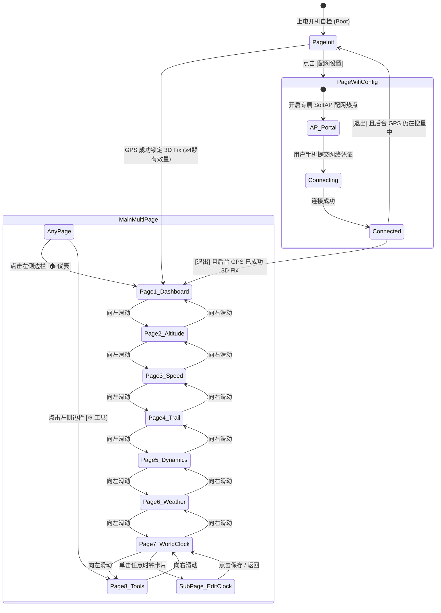

# 产品需求文档 (PRD) - M5Track-Tab5 车载高精度轨迹记录仪与宽屏数字仪表盘

---

## 1. 项目背景与目标

车载日常通勤、自驾越野以及车队出行场景中，车主需要一款**开机秒启、定位精准、屏幕宽阔直观、长途自驾易于离线与无线导出**的独立车载数字仪表与轨迹记录系统。

本项目基于 **M5Stack Tab5**（主控架构：ESP32-P4 双核 RISC-V 400MHz + ESP32-C6 Wi-Fi 6，搭载 5.0 英寸 1280×720 高清全贴合 IPS 电容触控屏）与 **M5Stack Module GNSS (M135 / u-blox NEO-M9N)**，打造一款集专业航向、高程折线、车速极值、全画幅矢量航迹、越野姿态水平仪、多时区时钟与气象预警于一体的车规级数字仪表台。

### 核心设计目标
1. **宽屏车规级人机工程**：利用 16:9 宽屏优势，采用 **左侧 160px 常驻触控侧边栏 (Left Dock)** 与 **右侧 1120×720 全高主视口**，触控热区成倍放大，驾驶员触手可及。
2. **秒级开机搜星**：结合 Wi-Fi 6 与 u-blox AssistNow (AGPS) 辅助星历毫秒级注入，配合板载 RX8130CE 硬件 RTC 闭环，彻底解决地库与楼宇遮挡下冷启动搜星漫长的问题。
3. **原生集成电源与精准计量**：全面利用 Tab5 主板板载 **IP2326** 充电芯片与 **INA226 (I2C `0x40`)** 高精度功率/电流/电压监视芯片，支持背部快拆 **NP-F550** 锂电池（约 2000mAh/7.4V）及车充宽压输入，软硬结合实现无跳变的高精度库仑计电量显示。
4. **安全闭环免维护**：随车点火自启、动静自适应录制、长停 15 分钟自动封口、极端掉电 4 级保护与开机毫秒级自愈修复。

---

## 2. 核心用户角色与典型用例

### 用户角色：车载驾驶者 / 越野自驾玩家 (Driver)
- **用例 1 (日常通勤点火即走)**：车辆点火通电，设备秒级自检启动；自动连接已知车载热点拉取 AGPS 星历，数秒内锁定 3D Fix 并平滑切入主驾驶仪表盘；车动（车速 $>3\text{km/h}$）后自动在 TF 卡生成双流 GPX 轨迹。
- **用例 2 (自驾翻山与姿态掌控)**：在自驾游或越野跑山途中，随时通过左滑切换查看过去 1 小时海拔高程连续起伏曲线、车速巡航与急加速分布、G-Force 摩擦力圆及道路实时坡度（陡坡颜色预警）。
- **用例 3 (全屏轨迹巡航与一键返航)**：进入无外部地图信号的山区或荒野，打开 Page 4 轨迹地图，整条自驾轨迹始终自适应最大化铺满 1120×720 画布，四角悬浮胶囊清晰指示直线距起点的距离与返航方位角。
- **用例 4 (行程单手一键归零)**：每次自驾加满油或开启新旅程时，在主仪表盘右下角长按【TRIP】卡片 2 秒，伴随触觉振动反馈，全系统各页面（里程、海拔极值、车速极值、轨迹起点）全链路同步归零并开启新分段。
- **用例 5 (轨迹免拔卡无线导出)**：抵达目的地后，在工具箱中一键开启 SoftAP 专属热点（`M5Track-Share`），手机直连浏览器秒级批量下载国际版（WGS-84）与国内火星版（GCJ-02）GPX 轨迹，即走即关。

---

## 3. 功能需求详细说明与验收标准

### 3.1 屏幕布局、纯黑主题与左侧常驻侧边栏 (Theme, Viewport & Left Dock)

```text
+------+-------------------------------------------------------------+
|  🏠  |                                                             |
| 仪表 |  <-- 【专职主页键】：任何页面点击，100% 秒回 Page 1 主仪表盘  |
|------|                                                             |
|14:35 |  <-- 【专职时钟键】：点击 100% 直达 Page 7 世界时钟          |
|28 秒 |                                                             |
|------|                                                             |
| 🛰️   |  <-- 【专职定位键】：点击直达 GPS 卫星详情与经纬度          |
|18 3D |                                                             |
|------|                                                             |
| 📶   |  <-- 【专职网络键】：点击直达 Wi-Fi 配网与网络管理           |
|热点  |                                                             |
|------|                                                             |
| 🔋   |  <-- 【专职电源键】：显示 INA226 库仑计精准电量与充放电状态 |
| 95%  |                                                             |
|------|                                                             |
| ☀️   |  <-- 【专职气象键】：点击 100% 直达 Page 6 天气预报          |
|24.5℃ |                                                             |
|------|                                                             |
|  ⚙️  |                                                             |
| 工具 |  <-- 【专职工具键】：任何页面点击，100% 直达 Page 8 系统工具箱|
+------+-------------------------------------------------------------+
(左160)                            (主视口 1120 x 720)
```

- **全贴合宽屏横屏工作台**：
  - 屏幕驱动采用 MIPI-DSI 高速总线，分辨率 **1280 × 720**（标准 16:9 高清横屏）；
  - 机身侧面集成标准 **1/4"-20 摄影/车载螺纹接口**，免定制支架直连主流吸盘与仪表台球头支架；
  - 供电 Type-C 接口支持 USB PD/QC 快充输入及 M5-Bus 宽压 HVIN（6~24V 直通车电）。
- **纯黑沉浸式夜视规范 (Pure Dark Dashboard Theme)**：
  - 全界面背景强制纯黑（`#000000` / `TFT_BLACK`），夜间行车零眩光；
  - 前景读数采用高对比度荧光青绿（`#00FFAA`）、竞速荧光黄（`#FFD700`）与纯白（`#FFFFFF`）；
  - 告警元素采用醒目琥珀橙（`#FFA500`）与警示红（`#FF3B30`）。
- **左侧 160px 常驻触控侧边栏 (Left Dock)**：
  - 坐标范围：`X: 0 ~ 159`，`Y: 0 ~ 719`（全高 720px，常驻于所有主页面左侧，最靠近驾驶员右手）：
    1. **`🏠 仪表`（专职主页快捷键）**：高度 90px，任何页面单点秒级回退至 Page 1 仪表盘；处于 Page 1 时高亮荧光绿；
    2. **`14:35`（专职时钟热区）**：高度 110px，大字显示时分与小秒，单点直接跳转至 **Page 7（世界时钟页）**；
    3. **`🛰️ 18 3D`（专职定位热区）**：高度 105px，展示可用星数与定位状态（录制中带闪烁红点 `REC`），单点直达 GPS 卫星星图；
    4. **`📶 车载热点`（专职网络热区）**：高度 105px，动态显示当前已连接的 Wi-Fi 名称，单点直达网络管理；
    5. **`🔋 95%`（专职电源状态与双色指示）**：高度 105px，由板载 INA226 库仑计驱动；
       - **有外接电源时（车载 USB-C 或 6~24V HVIN 接入）**：电池图标与电量文字强制显示为**绿色 (`#00FFAA`)**，充电时呈现动态闪电 `⚡ 95%`；
       - **无外接电源时（纯 NP-F550 电池放电模式）**：电池图标与电量文字强制显示为**红色 (`#FF3B30`)**（如 `🔋 95%`），直观警示车主当前车电断开、正消耗内部储备电量；
    6. **`☀️ 24.5℃`（专职气象热区）**：高度 105px，基于 GPS 坐标反查的室外气温与天气图标，单点直接跳转至 **Page 6（天气预报页）**；
    7. **`⚙️ 工具`（专职工具箱快捷键）**：高度 100px，任何页面单点直接跳转至 **Page 8（系统扩展工具箱）**。
- **右侧全高主内容安全视口 (Main Viewport)**：
  - **坐标范围：`X: 160 ~ 1279` (宽度 1120px), `Y: 0 ~ 719` (高度 720px)**。
  - 所有子页面 BasePage 独占 1120×720 纯黑画布，享有完整的垂直全高空间。
- **悬浮式自动隐藏页面指示点 (Floating OSD Indicator)**：
  - 8 颗发光小圆点以半透明悬浮 HUD 覆盖在主视口底部中央（`Y: 685~705`）；
  - 滑动切页时浮现，3 秒静止无操作自动彻底隐藏。

---

### 3.2 页面流转与生命周期系统 (Page Lifecycle)



#### 3.2.1 开机自检与初始化搜星页 (`PageInit`)

```text
+--------------------------------------------------------------------+
| 14:35:28 (RTC)       [ ⚡ 系统初始化与硬件自检中... ]  🔋 95% (NP-F550) |
+====================================================================+
| 【左区：硬件外设自检】   |      【中区：全景雷达搜星】   | 【右区：网络状态】 |
| +---------------------+ |            .---.              | +----------------+ |
| | 💾 TF 卡:  [挂载正常]| |          /   |   \            | | 📶 Wi-Fi 状态: | |
| | 🛰️ M9N:   [串口正常]| |         /    |    \           | |   [已连接 ✅]  | |
| | 🧭 IMU:   [双BMI270]| |        |-----●-----|          | | SSID: Tesla_Hot| |
| | ⛰️ 气压:  [BMP280就]| |         \    |    /           | | IP: ...43.105  | |
| | ⚡ 库仑计:[INA226在]| |          \   |   /            | | [⚙️更换/重新配网| |
| +---------------------+ |            '---'              | +----------------+ |
| 注:检测到TF卡格式不兼容 |    动态雷达扫描 (Searching)   | +----------------+ |
| 自动弹出[一键格式化]框  | 北斗:10|GPS:8|GLO:4|GAL:2     | | ℹ️ 搜星进度:   | |
|                         | 已捕获: 24 颗卫星 (HDOP: 0.8) | |  3D Fix 自动切入| |
+====================================================================+
|         [ 车辆驶入开阔道路捕获 3D Fix (≥4颗有效卫星) 后，自动切入仪表盘 ]     |
+--------------------------------------------------------------------+
```

- **硬件外设自检流水线**：开机 500ms 内并行自检 TF 卡挂载、NEO-M9N 串口通信、双 BMI270（主 0x68 / 副 0x69 双冗余就绪）、BMP280、RX8130CE 与 INA226；
- **TF 卡格式智能防御**：若检测到非 FAT32、exFAT 或卡文件系统损坏，居中弹出 `[一键格式化为 FAT32]` 确认框，车主轻点即可重建，无需拔卡；
- **Wi-Fi 状态自适应呈现**：
  - 若已自动连上历史已知 Wi-Fi，立即显示绿色 `[已连接 ✅]`、**SSID**、**信号强度** 与 **IP 地址**；
  - 若未连接，显示 `[⚠️ 未连接 Wi-Fi]` 与醒目的 `[📶 配网设置]` 按钮；
- **零人工干预自动切入**：NEO-M9N 成功锁定 3D Fix 且有效卫星数 $\ge 4$ 时，无需人工点击，自动平滑切入 **Page 1（驾驶主仪表盘）**。

---

### 3.3 正式多页面系统规格 (Main Multi-Page System, Pages 1 ~ 8)

#### 页面 1：核心驾驶仪表盘 (`Page1Dashboard`)

```text
+------+-------------------------------------------------------------+
|  🏠  |  【左半部：360px大圆形罗盘】   |  【右半部：核心车速与行程卡】|
| 仪表 |                               |                             |
|------|            .-----.            |              108            |
|14:35 |          /    N    \          |             km/h            |
|28 秒 |         |  W -|- E  |         |       [点击直达车速详情]    |
|------|          \    S    /          |                             |
| 🛰️   |            '-----'            |  [==== 动态车速弧形光条 ===]|
|18 3D |           185° S 南           |-----------------------------|
|------|                               | ⛰️ 海拔高度:   1,286 m      |
| 📶   |     [ G-Force 微型靶图 ]      |    (点击直达海拔折线页)     |
|热点  |       纵 0.2G / 横 0.1G       |-----------------------------|
|------|     (点击直达车辆姿态页)      | 🚗 本次行程:    42.8 km      |
| 🔋   |                               |    (长按 2 秒全系统归零)    |
| 95%  |                               | 🕒 行驶用时:   00:45:20     |
+------+-------------------------------------------------------------+
(左160)                            (主视口 1120 x 720)
```

- **视觉重心与左右黄金分割架构**：
  - **左半部 · 航向罗盘与动态姿态区（宽度 480px）**：
    - 精致发光大圆形罗盘（直径 360px），外圈标注 N/S/E/W 刻度环；
    - 航向指针随地磁与 GPS 动态平滑旋转，下方大字显示航向角（如 `185° S 南`）；
    - 下方嵌入微型 G-Force 摩擦力靶图（点击直接直达 Page 5 姿态详情页）。
  - **右半部 · 车速仪表与行程卡片区（宽度 640px）**：
    - **发光数码主车速**：巨大字号发光青绿色数字（字号 120pt，如 `108 km/h`），下方配有动态弧形加速刻度光条；**点击车速区域直接跳转至 Page 3 车速详情页**；
    - **实时海拔卡片**：大字显示如 `⛰️ 海拔高度: 1,286 m`，**点击该区域直接跳转至 Page 2 海拔折线页**；
    - **本次行程 TRIP 卡片（长按 2 秒全系统联动归零）**：
      - 显示本次行驶里程（如 `🚗 本次行程: 42.8 km`）与行驶总用时；
      - **全系统联动归零规范 (Full Trip Sync Reset)**：
        - 驾驶员在右下角里程卡片上持续长按 2 秒，触发内部马达短震（100ms）确认，屏幕浮现 `[ ✅ 行程数据已全链路重置 ]`；
        - 1. **Page 1（仪表盘）**：`TRIP` 里程归零为 `0.0 km`，行驶用时清零，平均时速重置；
        - 2. **Page 2（海拔页）**：【最高海拔 ▲】与【最低海拔 ▼】极值重置为当前实际海拔，累计爬升归零，过去 1 小时海拔折线图清空历史采样；
        - 3. **Page 3（车速页）**：【最高时速 ▲ MAX】与【平均时速 AVG】重置为当前车速，过去 1 小时车速折线图清空历史采样；
        - 4. **Page 4（轨迹页）**：清空已绘制的历史航迹，**将当前坐标重新锚定为新起点（Green Flag）**，距起点直线距离重置为 `0.0 km`；
        - 5. **Page 5（姿态页）**：峰值横向与纵向极限 G 值归零；
        - 6. **TF 卡 GPX 轨迹流**：立即向双文件写入 `</trkseg><trkseg>` 开启新轨迹分段。

---

#### 页面 2：海拔高度连续起伏折线与极值详情页 (`Page2Altitude`)

```text
+------+-------------------------------------------------------------+
|  🏠  | CURRENT ALTITUDE (实时高程)            ▲ 累计爬升: +540 m   |
| 仪表 |     1,286 m                            ↕️ 垂直升降: +1.5m/s  |
|------|-------------------------------------------------------------|
|14:35 | [过去 1 小时连续高程起伏折线图 - 宽幅 1050px 平滑渐变发光]  |
|28 秒 | 1600m|                                                     |
|------|      |                    /\_/\                            |
| 🛰️   | 1200m|         _/\       /     \      _/\                  |
|18 3D |      |        /   \__   /       \____/   \                 |
|------|  800m|_______/       \_/                  \_____           |
| 📶   |      +------------------------------------------           |
|热点  |      -60m        -45m        -30m        -15m       Now    |
|------|-------------------------------------------------------------|
| 🔋   |  ▲ 行程最高海拔: 1,420 m         ▼ 行程最低海拔:  310 m     |
| 95%  |  (暖红高光，翻山极值记录)         (冰蓝冷光，盆地起伏记录)   |
+------+-------------------------------------------------------------+
(左160)                            (主视口 1120 x 720)
```

- **进入方式**：手势左右滑动，或在 Page 1 直接点击【海拔高度卡片】直达；
- **顶部实时高程数据**：超大字号荧光绿显示 `1,286 m`（BMP280 气压计与 NEO-M9N 互补融合定高）；右上角并列呈现【▲ 累计爬升】与【↕️ 实时爬升速率】；
- **中部 1050px 超宽幅折线图**：过去 60 分钟环形缓冲采样（每 30 秒 1 点），自适应 Y 轴缩放，曲线带渐变山形光晕；
- **底部高程极值卡片**：【最高海拔 ▲ 1,420 m】与【最低海拔 ▼ 310 m】。

---

#### 页面 3：车速变化连续折线与极速详情页 (`Page3Speed`)

```text
+------+-------------------------------------------------------------+
|  🏠  | CURRENT SPEED (实时车速)               ▲ 最高时速: 126 km/h |
| 仪表 |     108 km/h                           平均时速:  68.4 km/h|
|------|-------------------------------------------------------------|
|14:35 | [过去 1 小时连续车速变化折线图 - 宽幅 1050px 发光动态曲线]   |
|28 秒 |140km |                                                     |
|------|      |                    _/\_        (最高 126km/h)       |
| 🛰️   |100km |                   /    \      __/\_                 |
|18 3D |      |         _/\      /      \____/     \                |
|------| 60km |        /   \____/                                   |
| 📶   |      |_______/                                             |
|热点  |  0km +------------------------------------------           |
|------|      -60m        -45m        -30m        -15m       Now    |
| 🔋   |-------------------------------------------------------------|
| 95%  | 【行程车速结构统计】                                        |
|------|  高速巡航 (>80km/h): 65%   城市通畅 (40-80): 25%   缓行: 10% |
| ☀️   |  ⏱️ 移动行驶: 00:38:15     🛑 怠速停驶: 00:07:05            |
+------+-------------------------------------------------------------+
(左160)                            (主视口 1120 x 720)
```

- **进入方式**：手势左右滑动，或在 Page 1 直接点击【实时车速区域】直达；
- **顶部车速与极速**：发光大字 `108 km/h`（超速自动变色警示）；并列显示【▲ 最高时速: 126 km/h】与【平均时速: 68.4 km/h】；**坚决不展示无意义的最低时速**；
- **中部 1050px 宽幅折线图**：展现巡航平稳度与急加速急减速动态；
- **底部工况统计**：高速巡航/城市通畅/缓行拥堵比例分布，以及纯车动用时 vs 怠速停驶用时。

---

#### 页面 4：全画幅自适应矢量自驾轨迹与返航地图 (`Page4Trail`)

```text
+------+-------------------------------------------------------------+
|  🏠  | [🚩 直线距起点: 38.5km ↗15°]      [ ⛶ 全程全景铺满 / 跟随 ] | <- 顶部悬浮胶囊
| 仪表 |                                                             |
|------|  🟢 起点                                                    |
|14:35 |   \                                                         |
|28 秒 |    \__                                      ___..---..      |
|------|       \                                    /          \     |
| 🛰️   |        \                                  /            \    |
|18 3D |         \                                /              \   |
|------|          \                              /                \  |
| 📶   |           \__      __..--------..______/                  \ |
|热点  |              \    /                                        \|
|------|               \  /        (轨迹 100% 极限制铺满画布)        |
| 🔋   |                \/                                          /|
| 95%  |                                                           / |
|------|                                                          /  |
| ☀️   |                                                         ▲   |
|24.5℃ | [🚗 累计自驾: 42.8km | 内存点: 248]             (当前车位 185°)| <- 底部悬浮胶囊
+------+-------------------------------------------------------------+
(左160)             (主视口 1120 x 720 全画幅纯黑矢量画布)
```

- **轨迹全画幅极限自适应铺满 (Full-Bleed Dynamic Auto-Fitting)**：
  - 算法每秒实时计算起点、当前车位及沿途所有航迹点的经纬度极值包围盒；
  - 保持 1:1 物理比例，四周仅留 20px 最小边距，**整条自驾轨迹始终拉伸到极限，100% 铺满整个 1120×720 画布**，无论是短途 2 公里还是跨省 800 公里均壮阔呈现；
- **四角悬浮半透明 HUD 胶囊**：不设分割底栏，将纵向 720px 每一寸像素全让给地图；四角半透明胶囊展示直线距起点距离（`38.5 km`）、返航朝向、累计轨迹长与内存点数；
- **双模切换**：点击右上角胶囊可在【全程全景铺满】与【近景 5km 弯道跟随】之间秒级平滑切换。

---

#### 页面 5：车辆动态 G 值摩擦力圆与越野姿态水平仪 (`Page5Dynamics`)

```text
+------+-------------------------------------------------------------+
|  🏠  | 【左半部：400px 大 G-Force 靶图】| 【右半部：坡度与越野姿态仪】|
| 仪表 |                 +刹车/制动      |                             |
|------|                     |           |  🛣️ 实时道路坡度:   +7.5 %   |
|14:35 |                .----+----.      |      [ ⚠️ 陡坡缓降警告 ]     |
|28 秒 |            .---|    |    |---.  |-----------------------------|
|------|       -左转|   |    *    |   |+右|  🚗 车身俯仰角 (Pitch):     |
| 🛰️   |            '---|    |    |---'  |     +3.2° (车头抬起/下压)   |
|18 3D |                '----+----'      |-----------------------------|
|------|                     |           |  📐 车身侧倾角 (Roll):      |
| 📶   |                 -加速/推背      |     -1.8° (车身左倾/右倾)   |
|热点  |                                 |-----------------------------|
|------|  当前合成 G 值: 0.45 G          |  融合模式: 气压定高 + 6轴IMU|
| 🔋   |  ▲ 极限横向 G: 0.82 G (过弯峰值)|  静态抗漂: 零速锁定 (ZUPT)  |
| 95%  |  ▲ 极限纵向 G: 0.68 G (刹车峰值)|  动态刷新: 50Hz 极速响应    |
+------+-------------------------------------------------------------+
(左160)                            (主视口 1120 x 720)
```

- **左半部 · 400px 超大 G-Force 靶图**：原点 `(0,0)`，内圈 0.5G，中圈 1.0G，外圈 1.5G 极限；发光小红点带半秒动态拖尾；永久记忆本次行程【极限横向 G】与【极限纵向 G】；
- **右半部 · 越野姿态与道路坡度**：气压计与 GNSS 融合计算道路坡度（`+7.5%`，陡坡触发警告）；车身俯仰角（$\pm 45^\circ$）与侧倾角（$\pm 45^\circ$）动态小车图标倾斜展示；
- **静止零速锁定 (ZUPT)**：红灯停车时自动锁定角度，杜绝传感器底噪跳动。

---

#### 页面 6：当前位置 12 小时两段大字气象预报页 (`Page6Weather`)

```text
+------+-------------------------------------------------------------+
|  🏠  | ☀️ 晴转多云   24.5 ℃      体感 23℃ | 湿度 52% | 东北风 14km/h  |
| 仪表 | 当前位置: 依据 GPS 经纬度反查     [ 🔘 前12小时 | 后12小时 🔄 ]| <- 点击一键切
|------|-------------------------------------------------------------|
|14:35 | 【未来 12 小时逐小时气温与降水走势 (每小时宽达 93px，字大)】 |
|28 秒 |  15:00   16:00   17:00   18:00   19:00   20:00 ...   02:00  |
|------|    ☀️      ⛅      ⛅      🌧️      🌧️      ⛅          🌙   |
| 🛰️   |   25°     24°     23°     20°     19°     18°        14°   |
|18 3D |   ---.            .-------.                                 |
|------|       \          /         \                                |
| 📶   |        \________/           \___________________________    |
|热点  | [降水概率 %]                                                |
|------|    0%     10%     75%     80%     20%      0%         0%    |
| 🔋   |    _       _       █       █       _                        |
| 95%  |-------------------------------------------------------------|
|------| ⚠️ 行车气象预警:                                            |
| ☀️   |   预计 1.5小时后 (17:00) 迎面降雨 (概率75%)，请注意路面湿滑 |
+------+-------------------------------------------------------------+
(左160)                            (主视口 1120 x 720)
```

- **车规大字 12 小时双时段架构**：彻底解决 24 小时挤压看不清的问题；每小时独享 **93px（物理宽度 8.1mm）** 空间，大字温度 `25°` 与时间 `15:00` 极度舒展清晰；
- **一键秒切**：右上角大胶囊按键（或轻触图表）在【前 12 小时】与【后 12 小时】之间瞬间往复切换；
- **底部自驾前瞻预警**：分析降水趋势并给出雨刮开启与减速提醒；断网自动展示离线缓存数据。

---

#### 页面 7：多时区世界时钟页 (`Page7WorldClock`)

```text
+------+-------------------------------------------------------------+
|  🏠  | 【多时区世界时钟 - 2×2 宽幅大卡片，轻触任意卡片直接修改】   |
| 仪表 | +-----------------------------+---------------------------+ |
|------| | 📍 北京 Beijing (UTC+8)     | 🌐 协调世界时 UTC (UTC+0) | |
|14:35 | |       14:35:28 ☀️           |       06:35:28 ☀️         | |
|28 秒 | | 10月30日 星期五 [本地基准]  | 相对时差: 比本地慢 8 小时 | |
|------| +-----------------------------+---------------------------+ |
| 🛰️   | +-----------------------------+---------------------------+ |
|18 3D | | 🌐 纽约 New York (EDT-4)    | 🌐 东京 Tokyo (UTC+9)     | |
|------| |       02:35:28 🌙           |       15:35:28 ☀️         | |
| 📶   | | [夏令时自适应] 慢 12 小时   | 相对时差: 比本地快 1 小时 | |
|热点  | +-----------------------------+---------------------------+ |
|------| 💡 提示: 单击卡片可修改时区城市 | 支持根据 GPS 经度自适应换算 |
| 🔋   | ----------------------------------------------------------- |
| 95%  | 精度基准: NEO-M9N 卫星授时 + RX8130CE 硬件 RTC (毫秒级无漂移)|
+------+-------------------------------------------------------------+
(左160)                            (主视口 1120 x 720)
```

- **4 张宽幅航空级时区大卡片（每张宽达 $530 \times 320\text{ px}$）**：
  - 本地时间（荧光绿）、世界协调时 UTC（冰蓝）、美东时间（琥珀橙，内置冬夏令时 DST 自动引擎）、自定义城市/东京（纯白）；
- **卡片轻点进入编辑页 (`SubPageEditClock`)**：
  - **模式 ①：GPS 经度自动定位**：跨省自驾经度动态偏移（$\text{Offset} = \text{round}(\text{Lon}/15^\circ)$）；
  - **模式 ②：大分类标签免打字点选**：亚太、美洲、欧洲、UTC 四大标签横向切换，大热区点选即存。

---

#### 页面 8：系统动态扩展工具箱 (`PageToolsGrid`)

```text
+------+-------------------------------------------------------------+
|  🏠  | 【系统动态扩展工具箱 - 2×2 宽幅卡片，轻触卡片进入二级菜单】 |
| 仪表 | +-----------------------------+---------------------------+ |
|------| | 💾 TF 卡存储管理 (SD Card)  | | 📶 Wi-Fi 网络管理 (WiFi)  | |
|14:35 | | • 状态: 正常挂载 (FAT32)    | | • 状态: 已连 Tesla_Hot  | |
|28 秒 | | • 容量: 剩余 28.5GB / 32GB  | | • 本机 IP: 192.168.43.10| |
|------| | • 轨迹: 12 条 (W/C双文件)   | | • 已存已知网络: 3 组    | |
| 🛰️   | | • [一键格式化] / [WiFi导出] | | • [+ 增加新网络] (配网) | |
|18 3D | +-----------------------------+---------------------------+ |
|------| +-----------------------------+---------------------------+ |
| 📶   | | 🛰️ GPS 卫星详情 (GNSS Info) | | ⚙️ 系统偏好与电量 (Sys)   | |
|热点  | | • 定位: 3D Fix (HDOP 0.8)   | | • 屏幕背光调节 (滑块)   | |
|------| | • 星数: 22 颗 (北斗10/GPS8) | | • INA226 库仑计实时功耗 | |
| 🔋   | | • 经纬度/载噪比 C/N0 柱状图 | | • NP-F550 电池状态与续航| |
| 95%  | | • 四星系统动态星图分布      | | • 硬件: ESP32-P4 / 32MB | |
|------| +-----------------------------+---------------------------+ |
| ☀️   | 💡 提示: 支持多于 4 个工具自动分页 | 随时点击左上角 [🏠] 秒回首页|
+------+-------------------------------------------------------------+
(左160)                            (主视口 1120 x 720)
```

- **4 大核心工具二级页面**：
  1. **`ToolTfManager`**：机内 FAT32 一键格式化重置、W/C 双轨迹浏览、免拔卡 SoftAP Wi-Fi 高速导出；
  2. **`ToolWifi`**：已存网络列表查看与删除 🗑️、启动 Web 扫码配网；
  3. **`ToolGnss`**：四星系统分布星图、载噪比 C/N0 动态柱状图、原始大地坐标与精度因子；
  4. **`ToolSettings`**：背光滑动调节、ESP32-P4 / 32MB 内存状态、板载 INA226 库仑计实时物理量诊断；
- **自适应扩页机制**：工具数超过 4 个自动延展出 Page 9，小圆点指示器自适应增加。

---

### 3.4 双源自适应时钟引擎与室内转室外极速重捕获机制 (Dual-Source Time Engine & Fast Re-Acquisition)
- **底层时钟源**：NEO-M9N 卫星原子钟授时 + Tab5 板载 **RX8130CE 硬件 RTC**（I2C `0x32`，带 $70000\mu\text{F}$ 超级电容）+ 网络 NTP；
- **无 GPS 信号下的 Wi-Fi NTP 自动校时**：
  - 当设备处于室内、地库或冷启动尚未捕获有效 GPS 信号（`!gnss.isValid`），但 **Wi-Fi 已成功联网**时，系统立即自动触发多服务器 NTP 校时（`ntp.aliyun.com` / `cn.pool.ntp.org` / `pool.ntp.org`）；
  - NTP 同步成功后，第一时间将精准 UTC 时间更新至系统时钟（`settimeofday`）并**反向写入校准 Tab5 板载 RX8130CE 硬件 RTC**，同时构建 `UBX-MGA-INI-TIME_UTC` 帧注入 NEO-M9N 串口辅助热启动；
- **室内/地库无信号驶出室外极速重捕获自愈机制（解决室内转室外不锁星顽疾）**：
  1. **两阶段动态门限（Dynamic Two-Stage Filter）**：未定位搜星期间自动放宽捕获门限（`minElev = 5°`, `cnoThresh = 14 dBHz`），允许刚出地库时的边缘卫星立即参与快速收敛；待连续稳定 3D Fix 满 10 秒后再动态收紧至抗多径门限（`minElev = 10°`, `cnoThresh = 20 dBHz`），一旦丢星立即恢复宽松捕获门限；
  2. **45 秒未锁星自动软热启动 + 重注时间坐标看门狗（Auto Hot-Start Watchdog）**：当在室内/地库长时间无星导致 M9N 内部多普勒搜索窗口发散时，系统每 45 秒自动向 M9N 发送仅重置 GNSS 基带捕获状态机的**无损热启动命令 (`UBX-CFG-RST`, `navBbrMask=0x0000` 保留全部星历)**，并立即重新注入最新 RTC/NTP UTC 时间与 NVS 历史坐标，无需重启设备即可在驶出室外瞬间秒级锁星。

---

### 3.5 u-blox AGPS (AssistNow) 极速搜星联动
- Wi-Fi 连通时后台异步拉取 u-blox AssistNow Online 离线星历包，直接通过串口写入 NEO-M9N，实现开阔道路 3~5 秒闪电冷定位。

---

### 3.6 Wi-Fi 凭证管理与双二维码扫码自动连网并弹出界面 (Multi-SSID, QR Code Auto-Connect & Captive Portal)
- 由协处理器 ESP32-C6 管理，支持最多 5 组车载热点/家庭网络循环自动重连；
- **配网（`M5Track-Setup`）与轨迹无线导出（`M5Track-Share`）双模式二维码交互**：
  1. **Step 1 · 扫码自动连 Wi-Fi 二维码**：屏幕渲染标准 `WIFI:T:nopass;S:<SSID>;;` 协议二维码，手机相机或微信一扫即可免输密码一键接入设备热点；
  2. **Step 2 · 自动弹出 / 扫码直达网页二维码**：
     - 底层内置 **DNS Captive Portal（强制门户 DNS 劫持服务，端口 53 全域名解析至 `192.168.4.1`）**，手机连上热点后系统会自动弹出配网页面或轨迹文件下载界面；
     - 同时屏幕并排展示 **Step 2 网页直达二维码**（配网：`http://192.168.4.1/setup`，轨迹下载：`http://192.168.4.1/tracks`），若部分手机机型关闭了系统弹窗，再扫右侧二维码即可直接唤起浏览器进入对应功能界面。

---

### 3.7 轨迹流式记录与双坐标系并行落盘 (Safe GPX Logging & SdFat)
- 运行 `SdFat` 库，支持原生长文件名；
- **双流并行落盘**：每秒同时流式追加 `W-yyyymmdd-hhmmss.gpx`（国际 WGS-84）与 `C-yyyymmdd-hhmmss.gpx`（国内 GCJ-02）；
- **1 小时连续切片**：每满 3600 点自动连续切卷，合并线段严丝合缝；
- **4 级断电自愈**：每点预写尾标签 `</trkseg></trk></gpx>`、10 秒定时 sync、开机毫秒级扫描修复；车速 $<1.8\text{km/h}$ 触发零漂死区冻结；
- **TF 卡 50% 容量严格配额与循环覆盖 (50% Storage Quota & Auto-Loop)**：
  - 系统实时监控 `/tracks/` 目录的累计占用空间，**严格限制轨迹数据总容量严禁超过 TF 卡总容量的 50%**（例如 32GB 卡上限配额为 16GB，可记录 3000+ 小时自驾）；
  - 当 `/tracks/` 目录体积达到 50% 阈值时，自动触发后台平滑循环覆盖：按时间倒序成对删除最古老的 `W-` 与 `C-` 历史文件，将占用释放回落至总容量的 40% 以下；
  - 保障长途行车永远不会因“卡满”而报错或中断录制，同时永久为车主保留剩余 50% 卡空间用于其他用途。

---

### 3.8 电源管理、NP-F550 电池与板载 INA226 库仑计体系
- **板载物理芯片**：Tab5 主板集成 **INA226 (I2C `0x40`)** 数字功率计与 **IP2326** 充放电管理芯片；
- **安时积分 + OCV 校准复合库仑计**：
  - INA226 经 $20\text{m}\Omega$ 分流电阻以 500ms 周期高频采样总线电压、充放电电流（0.1mA 分辨率）与即时功耗；
  - 行车过程中通过安时积分（$\Delta Q = I \times \Delta t \times \eta$）输出极其平滑的电池电量（0~100%），彻底杜绝负载压降引起的电量忽高忽低跳动；
  - 停车熄火或静置电流 $|I| < 20\text{mA}$ 维持超 5 秒时，根据 11 节点锂电 OCV 曲线自动对冲校准累计漂移；
- **外电状态双色指示机制 (External Power Dual-Color Indication)**：
  - **有外接电源输入时**：系统判定当前为车载 USB-C (5V/9V/12V PD/QC) 或 6~24V HVIN 供电，全屏左侧 Dock 电池图标及百分比**高亮呈现绿色 (`#00FFAA`)**；
  - **无外接电源输入时**：系统判定车电熄火或供电断开，当前由内部 NP-F550 电池独立放电支撑，左侧 Dock 电池图标及百分比**强制切换呈现红色 (`#FF3B30`)**，提醒驾驶员注意剩余续航；
- **静止满 20 分钟自动关停与深度休眠 (Standstill 20-Min Auto Deep Sleep)**：
  - 车辆连续停止移动满 **20 分钟 (1200秒)**（车速 $<1.8\text{km/h}$ 或地库无星时 IMU 方差持续处于静止底噪）：
    1. **停止轨迹**：正在记录的 GPX 文件写入 XML 闭合标签并调用 `file.close()` 彻底安全存盘；
    2. **停止行程**：本次行程结算，最后坐标写入 NVS，冻结行程数据；
    3. **设备休眠**：屏幕与高功耗外设全部切断，配置 BMI270 运动检测为唤醒源，主控切入 **Deep Sleep（待机电流 $<50\mu\text{A}$）**，车辆再次起步时毫秒级自动唤醒开机。

---

### 3.9 基于 GPS 坐标的实时与 12 小时天气引擎
- 利用 NEO-M9N 经纬度反查 Open-Meteo REST API，获取实时气温、湿度、风力与未来逐小时天气，自动写入 PSRAM/NVS 离线缓存。

---

### 3.10 车载原生触控手势与侧边栏交互规范
- **纯屏原生触控设计（无外置实体/虚拟按键）**，全机交互基于触屏原生设计：
  - **单点左侧 Dock 快捷键**：`[🏠 仪表]` 专职回主页，`[⚙️ 工具]` 专职去工具箱；
  - **屏幕内大卡片交互**：Page 1 长按 2 秒 TRIP 里程触发马达振动全系统重置；
  - **全屏左右滑动**：同级页面平滑横向切换。

---

### 3.11 车载工况 GPS 调优、气压高程融合与 MagSafe 强磁免疫航向
- **车载动态平台模型**：启用 u-blox Automotive Dynamic Model（抗 4G 极限加减速）；
- **气压高程互补融合**：BMP280 气压计（10Hz）与 GNSS 高程互补滤波，彻底消除立交桥下爬坡迟滞与恶劣天气气压漂移；
- **MagSafe 强磁免疫航向计算 (MagSafe Immune Heading Engine)**：
  - 针对车主在机身底部/背部贴附 MagSafe 磁吸环车载使用的工况，**系统在底层彻底旁路并屏蔽 BMM150 地磁罗盘传感器**，杜绝钕铁硼强磁导致磁针乱转；
  - 航向角 100% 由 **NEO-M9N 卫星地面真航向** 与 **双 BMI270 均值融合陀螺仪 Z 轴角速度（50Hz 加权积分，白噪声降低约 30%）** 互补融合生成；
  - 车动转向零延迟平滑，车速 $\le 1.8\text{km/h}$ 停稳等红灯时自动激活静态航向物理锁死，罗盘指针稳定如磐石。

---

### 3.12 双 BMI270 冗余互验、均值降噪与盲区 DR 航位推测
- **双芯片并行均值降噪 (Option A)**：Tab5 主板 `0x68` 与 Module GNSS `0x69` 同步以 50Hz 采样，对加速度与角速度实施加权平均，白噪声降低 $\sqrt{2} \approx 30\%$，大幅平滑 Page 5 动态 G 值靶图与车身姿态；
- **交叉互验与故障秒级热转移 (Cross-Check & Failover)**：实时比对双芯片角速度差值，Master 芯片出现通信故障或数据异常时，20ms 内无缝切换至 Slave 芯片单独工作；
- **盲区惯导推算 (DR)**：隧道与地下车库卫星失锁期间，利用双 IMU 融合后的角速度积分与车身加速度无缝推算位置。

---

### 3.13 全国特长公路隧道微型数据库与零感知轴线吸附
- 依托 ESP32-P4 的 32MB PSRAM 与片上 Flash LittleFS，内置全国特长公路隧道数据库（~20KB）；进隧道自动单维轴线锁死，消除消费级陀螺仪零漂导致的穿山漂移。

---

### 3.14 车载 GPS 极限工况防御与硬件诊断体系
- 动力学极限跳变过滤（速度突变 $>180\text{km/h}$ 或瞬态加速度 $>1.2\text{G}$ 点自动剔除）；
- 具备双 IMU 异常互验预警、天线断开/短路探测、存储卡低水位告警与整机自愈机制。

---

### 3.15 TF 卡系统开关机事件日志与 100KB FIFO 滚动文件机制 (Power Event Logging & 100KB FIFO Limit)
- **存储文件路径**：MicroSD 卡 `/tracks/power.log`；
- **准确时标基准（采用 GPS 定位时区时间）**：
  - 依赖精准时钟引擎（RX8130CE RTC / GNSS 原子钟 / Wi-Fi NTP），每一条日志均标注文档规范的 **GPS 定位时区时间戳 `[YYYY-MM-DD HH:MM:SS ±HH:MM]`**（根据车辆 GPS 经纬度动态推算时区，中国大陆范围统一采用北京时间 UTC+8，跨国自驾按 $15^\circ$ 太阳时区自动偏移，且开机时预读 NVS 历史坐标提前就绪时区）；
  - 若冷启动瞬间硬件 RTC 尚未校准，标记为 `UNCALIBRATED`，并在后续 GNSS 3D 定位或 NTP 授时校准成功的第一瞬间追加 `TIME_SYNC_GNSS` 或 `TIME_SYNC_NTP` 事件记录时钟跳变；
- **核心记录事件类型**：
  1. `BOOT`：系统上电启动，记录复位原因（Power-on / Watchdog / Software / DeepSleep）、供电状态（车载 USB / 电池）、电池电压与电量百分比；
  2. `STANDBY_ENTER`：车辆在纯电池供电下静止满 20 分钟切入低功耗待机，记录触发时电池剩余电量与电压；
  3. `STANDBY_WAKEUP`：唤醒恢复运行，准确记录唤醒源（车充供电恢复 / 6轴 IMU 持续有效车身移动）与电池状态；
  4. `SHUTDOWN_LOW_BATT`：电池达到截止保护电压（$<6.0\text{V}$）触发的主动安全关机；
  5. `TIME_SYNC_NTP` / `TIME_SYNC_GNSS`：时钟源校时同步生效事件；
- **严格 100KB FIFO 滚动与淘汰机制**：
  - 文件最大尺寸硬性限制为 **100KB (102,400 字节)**；
  - 当文件追加写将超过 100KB 时，触发 FIFO 头部淘汰算法：自动跳过头部最早的约 20KB 历史数据并对齐换行符（`\n`），通过原子临时文件（`/tracks/power.tmp`）流式转存剩余最新约 80KB 内容并执行安全原子重命名；
  - 文件体积严格在 80KB ~ 100KB 之间循环滚动，永久保留最新且最关键的约 1000+ 次开关机与供电轨迹溯源；
- **便捷无线排查支持**：
  - 开启 `M5Track-Share` 热点后，手机访问轨迹下载页面顶部直接提供 `power.log` 单击下载入口，通过 `/api/download?file=power.log` 便捷离线分析。
