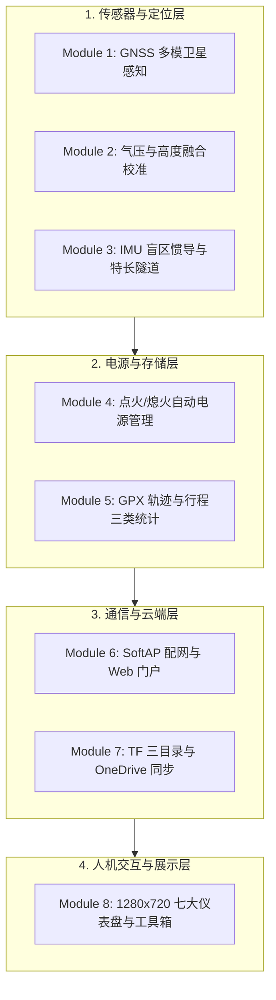
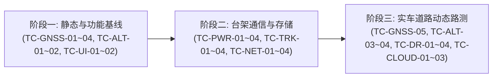

# M5Track-Tab5 功能模块测试计划 (Functional Test Plan)

> **版本**: v1.0.0  
> **编制日期**: 2026-11-04  
> **适用硬件平台**: M5Stack Tab5 (ESP32-P4 + ESP32-C6) + Module GNSS (u-blox NEO-M9N + BMP280 + BMI270 + BMM150)  
> **文档位置**: `DevDoc/m5-vehicle-tracker/TEST_PLAN.md`

---

## 1. 测试计划概述与测试策略

本测试计划旨在为 **M5Track-Tab5 车载高性能轨迹与姿态记录终端** 建立端到端、系统化、可度量的功能验证与边界测试标准。测试策略涵盖以下层级：

1. **台架实验室测试 (Bench Testing)**：在室内通过 USB 供电、模拟输入、串口注入及串口日志抓取，验证驱动初始化、状态机跃迁、UI 触控交互、Web 配网与文件系统完整性。
2. **半实物/窗边静态测试 (Window / Static Testing)**：在近窗或楼顶开阔地进行 GNSS 冷启动/温启动搜星、可见星捕获、3D 定位收敛、UTC 授时与基准气压 $P_0$ 动态校准验证。
3. **车载实车道路测试 (In-Vehicle Road Testing)**：在实际车辆点火起步、急加减速、特长隧道进出穿行、山地连续爬坡与熄火断电工况下，验证惯性导航推算、GPX 轨迹双坐标系记录、电源管理自动启闭与 OneDrive 云同步。

---

## 2. 功能模块测试矩阵 (Functional Test Matrix)

---

## 3. 详细模块测试用例与验证规程

### 模块 1: GNSS 多模卫星定位与射频诊断模块 (GnssDriver)

| 用例编号 | 测试项目 | 前置条件 | 测试步骤与操作 | 预期结果与合格判定标准 | 优先级 |
| :--- | :--- | :--- | :--- | :--- | :--- |
| **TC-GNSS-01** | 冷启动可见星捕获 (In-View Satellites) | 室内窗边或开阔地，清除星历或首次上电 | 设备上电，进入 Tool 3 (GNSS 诊断页) 或观察 Dashboard 状态栏 | 1. 启动 10s 内 `$xxGSV` 语句驱动搜星数动态跳变 ($Sats > 0$)。 2. 屏幕与串口正确统计当前视野内可见卫星总数 (通常 15~32 颗)。 | **P0** |
| **TC-GNSS-02** | 3D 坐标定位收敛 (3D Fix Lock) | 开阔地，外置天线无遮挡 | 保持静止等待 3D Fix 锁定 | 1. `Fix` 状态从 `NONE(0)` 变为 `3D(3)`。 2. 经度、纬度、海拔高度正常更新，`HDOP < 2.0`。 | **P0** |
| **TC-GNSS-03** | 多卫星星座信噪比 (C/N0 & Constellation) | 3D Fix 稳定 | 打开 GNSS 诊断仪子页面查看星座柱状图与信噪比 | 1. 正常区分 BDS(北斗)、GPS、GLONASS、Galileo 四大星座。 2. 柱状图高度与 C/N0 (dBHz) 对应，参与解算与未参与解算区分标注。 | **P1** |
| **TC-GNSS-04** | UTC 高精度时间校准 | 捕获至少 1 颗有效授时卫星 | 观察设备系统时间、屏幕 UTC 时钟与串口输出 | 1. UTC 时钟立即更新为真实公历年月日时分秒（非 1970 或 00:00:00）。 2. 系统 RTC (`RX8130CE`) 同步写入校准时间。 | **P0** |
| **TC-GNSS-05** | 射频干扰与天线状态监测 (UBX-MON-RF) | 连接天线 / 拔出天线 / 强电磁源靠近 | 1. 拔掉天线接头。 2. 靠近无线车充发射端。 | 1. 拔掉天线时，`Antenna Status` 显示 `OPEN(开路)` 告警。 2. 强干扰时，`Jamming State` 状态跳变并记录日志。 | **P2** |

---

### 模块 2: 多源高度融合与海平面气压动态校准模块 (AltitudeFusion)

| 用例编号 | 测试项目 | 前置条件 | 测试步骤与操作 | 预期结果与合格判定标准 | 优先级 |
| :--- | :--- | :--- | :--- | :--- | :--- |
| **TC-ALT-01** | NVS 历史 $P_0$ 掉电预热恢复 | 上次定位已持久化 $P_0$ (如 $1020.2\text{ hPa}$) | 冷机上电，GNSS 尚未定位 (室内) | 1. 串口打印 `[ALTITUDE] Seeded sea-level pressure...`。 2. 室内静态高度显示与当地真实海拔一致 (如北京平原 50~70m)，不得错误暴跌至 9m。 | **P0** |
| **TC-ALT-02** | 首次 3D Fix 即时 $P_0$ Snap 瞬态校准 | 首次开机或 $P_0$ 为默认 $1013.25\text{ hPa}$ | 移至室外获得稳定 3D Fix (`dop < 8.0`) | 1. 触发即时校准，重新计算本地海平面气压 $P_0Target$ 并更新。 2. 融合高度瞬间对齐 GPS 3D 参考高度，无滞后阶跃，并写入 NVS。 | **P0** |
| **TC-ALT-03** | 连续自适应滤波与抗风阻阶跃 | 获得 3D 定位并在车内行驶 | 车辆行驶中车窗启闭 (引起车内气压突变 2~3 hPa) | 1. 融合算法抑制气压毛刺，高度读数平滑过渡。 2. 屏幕 Page 2 曲线无断崖式尖峰。 | **P1** |
| **TC-ALT-04** | 实时坡度 (Slope %) 与累计爬升/下降 | 车辆在起伏道路或立交桥行驶 | 观察 Page 2 坡度百分比与累计升降值 | 1. 上坡显示正坡度 (如 +4.5%)，下坡显示负坡度 (如 -3.2%)。 2. 累计爬升米数与海拔增量积分保持单调递增。 | **P1** |

---

### 模块 3: 惯性导航与特长公路隧道盲区推算模块 (DeadReckoning & TunnelService)

| 用例编号 | 测试项目 | 前置条件 | 测试步骤与操作 | 预期结果与合格判定标准 | 优先级 |
| :--- | :--- | :--- | :--- | :--- | :--- |
| **TC-DR-01** | 6 轴 IMU 零偏校准与静态滤波 | 车辆平稳停放 | 观察 Page 5 姿态仪与重力加速度矢量 | 1. 静止时三轴角速度为 0，纵向与侧向 G 值波动 $< 0.02\text{G}$。 2. Z 轴垂直加速度稳定在 $1.0\text{G} \pm 0.05\text{G}$。 | **P1** |
| **TC-DR-02** | 特长隧道入口自动识别与轴线捕捉 | 车辆接近预设特长隧道 (如天山胜利/秦岭终南山) | 驶入隧道入口坐标 200m 范围内且航向对齐 | 1. UI 弹出隧道模式横幅或提示当前隧道名称与全长。 2. GNSS 信号衰减丢失瞬间平滑切入 `isDeadReckoning = true`。 | **P1** |
| **TC-DR-03** | 隧道内轴线折线几何约束与里程推算 | 处于特长隧道内部无卫星盲区 | 车辆在隧道内正常行驶 | 1. 轨迹沿隧道规划多义线平滑推算，不向两侧山体乱跳。 2. 根据车速与 IMU 积分推算隧道内已行进里程及剩余里程。 | **P2** |
| **TC-DR-04** | 隧道出口信号瞬态重捕与状态恢复 | 车辆穿出隧道 | 驶出隧道，GNSS 重新捕获卫星 3D Fix | 1. 定位状态从 `DR` 自动重置为 `3D Fix`。 2. 消除累计航位漂移，轨迹无缝接续。 | **P1** |

---

### 模块 4: 电源监控与车载自动点火/熄火启闭模块 (PowerMonitorService)

| 用例编号 | 测试项目 | 前置条件 | 测试步骤与操作 | 预期结果与合格判定标准 | 优先级 |
| :--- | :--- | :--- | :--- | :--- | :--- |
| **TC-PWR-01** | 外部点火上电唤醒 (ACC/USB Voltage Rise) | 设备关机但连接车载 USB | 启动汽车点火（或插入 USB-C 供电） | 1. 系统自动上电并启动开机自检流程。 2. INA226 采样检测到输入电压 $> 4.8\text{V}$，记录 `POWER_UP` 事件。 | **P0** |
| **TC-PWR-02** | 熄火断电倒计时与安全关机 (Ignition Off Delay) | 正常运行中 | 拔掉外部电源模拟熄火 | 1. 屏幕弹出“检测到熄火，30秒后自动关机”弹窗。 2. 界面显示关机倒计时与“取消关机”触摸按钮。 3. 倒计时归零时自动保存 GPX 轨迹并安全关断系统电源。 | **P0** |
| **TC-PWR-03** | 关机倒计时用户人工取消 | 熄火倒计时进行中 | 点击屏幕“取消关机”按钮 | 1. 倒计时中断，设备维持电池供电常开运行模式。 2. 状态栏显示电池续航图标与剩余容量估算。 | **P1** |
| **TC-PWR-04** | 电池紧急低压保护 (Low Voltage Protection) | 电池电量低 ($V_{bat} < 3.4\text{V}$) | 持续运行直至触发低压报警 | 1. 强制写入关闭文件句柄，将 GPX 尾部封闭。 2. 记录 `LOW_BATT_SHUTDOWN` 日志并切断供电，保护锂电池。 | **P0** |

---

### 模块 5: GPX 轨迹双坐标系记录与三类行程统计模块 (TrackLogger & TripStats)

| 用例编号 | 测试项目 | 前置条件 | 测试步骤与操作 | 预期结果与合格判定标准 | 优先级 |
| :--- | :--- | :--- | :--- | :--- | :--- |
| **TC-TRK-01** | TF 卡热插拔与安全挂载 (SD Hotplug) | 运行时插入/拔出 MicroSD 卡 | 1. 开机状态下插入 TF 卡。 2. 拔出 TF 卡。 | 1. 插入时自动识别 FatFS，挂载 `/sd` 并恢复记录。 2. 拔出时界面给出 TF 离线告警，不导致系统崩溃 (Crash/Panic)。 | **P0** |
| **TC-TRK-02** | GPX 1.1 双坐标系输出合规性 | 3D Fix 状态下行驶记录 5 分钟 | 取出 TF 卡在电脑上检查生成的 `.gpx` 文件 | 1. XML 格式符合 GPX 1.1 规范（标签完整闭合）。 2. `<trkpt>` 经纬度为标准 WGS-84。 3. `<extensions>` 内包含 `<m5:gcj02 lat="..." lon="..."/>` 高德修正坐标。 4. 包含海拔、速度、航向、三轴加速度与气压高度扩展字段。 | **P0** |
| **TC-TRK-03** | 三类行程分卷统计准确性 (Trip / Daily / Total) | 行车测试跨越不同时间段 | 连续进行多次启动、停止行车 | 1. **Trip**: 每次点火到熄火重置，准确统计本次用时、里程、均速、爬升。 2. **Daily**: 每日零点自动滚卷，汇总全天多次行程数据。 3. **Total**: 跨开机掉电持久保存在 NVS，累计历史总里程。 | **P0** |
| **TC-TRK-04** | 历史行程流水日志保存 (`/tracks/trips.csv`) | 完成一次完整点火至熄火过程 | 检查 `/sd/tracks/trips.csv` | 1. CSV 文件末尾成功追加本次行程的一行记录。 2. 字段包括：开始时间、结束时间、历时、里程、均速、极速、累计爬升、能耗。 | **P1** |

---

### 模块 6: SoftAP Web 配网与 Captive Portal 模块 (NetworkManager & WebPortal)

| 用例编号 | 测试项目 | 前置条件 | 测试步骤与操作 | 预期结果与合格判定标准 | 优先级 |
| :--- | :--- | :--- | :--- | :--- | :--- |
| **TC-NET-01** | 已知 Wi-Fi 快速静默重连 | NVS 已配置常用 Wi-Fi SSID/密码 | 设备开机进入 Wi-Fi 覆盖区 | 1. 5~8s 内成功连接家庭/车机 Wi-Fi。 2. 自动触发 NTP 网络对齐校时与 OneDrive 同步检测。 | **P0** |
| **TC-NET-02** | SoftAP 热点广播与二维码扫描 | 无可用已存 Wi-Fi 或点击配网按钮 | 进入 PageWifiConfig 页面 | 1. 屏幕展示 `M5Track-XXXX` 热点 SSID 与接入密码二维码。 2. 手机扫描二维码可直连热点并自动弹出 Captive Portal 登录页面。 | **P1** |
| **TC-NET-03** | Web 端 Wi-Fi 扫描与配置提交 | 手机连接设备热点 | 在 Web 页面选择周边 Wi-Fi，输入密码并保存 | 1. 设备收到配置后保存至 NVS。 2. 设备关闭 SoftAP，切入 STA 模式并成功联网。 | **P1** |
| **TC-NET-04** | Web 局域网 TF 卡文件管理与下载 | 设备已连接家庭局域网 | 电脑浏览器访问设备 IP 地址 | 1. 网页展示 `/tracks` 目录下的 `.gpx` 与 `.csv` 文件列表。 2. 支持直接点击下载轨迹文件，文件内容完整未被损坏。 | **P1** |

---

### 模块 7: 三目录存储架构与 OneDrive 云端同步模块 (OneDriveSyncService)

| 用例编号 | 测试项目 | 前置条件 | 测试步骤与操作 | 预期结果与合格判定标准 | 优先级 |
| :--- | :--- | :--- | :--- | :--- | :--- |
| **TC-CLOUD-01**| 三目录独立存储与隔离 | 格式化 TF 卡后首次启动 | 检查 TF 卡根目录结构 | 1. 自动生成 `/tracks/`（轨迹）、`/system/`（日志配置）、`/backup/`。 2. 各模块读写严格限制在其子目录，互不干扰。 | **P1** |
| **TC-CLOUD-02**| OneDrive 设备流授权认证 (OAuth 2.0 Device Code) | 首次绑定微软账号 | 打开 Tool 2 (OneDrive)，点击“绑定账号” | 1. 屏幕生成 9 位授权码 (User Code) 与登录二维码。 2. 手机扫码登录微软账号输入 Code 完成绑定。 3. 刷新 Token 持久化存储到 NVS，屏幕显示已绑定用户名。 | **P1** |
| **TC-CLOUD-03**| 增量轨迹文件自动上传与断点保护 | 已绑定 OneDrive 且有新增 `.gpx` 轨迹 | 连接 Wi-Fi 后触发同步 | 1. 自动扫描未同步的轨迹，后台静默上传到云端对应应用文件夹。 2. 上传成功后更新本地 `.sync_manifest`，避免重复传输。 | **P1** |

---

### 模块 8: 1280x720 多页面 UI 触控与高刷交互模块 (UiManager & Pages)

| 用例编号 | 测试项目 | 前置条件 | 测试步骤与操作 | 预期结果与合格判定标准 | 优先级 |
| :--- | :--- | :--- | :--- | :--- | :--- |
| **TC-UI-01** | 七大主仪表盘左右滑动切换 | 系统正常运行 | 在屏幕左右滑动手势切换 Page 1 ~ Page 7 | 1. 页面滑动丝滑无卡顿，无画面撕裂或重影。 2. 顶部状态栏与底部页码指示条实时对齐。 | **P0** |
| **TC-UI-02** | Page 1 主仪表盘实时数据渲染 | 3D Fix 且车辆运动中 | 观察时速表盘、指南针、高度、里程读数 | 1. 数字与指针刷新平滑（20~30 FPS），无肉眼可见数秒滞后。 2. 航向与指南针圆盘随真实方向同步转动。 | **P0** |
| **TC-UI-03** | Page 4 面包屑轨迹缩放与平移 | 行车记录轨迹点 $> 100$ | 双指/单指在 Page 4 画布上拖拽 | 1. 轨迹缩放自适应当前边界范围。 2. 车辆当前位置图标始终高亮居中或随动。 | **P1** |
| **TC-UI-04** | 工具箱九宫格进出与深层交互 | 主界面点击进入工具箱 | 依次点击 GNSS 诊断、TF 管理、OneDrive、设置 | 1. 各二级工具页面进入迅速，返回按键响应灵敏。 2. 退出工具箱后无内存泄漏 (Free PSRAM/Heap 保持平稳)。 | **P1** |

---

## 4. 测试实施阶段与验收准则 (Milestones & Acceptance)

### 4.1 验收合格通过标准 (Pass Criteria)
1. **P0 核心用例通过率 100%**：定位搜星、高程校准、关机断电保护、GPX 写入、主仪表盘流畅度必须全部通过。
2. **P1 扩展用例通过率 $\ge 90\%$**：云同步、配网及二级工具箱功能正常工作。
3. **连续运行稳定性**：实车连续运行 4 小时以上无死机重启 (Panic/WDT reset)、无内存泄漏、无 SD 卡写入锁死。
