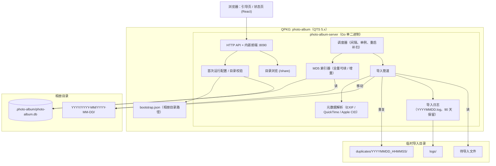
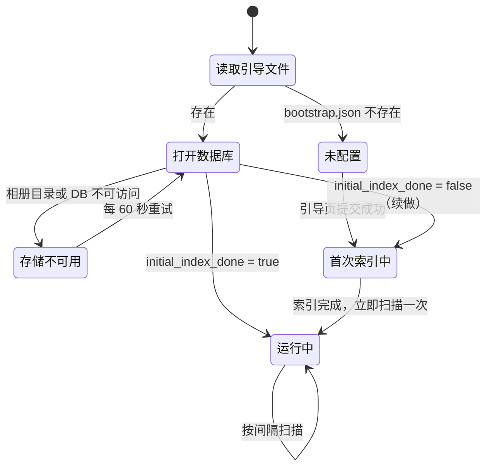
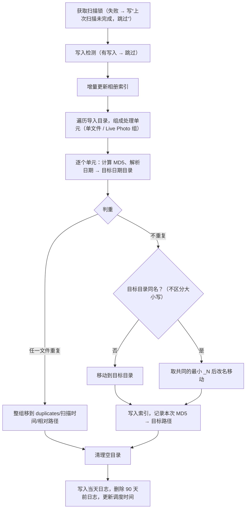

# 系统技术架构设计 — Photo Album（第一期）

> 对应需求：[PRD.md](./PRD.md)（第一期：照片导入与冲突处理，已定稿）
> 代码工程：`/Users/aubreyhan/Tools/git_repo/PersonalDev/Photo Album`

## 1. 技术决策汇总

| 项 | 决策 |
| --- | --- |
| 后端 | Go，静态编译为单个 x86_64 Linux 二进制 `photo-album-server`，不依赖 NAS 上任何运行时（`CGO_ENABLED=0`） |
| 前端 | React + Vite + TypeScript，构建产物通过 `go:embed` 内嵌进二进制 |
| 元数据解析 | 纯 Go：图片/RAW 用 EXIF 库，MOV 用 MP4 容器解析库；Apple ContentIdentifier 自行解析（HEIC/JPG 的 Apple MakerNote，MOV 的 QuickTime `mdta` 元数据） |
| 存储 | SQLite（纯 Go 驱动 `modernc.org/sqlite`），WAL 模式 |
| 数据库位置 | `<相册目录>/.photo-album/photo-album.db`（`.` 开头，索引和扫描自动跳过） |
| 引导文件 | QPKG 安装目录下的 `bootstrap.json`，只记录相册目录路径 |
| Web 访问 | 独立端口 8090，`qpkg.cfg` 配置 WebUI 端口，QTS 桌面图标直接打开；无登录 |
| 资源占用 | 进程以 `nice 19` + `ionice` 空闲级运行；MD5 单线程顺序读取 |
| 命名 | QPKG 包名 `photo-album`，显示名 `Photo Album` |

## 2. 架构总览



## 3. 启动流程与状态



- **未配置**：所有页面重定向到引导页。
- **存储不可用**：开机时 QPKG 可能先于存储卷挂载启动。这种情况**不能**进入引导页，状态页显示错误并定期重试。
- **重启补扫**：进入“运行中”时，若 `now ≥ next_scan_at`，立即扫描一次；否则等到 `next_scan_at`。

## 4. 数据存储

### 4.1 引导文件

`<QPKG 安装目录>/bootstrap.json`

```json
{ "album_dir": "/share/Photos" }
```

### 4.2 SQLite 表结构

```sql
CREATE TABLE settings (
  key   TEXT PRIMARY KEY,
  value TEXT NOT NULL
);
-- keys: album_dir, import_dir, interval_minutes,
--       initial_index_done, index_total, index_done,
--       last_scan_started_at, last_scan_finished_at, next_scan_at

CREATE TABLE files (
  rel_path   TEXT PRIMARY KEY,   -- 相对相册目录
  size       INTEGER NOT NULL,
  mtime_ns   INTEGER NOT NULL,
  md5        TEXT NOT NULL,
  indexed_at INTEGER NOT NULL
);
CREATE INDEX idx_files_md5 ON files(md5);
```

时间统一按 Unix 秒存储。所有路径在存储和比较前都先做 `filepath.EvalSymlinks`（QTS 的 `/share/<共享名>` 是指向 `/share/CACHEDEV1_DATA/...` 的符号链接）。

## 5. 核心模块设计

### 5.1 首次运行配置

- **目录浏览 API**：只列出 `/share/` 下的共享文件夹及其子目录，跳过 `@`/`.` 开头的项。
- **校验**（都基于解析符号链接后的真实路径）：
  - 两个目录相同 → 拒绝
  - 一个是另一个的前缀（互相包含）→ 拒绝
  - 用当前进程身份创建并删除一个探测文件，失败则判定为无读写权限 → 拒绝
  - 扫描间隔是 5–1440 之间的整数
- **提交顺序**：创建 `.photo-album/` → 初始化 DB → 写 settings → 最后写 `bootstrap.json`（以它作为“配置完成”的标志，中途失败可以重来）。

### 5.2 遍历与跳过规则（索引和扫描共用）

- 跳过名称以 `@` 或 `.` 开头的目录和文件
- 在导入目录中，另外跳过根目录下的 `logs/`、`duplicates/`
- 支持的扩展名（不区分大小写）：
  - 图片：`jpg jpeg heic heif png gif webp tif tiff`
  - RAW：`cr2 cr3 nef arw dng raf orf rw2`
  - 视频：`mp4 mov`
- 遍历结果按相对路径字典序排序，保证“同一次扫描中第一个”的定义可复现

### 5.3 MD5 索引器

- **首次全量（可续做）**：先遍历一遍统计 `index_total`，再逐个文件计算 MD5。每算完一个，以 `(rel_path, size, mtime)` 为键写入 `files` 表并更新 `index_done`。中断重启后，已有记录且 size/mtime 未变的文件直接跳过。全部完成后设置 `initial_index_done = true`。
- **增量更新**（每次扫描前）：遍历相册目录，按以下规则处理。
  - 新文件，或 size/mtime 有变化 → 重新计算 MD5
  - 表中有记录但磁盘上已不存在 → 删除记录
- **导入时**：每成功导入一个文件，立即写入 `files` 表。
- MD5 计算：用 1 MiB 缓冲顺序读取，单线程执行。

### 5.4 写入检测

1. 对导入目录（应用跳过规则）做快照：`map[rel_path]{size, mtime}`
2. 等待 30 秒
3. 再做一次快照并比较；有新增、删除或大小/时间变化，就判定为“有写入”
4. 有写入 → 本次扫描不处理任何文件，写一行跳过日志

### 5.5 拍摄日期解析

| 文件类型 | 取值顺序 |
| --- | --- |
| 图片 / RAW | EXIF `DateTimeOriginal`（若有 `OffsetTimeOriginal` 则按偏移换算）→ `CreateDate` → 文件修改时间 |
| 视频 | QuickTime `com.apple.quicktime.creationdate`（含时区偏移）→ `mvhd` 创建时间（UTC，1904 纪元）→ 文件修改时间 |

- 带时区的时间换算到 NAS 系统时区；不带时区的 EXIF 直接当作本地时间
- 值为 0、早于 1970 或晚于“当前时间 + 1 天”的，视为取不到
- 时区数据通过 `time/tzdata` 内嵌。NAS 时区的读取顺序：环境变量 `PHOTO_ALBUM_TZ`（IANA 名称）→ `TZ`（IANA 名称）→ `/etc/localtime` → `TZ` 按 POSIX 格式解析（如 QTS 风格的 `CST-8` 表示 UTC+8）→ `time.Local`。最终以 Phase 0 实测结果为准，见 §8

### 5.6 Live Photo 配对

1. 对本次扫描中的 HEIC/HEIF/JPG/JPEG 和 MOV 读取 ContentIdentifier：
   - 图片：Apple MakerNote tag `0x0011`
   - MOV：`mdta` key `com.apple.quicktime.content.identifier`
2. 同一 ContentIdentifier 正好对应 1 张图片 + 1 个 MOV → 配成一组
3. 剩下的文件按“同一目录、文件名主干相同（不区分大小写）、正好一张图片 + 一个 MOV”配对；同一主干对应多张图片（如 `IMG_1.HEIC` 和 `IMG_1.JPG`）时有歧义，不配对
4. 未配上的文件按普通文件处理（不与相册里已有的文件配对）

### 5.7 导入管道（单次扫描）



**判重规则**（对单元内每个文件，先命中的生效）：

| 优先级 | 条件 | 日志类型 |
| --- | --- | --- |
| 1 | 本次扫描中已有相同 MD5 的文件导入 | `本次重复`（第三列为先导入那份文件在相册中的路径） |
| 2 | 目标日期目录内有同名文件，且 MD5 相同 | `同名重复` |
| 3 | 相册索引中存在相同 MD5（任意位置） | `内容重复` |
| — | 目标日期目录内有同名文件，但 MD5 不同 | `同名改名`（第三列为改名后的新路径） |

- Live Photo 组：两个文件都重复时，各自按上表写日志；只有一个重复时，整组移到 duplicates，两个文件都标 `Live Photo 部分重复`。所有 Live Photo 文件的日志类型前都加 `Live Photo `。
- 重命名：`_N` 从 1 开始，取第一个在目标目录中不存在的编号（不区分大小写）；Live Photo 组要求两个文件名都不存在。Live Photo 组改名时，两个文件都写一行 `Live Photo 同名改名`。
- 单元内某个文件计算 MD5 失败时，整个单元留在原处：出错的文件写 `失败 | 源路径 | 错误原因`，另一半写 `失败 | 源路径 | Live Photo 另一半处理失败`。

### 5.8 文件移动

- **同一存储卷**：直接 `rename(2)`。
- **跨存储卷**（`EXDEV`）：
  1. 复制到目标目录下的临时文件 `.photo-album-tmp-<随机>`（以 `.` 开头，不会被扫描）
  2. `fsync` 后设置修改时间、属主和权限
  3. `rename` 为最终文件名
  4. 删除源文件
- 启动时清理所有残留的 `.photo-album-tmp-*`。
- **权限继承**：新建的日期目录和移入的文件，`chown` 为相册目录的 uid/gid。目录模式与相册目录相同；文件模式为相册目录模式去掉执行位。进程以 admin 身份运行，才有权限 `chown`。
- **错误分类**：
  - `ENOSPC` → 中止本次扫描并写日志
  - 其他错误 → 该单元留在原处，写 `失败` 日志，继续处理下一个
  - Live Photo 组移动时，若第一个文件已经移动成功、第二个失败，就把第一个移回原处，保证整组一起成功或一起失败

### 5.9 空目录清理

扫描结束后，只检查本次有文件被移走的目录（导入或移到 duplicates），从最深的开始向上逐级检查，直到导入目录根目录（根目录本身不删）。一个目录只剩“垃圾项”或已为空时就删除，然后继续检查它的上一级；遇到不满足条件的目录就停止。用户事先建好的空目录不会被删。

垃圾项包括：

- 文件：`.DS_Store`、`._*`、`Thumbs.db`、`desktop.ini`
- 目录：`.@__thumb`、`@__thumb`（QTS 自动生成的缩略图目录）

### 5.10 导入日志

文件：`<导入目录>/logs/YYYYMMDD.log`，日期取本次扫描开始的日期；扫描结束时一次性追加写入。

```text
[2026-11-07 10:00:00] 扫描开始 2026-11-07 10:00:00 | 完成 2026-11-07 10:02:31
同名重复 | /share/Inbox/a/IMG_0001.JPG | /share/Photos/2026/2026-11/2026-11-07/IMG_0001.JPG
同名改名 | /share/Inbox/IMG_0002.JPG | /share/Photos/2026/2026-11/2026-11-07/IMG_0002_1.JPG
内容重复 | /share/Inbox/copy.jpg | /share/Photos/2025/2025-01/2025-01-01/IMG_9999.JPG
本次重复 | /share/Inbox/b/IMG_0003.JPG | /share/Photos/2026/2026-11/2026-11-07/IMG_0003.JPG
Live Photo 部分重复 | /share/Inbox/IMG_0004.MOV | /share/Photos/2026/2026-11/2026-11-06/IMG_0004.MOV
失败 | /share/Inbox/bad.cr3 | permission denied
[2026-11-07 11:00:30] 跳过 | 检测到写入，跳过本次扫描
[2026-11-07 12:00:00] 跳过 | 上次扫描未完成，跳过
```

每次写日志后，删除 `logs/` 中文件名日期早于“今天 − 90 天”的 `.log` 文件。

### 5.11 调度器

- 每 15 秒检查一次 `now ≥ next_scan_at`。
- 扫描开始时：`last_scan_started_at = now`，`next_scan_at = now + interval`。
- 用进程内互斥锁保证同时只有一个扫描。到点时如果锁被占用，写“上次扫描未完成，跳过”，并把 `next_scan_at` 往后推一个间隔。
- 修改间隔时：`next_scan_at = now + 新间隔`，不打断正在进行的扫描。

## 6. HTTP API

| 方法 | 路径 | 说明 |
| --- | --- | --- |
| GET | `/api/state` | `{ phase: unconfigured \| storage_unavailable \| indexing \| running }` |
| GET | `/api/fs/list?path=` | 列出子目录；`path` 为空时列出 `/share` 下的共享文件夹 |
| POST | `/api/setup` | `{ album_dir, import_dir, interval_minutes }`，返回校验错误或成功 |
| GET | `/api/status` | 两个目录、索引进度（`done/total`）、上次/下次扫描时间、扫描间隔、是否正在扫描 |
| PUT | `/api/settings/interval` | `{ interval_minutes }`（5–1440） |

`POST /api/setup` 只在“未配置”状态下可用。前端为 SPA，路由有 `/setup` 和 `/status`，根据 `/api/state` 自动跳转。

## 7. 工程与 QPKG 结构

```text
Photo Album/
├── cmd/photo-album-server/main.go
├── internal/
│   ├── bootstrap/      # bootstrap.json 读写
│   ├── store/          # SQLite 初始化、settings、files
│   ├── fsbrowse/       # /share 目录浏览
│   ├── setup/          # 首次配置与校验
│   ├── walk/           # 遍历与跳过规则、扩展名
│   ├── hashing/        # MD5
│   ├── indexer/        # 全量 / 增量索引
│   ├── metadata/       # exif.go, quicktime.go, applecid.go, tz.go
│   ├── importer/       # writedetect, units(livephoto), plan, dedupe, mover, cleanup
│   ├── importlog/      # 日志格式与保留
│   ├── scheduler/
│   ├── perm/           # 权限继承
│   └── server/         # HTTP API + embed 前端
├── web/                # React + Vite + TS
├── qpkg/
│   ├── qpkg.cfg        # QPKG_NAME=photo-album, QPKG_DISPLAY_NAME="Photo Album", QPKG_WEB_PORT=8090
│   ├── package_routines # 卸载前：停止服务，执行 photo-album-server -uninstall-cleanup（读取 bootstrap.json，只删除 <相册目录>/.photo-album/）
│   └── shared/photo-album.sh   # start/stop/restart/status，有 nice/ionice 时用它们启动（二进制内也会自行降优先级）
├── scripts/
│   ├── build_qpkg.sh   # 前端构建 → 测试 → 静态编译 → 组装 QDK 树 → qbuild（本机没有 qbuild 时打成 tar 包，到 NAS 上构建）
│   ├── nas_probe.sh    # Phase 0 只读环境探查
│   └── genicons/       # 生成 QPKG 图标
└── testdata/           # 真机样例（Phase 0 补充）
```

## 8. 风险与待真机验证项

| 项 | 说明 | 验证方式 |
| --- | --- | --- |
| NAS 时区 | 静态二进制需要正确识别 QTS 时区，候选来源：`/etc/localtime`、`/etc/TZ`、`/etc/config/uLinux.conf` | Phase 0 在 TS-873A 上检查 |
| ionice 可用性 | QTS 的 busybox 不一定带 `ionice`；没有时在 Go 内调用 `ioprio_set` 系统调用 | Phase 0 |
| 权限 / ACL | 共享文件夹开启“高级文件夹权限”（ACL）时，只 `chown` + `chmod` 可能不够 | Phase 0：创建测试文件，用 SMB 账号验证能否修改和删除 |
| 元数据库覆盖面 | CR3/RAF/ORF/RW2、iPhone HEIC MakerNote、MOV `mdta` 需要逐一用样例验证 | Phase 0 样例测试 |
| QDK 构建环境 | `qbuild` 需要 Linux 环境（Docker 或在 NAS 上构建） | Phase 1 |
