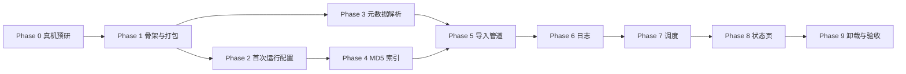

# 实施路线图 — Photo Album（第一期）

> 依据：[PRD.md](./PRD.md)、[ARCHITECTURE.md](./ARCHITECTURE.md)
> 代码工程：`/Users/aubreyhan/Tools/git_repo/PersonalDev/Photo Album`
>
> 每个任务都是可独立验收的原子单元，按顺序执行。

## 进度（2026-11-07）

| Phase | 状态 | 说明 |
| --- | --- | --- |
| 0 真机预研 | ⏳ 等待真机 | 探查脚本 `scripts/nas_probe.sh` 已就绪；ACL 验证和真机样例需要人工完成 |
| 1 骨架与打包 | ✅ 代码完成 / ⏳ 真机安装 | 静态 x86_64 二进制（约 12 MB），`build_qpkg.sh` 已能产出 QDK 源码树；本机没有 `qbuild`，需在 NAS 上生成 `.qpkg` |
| 2 首次运行配置 | ✅ | 目录浏览、校验（相同/包含/权限/间隔）、引导页 |
| 3 元数据解析 | ✅ 合成样例 / ⏳ 真机样例 | JPEG/PNG/WebP/TIFF 系 RAW/RAF/CR3/HEIC/MOV/MP4、Apple CID、时区（含 POSIX `CST-8`） |
| 4 MD5 索引 | ✅ | 全量可续做、增量更新、清理残留临时文件 |
| 5 导入管道 | ✅ | 写入检测、Live Photo、判重 4 类、`_N`、跨卷移动、回滚、duplicates、空目录清理 |
| 6 日志 | ✅ | 格式、按开始日期分文件、90 天保留 |
| 7 调度 | ✅ | 开始时间计时、重启补扫、单例、间隔修改立即生效 |
| 8 状态页 | ✅ | 每 5 秒刷新，间隔可编辑 |
| 9 卸载与验收 | ✅ 代码完成 / ⏳ 真机验收 | `-uninstall-cleanup`；Task 9.2 验收清单需在真机执行 |

自动化测试：`go test -race ./...` 全部通过，包括端到端测试（HTTP 配置 → 首次索引 → 自动扫描 → 导入 / 重复 / 日志 → 修改间隔）。另在本机以真实进程做过冒烟测试。

## 依赖关系

---

## Phase 0：真机预研（TS-873A）

### Task 0.1 环境探查
- **内容**：SSH 登录 NAS，确认以下几点：
  - 时区来源（`/etc/localtime`、`/etc/TZ`、`uLinux.conf`）
  - 是否有 `ionice` / `nice`
  - `/share` 下符号链接的结构
  - QPKG 安装目录的位置
- **产出**：在 ARCHITECTURE §8 回填结论。

### Task 0.2 权限 / ACL 验证
- **内容**：以 admin 身份在共享文件夹中创建目录和文件，按 §5.8 执行 `chown`/`chmod`，再用普通 SMB 账号尝试修改和删除；对开启 ACL 和未开启 ACL 两种情况各测一次。
- **产出**：确认权限继承方案，必要时修订 §5.8。

### Task 0.3 样例收集
- **内容**：在 `testdata/` 中准备以下样例：
  - iPhone HEIC + MOV 的 Live Photo（含 ContentIdentifier）
  - JPG + MOV 的 Live Photo
  - CR2 / CR3 / NEF / ARW / DNG / RAF / ORF / RW2 各一张
  - 无 EXIF 的 PNG
  - 带时区偏移和不带时区偏移的 JPG
  - 非 Apple 设备拍的 MP4
- **验收**：每个样例都附一份 `exiftool -json` 输出（只在开发机上用，作为期望值）。

---

## Phase 1：工程骨架与 QPKG 打包

### Task 1.1 Go 工程初始化
- **内容**：
  - `go mod init`，创建 `cmd/photo-album-server/main.go`，提供 `/api/ping`
  - 交叉编译参数：`CGO_ENABLED=0 GOOS=linux GOARCH=amd64`
- **验收**：`go build` 产出静态二进制，`file` 命令显示为 `statically linked`。

### Task 1.2 前端工程与内嵌
- **内容**：在 `web/` 下建 Vite + React + TS 工程，实现 `/setup`、`/status` 空页面和路由；`internal/server` 用 `go:embed` 托管 `web/dist`，非 `/api` 路径回退到 `index.html`。
- **验收**：本地运行后，访问 `http://localhost:8090/status` 能看到页面。

### Task 1.3 QPKG 打包
- **内容**：
  - `qpkg/qpkg.cfg`：包名、显示名、x86_64、`QPKG_WEB_PORT=8090`、`QPKG_WEBUI=/`
  - `photo-album.sh`：start/stop/restart，用 `nice -n 19` 加 `ionice -c3`（或 Go 内 `ioprio_set`）启动
  - `scripts/build_qpkg.sh`：先构建前端，再构建 Go 二进制，最后执行 `qbuild`（可在 Docker 中运行）
- **验收**：产出 `photo-album_0.1.0_x86_64.qpkg`，能在 App Center 手动安装、启动、停止；点击 QTS 桌面图标能打开页面。

### Task 1.4 引导文件与存储层
- **内容**：
  - `internal/bootstrap`：读写 `bootstrap.json`
  - `internal/store`：打开 SQLite（WAL），执行 §4.2 的 DDL，提供 settings 读写接口
  - 实现 §3 的启动状态机和 `/api/state`
- **验收**：
  - 单元测试覆盖三种情况：引导文件不存在 → `unconfigured`；DB 路径不可访问 → `storage_unavailable` 并定期重试；正常 → 按 `initial_index_done` 进入 `indexing` 或 `running`

---

## Phase 2：首次运行配置

### Task 2.1 目录浏览 API
- **内容**：实现 `/api/fs/list`，只允许访问 `/share` 下的路径（防止 `..` 越界），跳过 `@`/`.` 开头的项。
- **验收**：单元测试覆盖越界路径、符号链接、隐藏项过滤。

### Task 2.2 配置校验与提交
- **内容**：实现 `POST /api/setup`，校验规则见 §5.1，提交顺序为 `.photo-album/` → DB → settings → `bootstrap.json`。
- **验收**：单元测试覆盖相同目录、互相包含（含经符号链接后才相同的情况）、无权限、间隔越界；中途失败后可以重新提交。

### Task 2.3 引导页
- **内容**：React 引导页，包含两个目录选择器（树形浏览）和扫描间隔输入（分钟，默认 60）；校验错误逐条显示。
- **验收**：在 NAS 上完成配置后，自动跳转到状态页。

---

## Phase 3：元数据解析

### Task 3.1 遍历与类型识别
- **内容**：`internal/walk` 实现跳过规则、扩展名白名单、按路径排序。
- **验收**：单元测试覆盖 `@Recycle`、`.@__thumb`、`._IMG.jpg`、大写扩展名、`logs/`、`duplicates/`。

### Task 3.2 图片 / RAW 拍摄时间
- **内容**：`metadata/exif.go`，按 §5.5 的取值顺序实现，包括 `OffsetTimeOriginal` 换算和异常值过滤。
- **验收**：Phase 0 中所有图片和 RAW 样例的解析结果与 `exiftool` 期望值一致；解析不出的格式要列出清单（这些格式会回退到文件修改时间）。

### Task 3.3 视频拍摄时间
- **内容**：`metadata/quicktime.go`，优先读 `com.apple.quicktime.creationdate`，其次 `mvhd`（UTC，1904 纪元）。
- **验收**：iPhone MOV 与非 Apple MP4 样例都与期望值一致。

### Task 3.4 Apple ContentIdentifier
- **内容**：`metadata/applecid.go`，解析 HEIC/JPG 中 Apple MakerNote 的 tag `0x0011` 和 MOV 中 `mdta` 的 `com.apple.quicktime.content.identifier`。
- **验收**：Live Photo 样例中，图片和 MOV 解析出的 ID 相同。

### Task 3.5 时区
- **内容**：`metadata/tz.go`，按 Phase 0 的结论读取 NAS 时区；内嵌 `time/tzdata`。
- **验收**：给定 UTC 时间和 NAS 时区，跨午夜的视频能归到正确日期。

---

## Phase 4：MD5 索引

### Task 4.1 全量索引（可续做）
- **内容**：按 §5.3 实现：先统计总数，再逐个计算 MD5 并写库，同时更新 `index_done`；完成后设置 `initial_index_done`。
- **验收**：对上万个小文件建索引时中途 kill 进程，重启后不重复计算已完成的文件，最终记录数与文件数一致。

### Task 4.2 增量索引
- **内容**：按 `(rel_path, size, mtime)` 比对，处理新增、修改、删除。
- **验收**：单元测试覆盖手动新增、替换内容、删除文件三种情况。

---

## Phase 5：导入管道

### Task 5.1 写入检测
- **内容**：按 §5.4 实现两次快照比对；30 秒等待时长做成可注入参数，方便测试。
- **验收**：测试中途追加写入 → 判定有写入；没有变化 → 判定无写入。

### Task 5.2 处理单元组装（Live Photo）
- **内容**：按 §5.6 先用 ContentIdentifier 配对，再用文件名主干配对。
- **验收**：测试覆盖以下情况：CID 配对；无 CID 时按文件名配对；只有一半；同一目录有 `IMG_1.HEIC` 和 `IMG_1.JPG` 两张图片加一个 MOV（文件名配对有歧义时不配对，各自按普通文件处理）。

### Task 5.3 目标规划与判重
- **内容**：计算日期目录 `YYYY/YYYY-MM/YYYY-MM-DD`，按 §5.7 的优先级判重，计算 `_N`（不区分大小写，Live Photo 组取两者都空闲的编号）。
- **验收**：用表驱动测试覆盖 PRD §3.2 的 4 种情况、§3.5 的 Live Photo 各种情况，以及大小写同名。

### Task 5.4 文件移动与权限
- **内容**：按 §5.8 实现同卷 rename、跨卷“临时文件 → rename”、保留修改时间、权限继承、`ENOSPC` 中止、Live Photo 组整组回滚、启动时清理残留临时文件。
- **验收**：在 NAS 上测跨卷移动，修改时间保持不变；人为制造磁盘满（小容量卷或配额）时，扫描中止且源文件完好；用 SMB 普通账号能修改和删除导入后的文件。

### Task 5.5 重复文件与空目录
- **内容**：重复文件移到 `duplicates/<扫描时间>/<相对路径>`；按 §5.9 自底向上清理空目录。
- **验收**：只剩 `.DS_Store` 或 `.@__thumb` 的目录会被删除；`logs/`、`duplicates/` 和导入根目录保留。

### Task 5.6 管道串联
- **内容**：把 §5.7 的完整流程串起来，每个单元导入成功后立即写索引，并记录本次的 MD5 → 目标路径映射。
- **验收**：在 `testdata/` 构造的综合场景中，执行一次扫描后，相册、`duplicates/` 和导入目录中的最终文件结构与期望快照完全一致。

---

## Phase 6：导入日志

### Task 6.1 日志写入与保留
- **内容**：按 §5.10 的格式实现。扫描结束时一次性追加写入，文件按扫描开始日期命名；写完后删除 90 天前的日志。
- **验收**：用金样（golden file）测试比对日志格式；跨午夜的扫描写入开始那天的文件；早于 90 天的日志被删除。

---

## Phase 7：调度

### Task 7.1 调度器
- **内容**：按 §5.11 实现：每 15 秒检查一次，扫描单例，到点时上次未完成就跳过并写日志，修改间隔后重新计算 `next_scan_at`。
- **验收**：用可注入的时钟做单元测试，覆盖以下情况：
  - 首次索引完成后立即扫描
  - 重启时已过 `next_scan_at` → 立即扫描
  - 重启时未到 `next_scan_at` → 等待
  - 扫描超时导致下一次跳过
  - 修改间隔后立即生效

### Task 7.2 间隔修改 API
- **内容**：实现 `PUT /api/settings/interval`，范围 5–1440。
- **验收**：越界返回 400；修改后 `/api/status` 中的下次扫描时间随之更新。

---

## Phase 8：状态页

### Task 8.1 状态 API 与页面
- **内容**：实现 `/api/status`；React 状态页显示两个目录、索引进度（进度条）、上次和下次扫描时间、当前间隔（可编辑）、存储不可用时的错误提示；每 5 秒刷新一次。
- **验收**：在 NAS 上观察首次索引进度变化，修改间隔后页面立即反映。

---

## Phase 9：卸载与整体验收

### Task 9.1 卸载脚本
- **内容**：`package_routines` 在卸载前读取 `bootstrap.json`，删除 `<相册目录>/.photo-album/`；不碰相册目录和导入目录里的其他内容。
- **验收**：卸载后 `.photo-album/` 不存在，照片、`logs/`、`duplicates/` 都在；重装后进入引导页。

### Task 9.2 PRD 验收清单（TS-873A 真机）

| PRD 条目 | 验收要点 |
| --- | --- |
| §1 | App Center 安装、启动、停止、卸载正常 |
| §2 | 引导页能拒绝 3 类非法目录；配置后跳转到状态页 |
| §3 | 间隔可设置、立即生效；写入中跳过；并发时跳过；跳过规则生效；权限继承；修改时间保留 |
| §3.1 | 日期目录格式正确；EXIF、视频元数据、修改时间三种来源都正确；时区换算正确 |
| §3.2 | 4 种冲突情况、大小写同名、`_N` 递增都正确 |
| §3.3 / §3.3.1 | 日志格式、按天分文件、90 天保留、失败记录、磁盘满时中止 |
| §3.4 | 首次索引可续做；手动增删改相册文件后去重仍正确 |
| §3.5 | Live Photo 配对、同目录、同步改名、部分重复、只有一半 |
| §4 | 状态页内容完整，只有间隔可改 |
