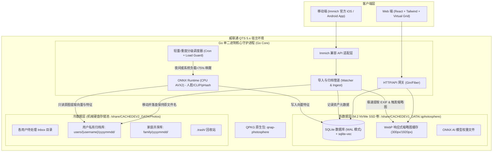

# 系统技术架构设计 - qnap-photosphere

## 1. 架构总览与冷热分层

针对威联通 TS-873A (AMD Ryzen V1500B x86_64, 无独显, M.2 NVMe SSD + 机械盘 HDD 混插) 的硬件特质，系统采取**彻底的冷热分层、I/O 解耦与单二进制原生运行模型**。



---

## 2. 核心架构设计要点

### 2.1 QPKG 打包规约 (QNAP QDK)
- **无运行时依赖**：Go 静态交叉编译为 `x86_64-linux` 二进制 `photosphere-server`，直接内嵌前端静态页面（通过 `go:embed`）。
- **QPKG 结构**：
  ```text
  qnap-photosphere/
  ├── package_routines/      # QDK 打包配置与控制脚本
  │   ├── qpkg.cfg           # 包元数据 (Icon, DisplayName, Architecture=x86_64)
  │   └── package_routines.sh
  ├── shared/                # 安装落盘目录 (在 NAS 上对应 /share/.../.qpkg/qnap-photosphere)
  │   ├── bin/
  │   │   ├── photosphere-server # Go 静态编译二进制
  │   │   └── libonnxruntime.so  # 预编译针对 x86_64 AVX2 动态库
  │   ├── models/            # 轻量 ONNX 模型 (FaceDet, FaceRec, MobileCLIP)
  │   ├── qpkg_icons/        # QTS 桌面图标 (80x80, 100x100 png)
  │   └── photosphere.sh     # 启停脚本 (init.d start/stop/status)
  ```

### 2.2 冷热分层与硬盘休眠策略
- **秒开不唤醒 HDD**：
  - 用户在 Web 端刷新、滑动浏览数万张照片时间线、按月份缩放、查看人脸聚类时，**所有请求全部由 NVMe SSD 上的 SQLite 和 WebP 缩略图命中**。
  - 只有当用户在 Web 端点击“下载原图”或放大查看 100% 原始 RAW/无损照片时，才触发 HDD 机械盘的物理 I/O，最大化减少磁头磨损与炒豆子噪音。
- **WebP 级联缩略图生成器**：
  - `thumb_small`：300x300（质量 80%），用于时间线瀑布流网格，单张约 8KB ~ 15KB。
  - `thumb_preview`：1920x1080（质量 85%），用于全屏灯箱挑片与查看，单张约 120KB ~ 250KB。

### 2.3 双轨任务流控引擎 (Load-Aware Scheduler)
针对 AMD Ryzen V1500B (4C/8T) 纯 CPU 推理性能，设计分级处理机制：

| 任务级别 | 触发时机 | 涉及任务 | CPU 核心限制 | 避让机制 |
| :--- | :--- | :--- | :--- | :--- |
| **P0 实时入库流水线** | 照片上传/放入导入目录时 | SHA256 计算、EXIF 提取、生成双层 WebP 缩略图、写入 SQLite、物理移至 yyyymmdd | 限制 2 协程并发 | 保证秒级入库与时间线展现 |
| **P1 离线重度 AI 流水线** | 管理员设置窗口 (默认 01:00-06:00) 或系统空闲时 | SCRFD 轻量人脸检测、ArcFace 特征提取、CLIP 图像特征向量化、pHash 全库聚类 | 限制 2-3 协程并发 (AVX2 指令优化) | 采集 `/proc/loadavg`，若负载 > 75% 立即挂起 60 秒 |

---

## 3. 代码工程目录结构设计 (Go Monorepo)

```text
photosphere/
├── cmd/
│   └── server/
│       └── main.go                 # 主程序入口：配置加载、DB 初始化、服务启动
├── internal/
│   ├── config/                     # 配置管理 (冷热路径、端口、用户、调度窗口)
│   ├── database/                   # SQLite 驱动初始化、迁移脚本 (gorm / sqlx)
│   ├── model/                      # 核心领域实体模型
│   ├── pipeline/                   # 归档入库管道
│   │   ├── watcher.go              # fsnotify 目录监控
│   │   ├── exif.go                 # EXIF 解析器 (调用内嵌纯 Go exif/libexiftool)
│   │   ├── hasher.go               # SHA256 & pHash 计算
│   │   ├── thumbnail.go            # libvips / imaging 生成 WebP 缩略图
│   │   └── archiver.go             # 物理归档、冲突探测与重命名
│   ├── ai/                         # 本地 AI 推理模块
│   │   ├── onnx_runtime.go         # ONNX Runtime CGO 绑定包装
│   │   ├── face.go                 # 人脸检测与特征向量
│   │   ├── clip.go                 # 图像与文本向量计算
│   │   └── scheduler.go            # 温控与调度控制器 (监控系统负载)
│   ├── api/                        # HTTP 接口路由与控制器
│   │   ├── router.go               # 路由组装与中间件
│   │   ├── handler_auth.go         # 用户登录、会话与多租户
│   │   ├── handler_timeline.go     # 时间线与相册接口
│   │   ├── handler_curate.go       # 快速挑片、标记、EXIF 修复与回收站
│   │   └── immich/                 # 兼容 Immich 移动端协议接口
│   │       ├── server_info.go
│   │       ├── user.go
│   │       └── asset.go            # 移动端上传与同步
├── web/                            # 前端单页面应用 (React + Tailwind CSS + Lucide)
│   ├── src/
│   │   ├── components/             # 虚拟列表网格、灯箱、挑片浮层、人脸面板
│   │   ├── hooks/                  # 快捷键监听 (P/X/1-5)、手势与时间线
│   │   ├── stores/                 # 全局状态 (Zustand)
│   │   └── views/                  # 待处理队列、时间线、相似去重页、设置页
│   └── dist/                       # 前端编译输出目录 (被 Go embed 内嵌)
├── scripts/
│   ├── build_qpkg.sh               # 一键本地交叉编译与 QDK 打包脚本
│   └── download_models.sh          # 下载预训练轻量 ONNX 模型权重
└── qpkg.cfg                        # 威联通 QPKG 配置文件
```
