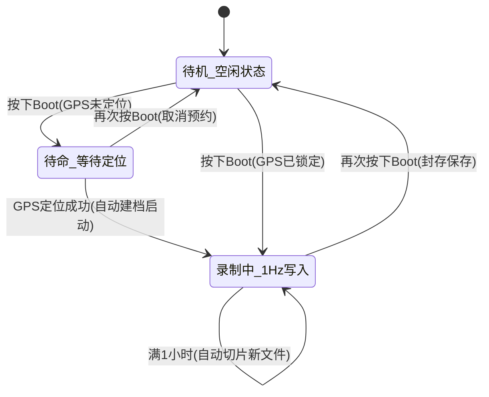

# ESP32-S3 AMOLED 行车轨迹记录仪工程架构

> **硬件平台**：微雪 [ESP32-S3-Touch-AMOLED-1.75-G](file:///Users/aubreyhan/Tools/ESP32/ESP32-S3-Touch-AMOLED-1.75/HARDWARE_REFERENCE_ZH.md) (SKU: 31264)  
> **工程目录**：[`/Users/aubreyhan/Tools/ESP32/CarTrackRecorder`](file:///Users/aubreyhan/Tools/ESP32/CarTrackRecorder)  
> **核心架构**：ESP-IDF v5.x + 官方 BSP + LVGL 9.4 + FreeRTOS 双核任务并行  

---

## 1. 业务功能与代码文件映射

| 业务需求 | 责任模块文件 | 关键实现细节 |
| :--- | :--- | :--- |
| **高度显示界面** | [`ui_view_altitude.c`](file:///Users/aubreyhan/Tools/ESP32/CarTrackRecorder/main/ui_view_altitude.c) | 40号大字体显示实时海拔；最高/最低极值统计卡片；5秒刷新的 60 点历史起伏折线图（Chart） |
| **轨迹显示界面** | [`ui_view_track.c`](file:///Users/aubreyhan/Tools/ESP32/CarTrackRecorder/main/ui_view_track.c) | 自车点居中固定；绘制本次加电绿色航迹；支持“正北朝上”与“航向朝上”随时切换；叠加指南针罗盘与车速 |
| **自适应瓦片地图** | [`tile_engine.c`](file:///Users/aubreyhan/Tools/ESP32/CarTrackRecorder/main/tile_engine.c) | Web 墨卡托经纬度转瓦片坐标；根据车速自动计算 Zoom（低速 Z16，高速 Z12）；SD 卡本地缓存优先 |
| **Boot 多态按键** | [`bsp_board.c`](file:///Users/aubreyhan/Tools/ESP32/CarTrackRecorder/main/bsp_board.c) | 独立按键状态机检测：单击（分段）、双击（持续）、再次按（停止）、长按（开关 Web AP 服务） |
| **GPS 驱动与授时** | [`gps_engine.c`](file:///Users/aubreyhan/Tools/ESP32/CarTrackRecorder/main/gps_engine.c) | I2C 查询读取 LC76G NMEA；经度判定与中国国境时区（UTC+8）自动计算；校准系统 RTC；延迟定位门禁 |
| **GPX 记录与存储** | [`gpx_manager.c`](file:///Users/aubreyhan/Tools/ESP32/CarTrackRecorder/main/gpx_manager.c) | 1Hz 写入标准 XML 标签；`yyyymmdd-hhmmss.gpx` 命名；1小时自动切片；断电刷盘保护；满盘 FIFO 淘汰 |
| **Web 导出与 AP 弹窗** | [`web_server.c`](file:///Users/aubreyhan/Tools/ESP32/CarTrackRecorder/main/web_server.c) | 启动/关闭自建 AP 热点（192.168.4.1）；手机浏览器直达下载 GPX；TF 容量仪表盘；长按屏幕 Toast 弹窗 |
| **全局状态栏与 UI 调度** | [`ui_app.c`](file:///Users/aubreyhan/Tools/ESP32/CarTrackRecorder/main/ui_app.c) | 常驻顶部弧形时间（时:分:秒）、GPS 搜星颗数、录制状态红点徽标、AP 开启标识；Toast 悬浮窗 |
| **主程序与任务调度** | [`main.c`](file:///Users/aubreyhan/Tools/ESP32/CarTrackRecorder/main/main.c) | Core 0 处理 GPS/GPX/网络/按键，Core 1 独占驱动 LVGL 9.4 渲染与触摸 |

---

## 2. 核心状态机设计



---

## 3. MicroSD 存储结构

```text
/sdcard/
├── gpx/
│   ├── 20261024-083000.gpx      <-- 轨迹文件 (1Hz 写入, 标准 XML)
│   ├── 20261024-093000.gpx      <-- 1小时自动切片生成的新文件
│   └── ...                      <-- 满盘时自动按 FIFO 规则清理最老文件
└── map/
    ├── 16_54321_26789.png       <-- 瓦片离线地图缓存 (按 Z_X_Y 组织)
    └── ...
```
